Инструкция предназначена для сотрудников ФБУ «Росавтотранс», ответственных за ведение реестров межрегиональных и международных маршрутов регулярных перевозок и реестра остановочных пунктов по межрегиональным и международным маршрутам регулярных перевозок.

Инструкция содержит описание действий по ведению журнала БСО в программном комплексе «Цифровая платформа пассажирских перевозок «ПАСПЕР» (далее по тексту – ЦП ПП «ПАСПЕР» или Система).

# Создание

В ЛК менеджера по межрегиональным перевозкам / менеджера по международным перевозкам перейти в раздел «Маршруты», открыть вкладку «Межрегиональные» / «Международные».

В списке маршрутов в левой части страницы (Рисунок 1, Рисунок 2) найти маршрут, по которому требуется создать БСО, и нажать на его визитку. Откроется карточка маршрута.

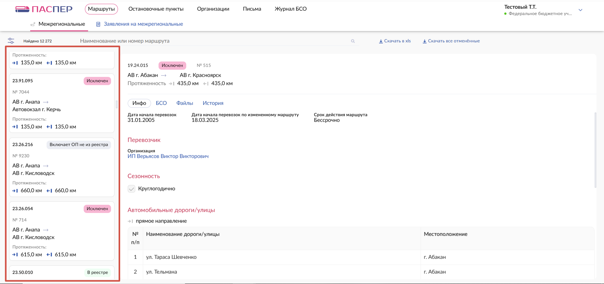

Рисунок - Список межрегиональных маршрутов

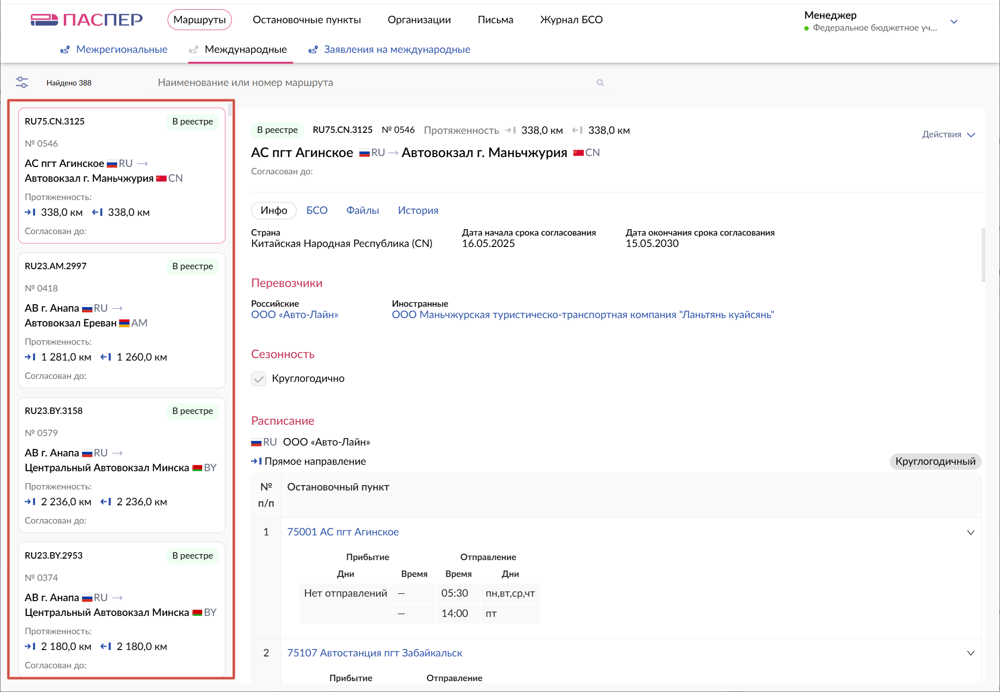

Рисунок - Список международных маршрутов

В карточке маршрута перейти на вкладку «БСО» и нажать ссылку «+Добавить» (Рисунок 3).

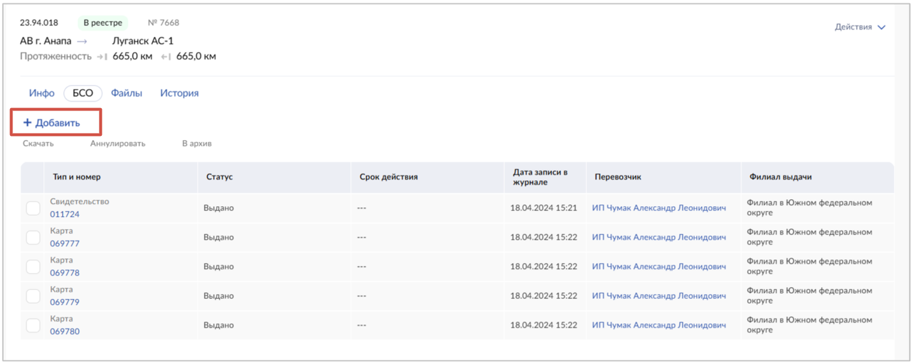

Рисунок – Кнопка «+ Добавить» на вкладке «БСО»

В открывшемся окне «Добавить БСО» (Рисунок 4):

Рисунок - Окно «Добавить БСО»

-   в поле «Тип бланка» из выпадающего списка выбрать одно из значений («Свидетельство» или «Карта»),
-   ввести номер (для карты можно ввести несколько номеров через запятую или диапазон номеров через тире),
-   установить начало и конец срока действия или установить признак «Бессрочно»;
-   для типа «Карта» в каждом поле «Класс ТС» и «Экологический класс ТС» (Рисунок 5) выбрать из выпадающего списка одно значение;
-   после заполнения всех полей нажать кнопку «Добавить».

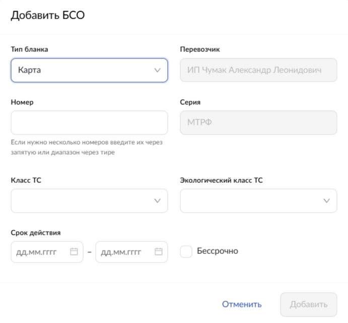

Рисунок - Окно «Добавить БСО» для карты

БСО принимает статус «Печать БСО», который означает, что БСО находится на стадии печати в ЦА ФБУ «Росавтотранс».

# Печать

Печать БСО выполняется в ЦА ФБУ «Росавтотранс» вне Системы.

# Передача в Минтранс России

Для заверения печатью и подписью уполномоченного лица БСО направляется в Минтранс России установленным порядком. Факт передачи БСО в Минтранс России требуется зарегистрировать в Системе.

## Регистрация передачи в Минтранс России в «Журнале БСО»

Перейти в раздел «Журнал БСО».

Нажать кнопку  в левой верхней части страницы (Рисунок 6).

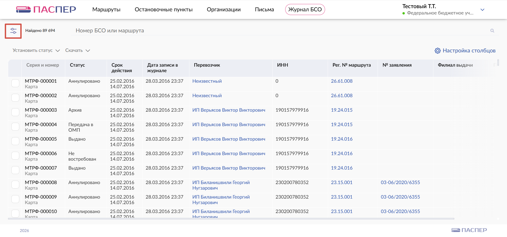

Рисунок – Вкладка «Журнал БСО»

Для параметра «Статус» отметить значение «Печать БСО» (Рисунок 7), при необходимости задать значения других параметров фильтрации, нажать кнопку «Найти»; на странице отобразится список карточек новых БСО в статусе «Печать БСО».

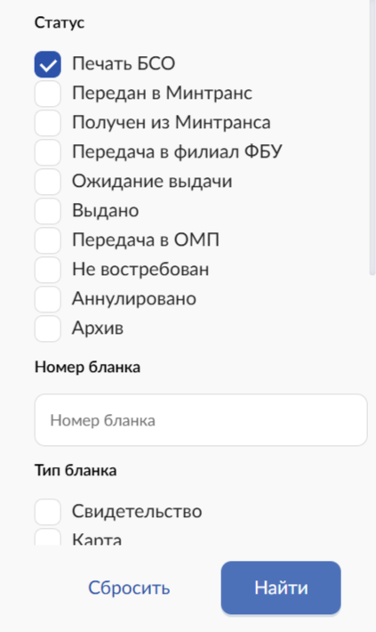

Рисунок - Выбор БСО в статусе «Печать БСО»

Нажать на чек-боксы , расположенные слева от серии и номера БСО, которые отправлены в Минтранс России исходящим письмом (Рисунок 8).

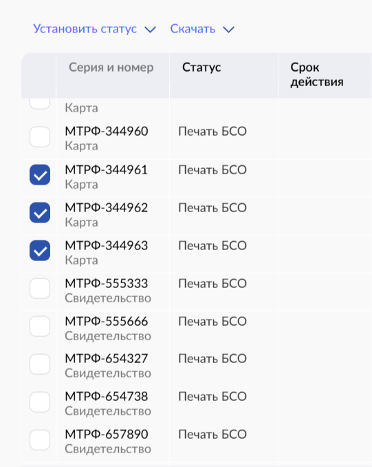

Рисунок – Выбор БСО в Журнале БСО

Нажать на ссылку «Установить статус» в левом верхнем углу страницы, в выпадающем списке выбрать значение «Передан в Минтранс» (Рисунок 9).

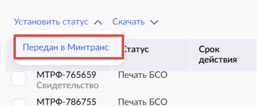

Рисунок – Установить статус «Передан в Минтранс»

В открывшемся окне «Передача на подпись в Минтранс» указать дату регистрации исходящего письма, которым БСО отправлены с Минтранс России; нажать кнопку «Сохранить» (Рисунок 10).

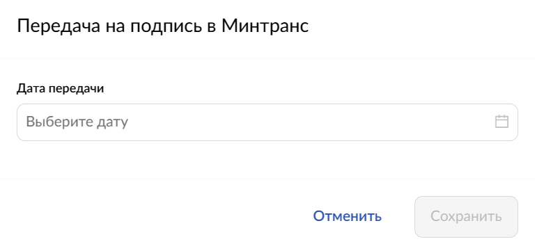

Рисунок - Окно «Передача на подпись в Минтранс»

Статус выбранных БСО автоматически меняется на «Передан в Минтранс».

## Регистрация передачи в Минтранс России в карточке БСО

В карточке БСО со статусом «Печать БСО» нажать на ссылку «Действия», в выпадающем меню выбрать «Передача на подпись в Минтранс».

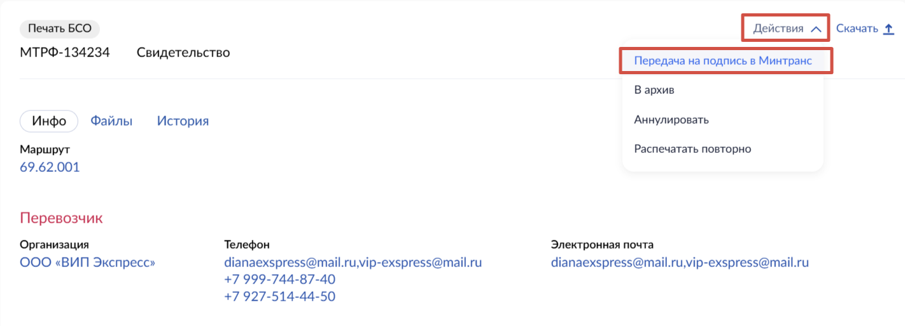

Рисунок - Регистрация передачи в Минтранс России в карточке БСО

В открывшемся окне «Передача на подпись в Минтранс» указать дату регистрации исходящего письма, которым БСО отправлен с Минтранс России; нажать кнопку «Сохранить» (см. Рисунок 10).

Статус БСО автоматически меняется на «Передан в Минтранс».

# Получение из Минтранса России

После подписания уполномоченным лицом Минтранса России, подписанные БСО направляются в ЦА ФБУ «Росавтотранс» для последующего распределения по филиалам. Факт получения БСО в ЦА ФБУ «Росавтотранс» требуется зарегистрировать в Системе.

## Регистрация получения из Минтранса России в Журнале БСО

Перейти в раздел «Журнал БСО».

Нажать кнопку  в левой верхней части страницы (см. Рисунок 6).

Для параметра «Статус» отметить значение «Передан в Минтранс», нажать кнопку «Найти» (Рисунок 12).

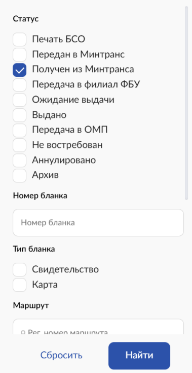

Рисунок - Выбор БСО в статусе «Передан в Минтранс»

На странице отобразится список всех карточек БСО, переданных для подписания в Минтранс России.

Нажать на чек-боксы , расположенные слева от серии и номера БСО, которые были получены из Минтранса России входящим письмом.

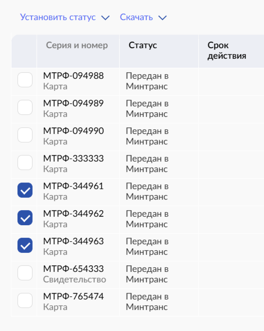

Рисунок - Выбор БСО в Журнале БСО

Нажать на ссылку «Установить статус» в левом верхнем углу страницы, в выпадающем списке выбрать значение «Получен из Минтранса» (Рисунок 14).

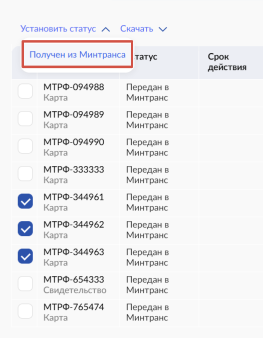

Рисунок – Установить статус «Получен из Минтранса»

В открывшемся окне «Получены из Минтранса России» указать дату регистрации входящего письма, которым БСО отправлены из Минтранса России; нажать кнопку «Сохранить» (Рисунок 15).

Рисунок - Окно «Получен из Минтранса»

Статус выбранных БСО автоматически меняется на «Получен из Минтранса».

## Регистрация получения из Минтранса России в карточке БСО

В карточке БСО со статусом «Передан в Минтранс» нажать на ссылку «Действия», в выпадающем меню выбрать «Получен из Минтранса» (Рисунок 16).

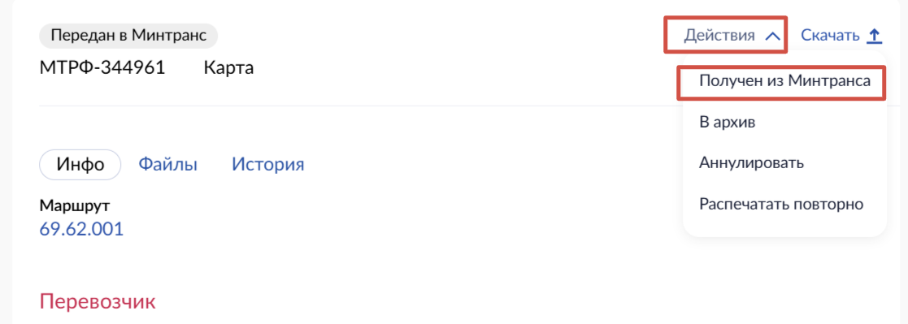

Рисунок - Регистрация получения из Минтранса России в карточке БСО

В открывшемся окне «Получены из Минтранса России» указать дату регистрации входящего письма, которым БСО отправлены из Минтранса России; нажать кнопку «Сохранить» (см. Рисунок 15).

Статус выбранных БСО автоматически меняется на «Получен из Минтранса».

# Передача в филиал

Подписанные БСО, полученные из Минтранса России, направляются в филиалы ФБУ «Росавтотранс», которые курируют соответствующие регионы перевозчиков – получателей БСО.

## Передача в филиал в «Журнале БСО»

Перейти в раздел «Журнал БСО».

Нажать кнопку  в левой верхней части страницы (см. Рисунок 6).

Для параметра «Статус» отметить значение «Получен из Минтранса», нажать кнопку «Найти» (Рисунок 17).

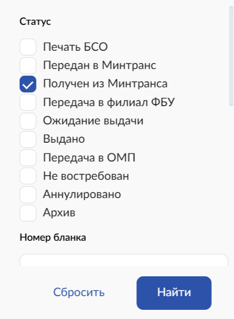

Рисунок - Выбор БСО в статусе «Получен из Минтранса»

На странице отобразится список всех карточек БСО, подписанных и полученных из Минтранса России.

Нажать на чек-боксы , расположенные слева от серии и номера БСО, которые необходимо направить в филиал (Рисунок 18).

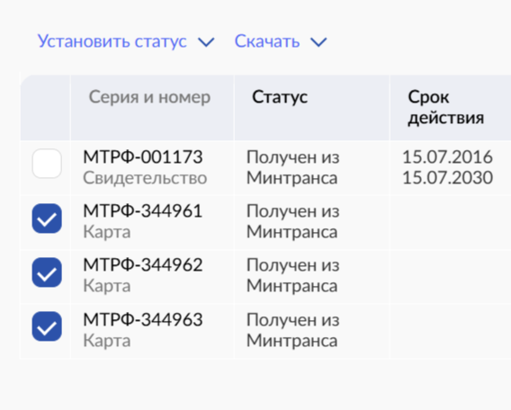

Рисунок - Выбор БСО в Журнале БСО

Нажать на ссылку «Установить статус» в левом верхнем углу страницы, в выпадающем списке выбрать значение «Передан в филиал ФБУ» (Рисунок 19).

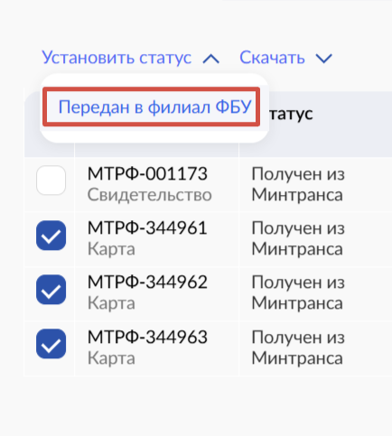

Рисунок – Установить статус «Передан в филиал ФБУ»

В открывшемся окне «Передача в филиал ФБУ»:

-   в поле «Дата передачи» указать дату передачи БСО в филиал;
-   в поле «Филиал» в выпадающем списке выбрать филиал, который соответствует региону перевозчика - получателя БСО,
-   нажать кнопку «Сохранить» (Рисунок 20).

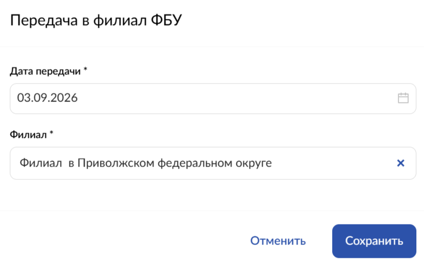

Рисунок – Окно «Передача в филиал ФБУ»

Статус выбранных БСО автоматически меняется на «Передача в филиал ФБУ».

## Передача в филиал из карточки БСО

В карточке БСО со статусом «Получен из Минтранса» нажать на ссылку «Действия», в выпадающем меню выбрать «Передача в филиал ФБУ» (Рисунок 21).

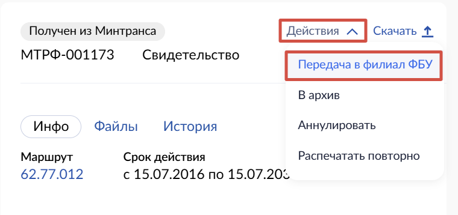

Рисунок – Передача в филиал ФБУ «Росавтотранс» в карточке БСО

В открывшемся окне «Передача в филиал ФБУ» в поле «Филиал» начать вводить название/часть названия филиала и в выпадающем списке выбрать филиал, который соответствует региону перевозчика - получателя БСО, нажать кнопку «Сохранить» (см. Рисунок 20).

Статус карточки БСО автоматически меняется на «Передача в филиал ФБУ».

# Ожидание выдачи

## Регистрация получения БСО филиалом в Журнале БСО

Перейти в раздел «Журнал БСО».

Нажать кнопку  в левой верхней части страницы (см. Рисунок 6).

Для параметра «Статус» отметить значение «Передача в филиал ФБУ», в поле «Филиал» выбрать нужный филиал и нажать кнопку «Найти» (Рисунок 22).

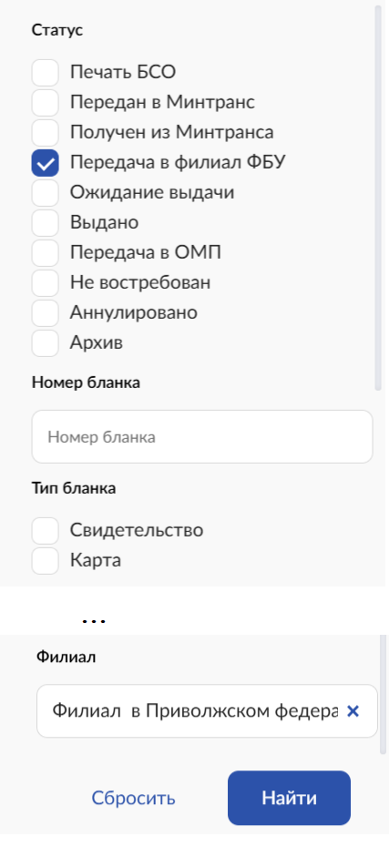

Рисунок - Выбор БСО в статусе «Передача в филиал ФБУ»

На странице отобразится список всех карточек БСО, переданных в выбранный филиал.

Нажать на чек-боксы , расположенные слева от серии и номера БСО, которые были переданы в филиал (Рисунок 23).

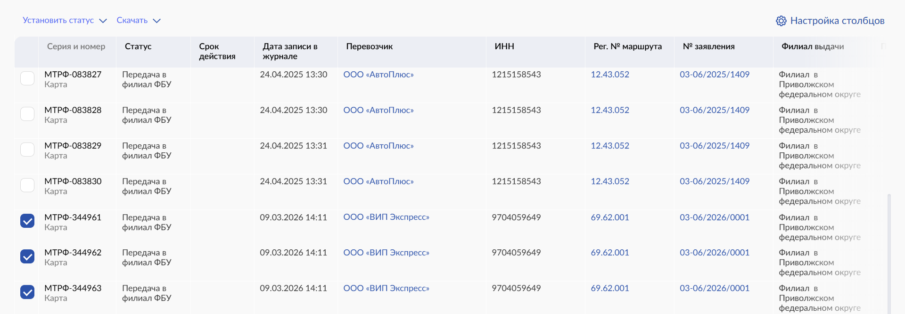

Рисунок – Выбор БСО в Журнале БСО

Нажать на ссылку «Установить статус» в левом верхнем углу страницы, в выпадающем списке выбрать значение «Ожидание выдачи» (Рисунок 24).

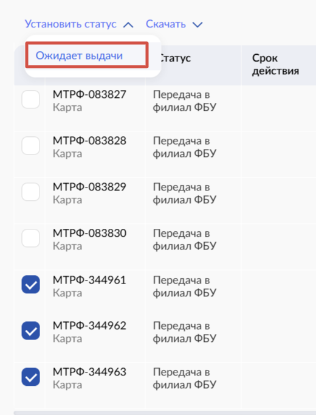

Рисунок - Получение БСО филиалом для ожидания выдачи

В открывшемся окне «Получен филиалом» в поле «Дата поступления» указать дату получения БСО филиалом, нажать кнопку «Сохранить» (Рисунок 25).

Рисунок – Окно «Получен филиалом»

Статус выбранных БСО автоматически меняется на «Ожидание выдачи».

## Регистрация получения БСО филиалом в карточке БСО

В карточке БСО со статусом «Передача в филиал ФБУ» нажать на ссылку «Действия», в выпадающем меню выбрать «Получено филиалом» (Рисунок 26).

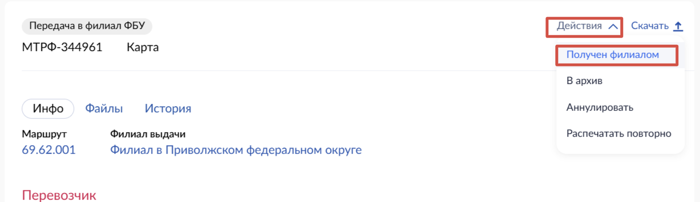

Рисунок - Действие «Получено филиалом» в карточке БСО

В открывшемся окне «Получен филиалом» в поле «Дата поступления» указать дату получения БСО филиалом, нажать кнопку «Сохранить» (см. Рисунок 25).

Статус карточки БСО автоматически меняется на «Ожидание выдачи».

# Выдача перевозчику

Выдача БСО перевозчику-получателю (законному представителю перевозчика-получателя) осуществляется в филиале ФБУ «Росавтотранс» по акту приема-передачи БСО в момент обращения перевозчика-получателя (законного представителя перевозчика-получателя) в филиал. Формирование акта приема-передачи БСО выполняется в Системе автоматически.

## Печать акта приема-передачи БСО

Перейти в раздел «Журнал БСО».

Нажать кнопку  в левой верхней части страницы (см. Рисунок 6).

В области настройки параметров фильтрации (Рисунок 27):

-   для параметра «Статус» отметить значение «Ожидание выдачи»,
-   в поле «Филиал» выбрать нужный филиал,
-   нажать кнопку «Найти».

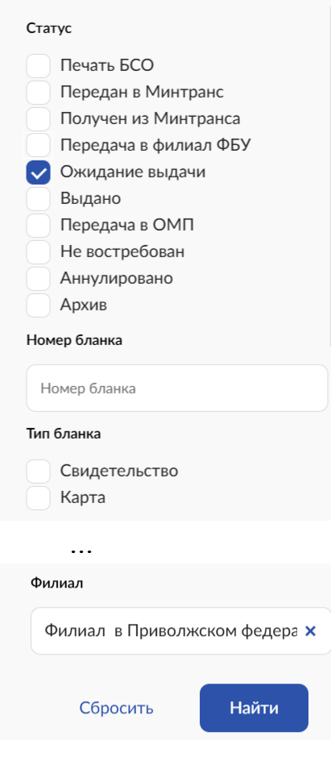

Рисунок – Выбор БСО со статусом «Ожидает выдачи» в филиале

На странице отобразится список всех карточек БСО, ожидающих выдачи в выбранном филиале.

Нажать на чек-боксы , расположенные слева от серии и номера БСО, которые необходимо выдать перевозчику.

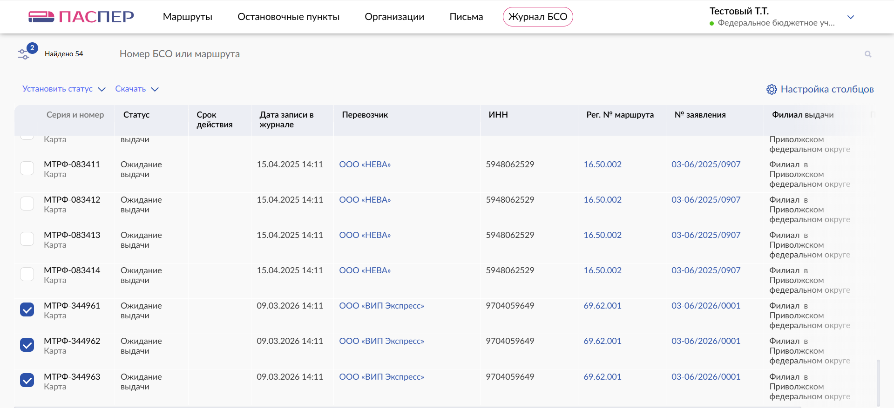

Рисунок – Выбор БСО в в Журнале БСО

Нажать ссылку «Скачать», в выпадающем меню выбрать «Акт приема-передачи» (Рисунок 29).

Рисунок - Выгрузка в файл документов по выдаче БСО

В открывшемся окне «Выберите перевозчика для акта приема-передачи» в поле «Перевозчик» начать вводить название/часть названия или ИНН/часть ИНН и выбрать в выпадающем списке ЮЛ/ИП перевозчика-получателя, нажать кнопку «ОК» (Рисунок 30).

Рисунок - Выбор перевозчика-получателя для акта приема-передачи БСО

Автоматически формируется и выгружается из Системы файл акта приема-передачи в формате \*.docx, заполненный согласно выбранным параметрам и доступный для редактирования.

## Регистрация выдачи перевозчику в Журнале БСО

Перейти в раздел «Журнал БСО».

Нажать кнопку  в левой верхней части страницы (см. Рисунок 6).

В области настройки параметров фильтрации (Рисунок 31):

-   для параметра «Статус» отметить значение «Ожидание выдачи»,
-   в поле «Филиал» выбрать нужный филиал,
-   в поле «Перевозчик» выбрать перевозчика-получателя, которому выдан БСО,
-   нажать кнопку «Найти».

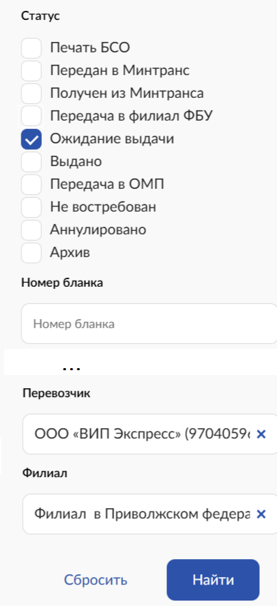

Рисунок – Выбор БСО в статусе «Ожидание выдачи» в выбранном филиале для выбранного перевозчика

На странице отобразится список карточек БСО, ожидающих выдачи в выбранном филиале выбранному перевозчику.

Нажать на чек-боксы , расположенные слева от серии и номера БСО, которые выданы перевозчику.

Нажать на ссылку «Установить статус» в левом верхнем углу страницы, в выпадающем списке выбрать значение «Выдан» (Рисунок 32).

Рисунок – Установить статус «Выдан» для выбранных БСО

В открывшемся окне «Перенести в выданные» (Рисунок 33):

в поле «Дата выдачи» указать дату, когда БСО передан получателю (законному представителю получателя),

в поле «Способ выдачи» выбрать из выпадающего списка одно из значений «Получил представитель от имени организации» или «Получил представитель курьерской службы»,

в поле «Акт приема-передачи» загрузить файл скан-копии подписанного акта приема-передачи БСО,

в поле «Скан документа-основания» загрузить файл скан-копии документа, подтверждающего, что лицо, подписавшее акт приема-передачи, является законным представителем перевозчика-получателя;

нажать кнопку «Сохранить».

Рисунок - Окно «Перенести в выданные»

Статус выбранных БСО автоматически меняется на «Выдано».

В карточках выданных БСО во вкладке «Файлы» отображаются приложенные скан-копии документов, доступные для скачивания (Рисунок 34).

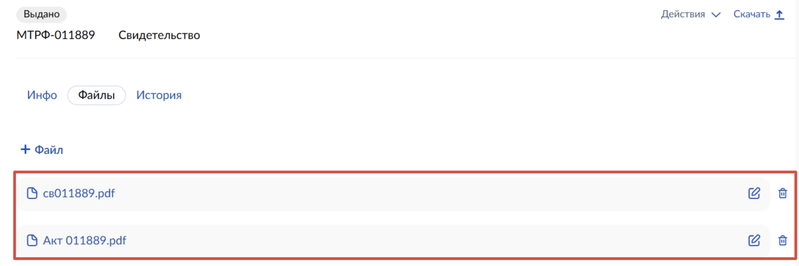

Рисунок – Вкладка «Файлы» с файлами приложенных документов

## Регистрация выдачи перевозчику в карточке БСО

В карточке БСО со статусом «Ожидание выдачи» нажать на ссылку «Действия», в выпадающем меню выбрать «Перенести в выданные» (Рисунок 35).

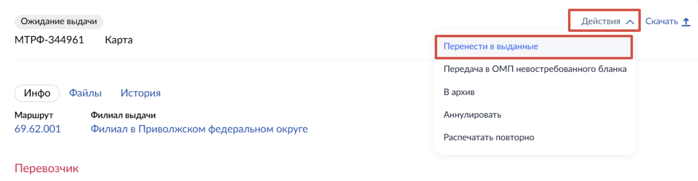

Рисунок - Действие «Перенести в выданные» в карточке БСО

В открывшемся окне «Перенести в выданные» (см. Рисунок 33):

в поле «Дата выдачи» указать дату, когда БСО передан получателю (законному представителю получателя),

в поле «Способ выдачи» выбрать из выпадающего списка одно из значений «Получил представитель от имени организации» или «Получил представитель курьерской службы»,

в поле «Акт приема-передачи» загрузить файл скан-копии подписанного акта приема-передачи БСО,

в поле «Скан документа-основания» загрузить файл скан-копии документа, подтверждающего, что лицо, подписавшее акт приема-передачи, является законным представителем перевозчика-получателя;

нажать кнопку «Сохранить».

Статус карточки БСО автоматически меняется на «Выдано».

Во вкладке «Файлы» отображаются приложенные скан-копии документов, доступные для скачивания (см.  Рисунок 34).

# Передача в ОМП

В случае если БСО не были получены перевозчиком в течение срока ожидания выдачи (до установленной даты начала перевозок), они направляются филиалами в ЦА ФБУ «Росавтотранс» как невостребованные.

## Регистрация передачи невостребованных БСО в Журнале БСО

Перейти в раздел «Журнал БСО».

Нажать кнопку  в левой верхней части страницы (см. Рисунок 6).

В области настройки параметров фильтрации (см. Рисунок 27):

-   для параметра «Статус» выбрать значение «Ожидание выдачи»,
-   в поле «Филиал» выбрать нужный филиал в выпадающем списке,
-   нажать кнопку «Найти».

На странице отобразится список всех карточек БСО, ожидающих выдачи в выбранном филиале.

Нажать на чек-боксы , расположенные слева от серии и номера БСО, которые необходимо передать в ЦА ФБУ «Росавтотранс» как невостребованные.

Нажать на ссылку «Установить статус» в левом верхнем углу страницы, в выпадающем списке выбрать значение «Передан в ОМП» (Рисунок 36).

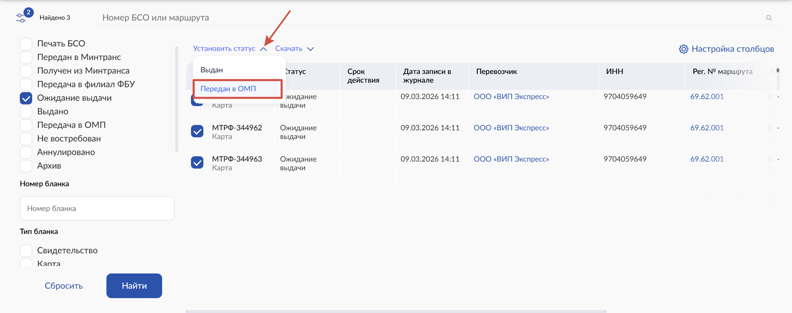

Рисунок – Установить статус «Передан в ОМП»

В открывшемся окне «Передача в ОМП невостребованного бланка» в поле «Дата передачи» указать дату передачи БСО в ЦА ФБУ «Росавтотранс», нажать кнопку «Сохранить» (Рисунок 37).

Статус выбранных БСО автоматически меняется на «Передача в ОМП».

Рисунок - Окно «Передача в ОМП невостребованного бланка»

## Регистрация передачи невостребованного БСО в карточке БСО

В карточке БСО со статусом «Ожидание выдачи» нажать на ссылку «Действия», в выпадающем меню выбрать «Передача в ОМП невостребованного бланка» (Рисунок 38);

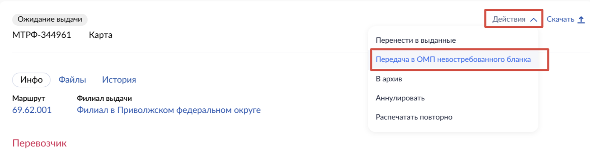

Рисунок - Действие «Передача в ОМП невостребованного бланка» в карточке БСО

В открывшемся окне «Передача в ОМП невостребованного бланка» в поле «Дата передачи» указать дату передачи БСО в ЦА ФБУ «Росавтотранс», нажать кнопку «Сохранить» (см. Рисунок 37).

Статус выбранных БСО автоматически меняется на «Передача в ОМП».

## Получение невостребованных БСО

## Регистрация получения невостребованных БСО в Журнале БСО

Перейти в раздел «Журнал БСО».

Нажать кнопку  в левой верхней части страницы (см. Рисунок 6).

В области настройки параметров фильтрации (Рисунок 39):

-   для параметра «Статус» отметить значение «Передача в ОМП»,
-   нажать кнопку «Найти».

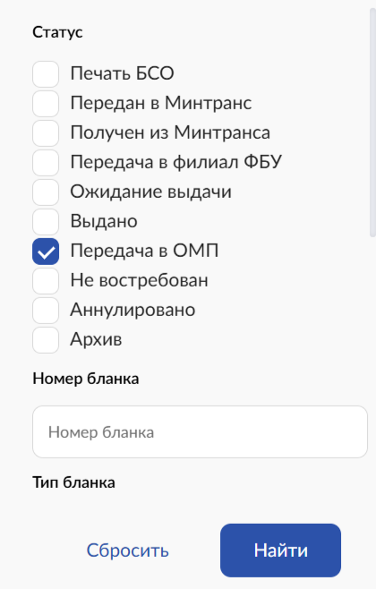

Рисунок - Выбор БСО в статусе «Передача в ОМП»

На странице отобразится список всех карточек БСО, переданных в ЦА ФБУ «Росавтотранс» как невостребованные.

Нажать на чек-боксы , расположенные слева от серии и номера БСО, которые получены в ЦА ФБУ «Росавтотранс» как невостребованные.

Нажать на ссылку «Установить статус» в левом верхнем углу страницы, в выпадающем списке выбрать значение «Не востребован» (Рисунок 40).

Рисунок - Получение невостребованного БСО

Статус выбранных БСО автоматически меняется на «Не востребован».

## Регистрация получения невостребованных БСО в карточке БСО:

В карточке БСО со статусом «Передача в ОМП» нажать на ссылку «Действия», в выпадающем меню выбрать «Принять невостребованный бланк» (Рисунок 41).

Статус карточки БСО автоматически меняется на «Не востребован».

Рисунок - Действие «Принять невостребованный бланк» в карточке БСО

# Аннулирование

Открыть карточку БСО, который требуется аннулировать.

В карточке БСО нажать на ссылку «Действия», в выпадающем меню выбрать «Аннулировать» (Рисунок 42).

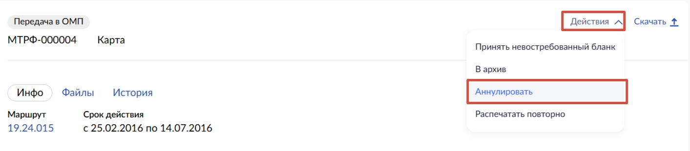

Рисунок - Действие «Аннулировать» в карточке БСО

В открывшемся окне с запросом подтверждения нажать «Установить» (Рисунок 43).

Рисунок - Окно с запросом подтверждения «Аннулировать»

Статус карточки БСО автоматически меняется на «Не востребован».

# Регистрация передачи в архив

Открыть карточку БСО, который требуется передать в архив.

В карточке БСО нажать на ссылку «Действия», в выпадающем меню выбрать «В архив» (Рисунок 44).

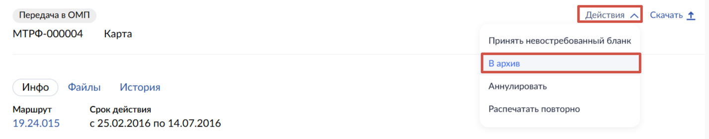

Рисунок - Действие «В архив» в карточке БСО

В открывшемся окне «В архив» (Рисунок 45) в поле «Причина» выбрать из выпадающего списка одно из предлагаемых значений: «Утерян/испорчен», «Брак» и нажать кнопку «Сохранить».

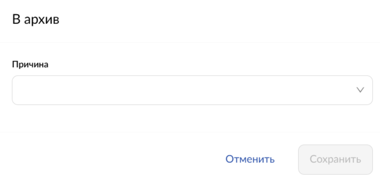

Рисунок - Окно «В архив»

Статус карточки БСО автоматически меняется на «Архив».

