Инструкция предназначена для сотрудников ФБУ «Росавтотранс», ответственных за ведение реестров межрегиональных и международных маршрутов регулярных перевозок и реестра остановочных пунктов по межрегиональным и международным маршрутам регулярных перевозок.

Инструкция содержит описание действий по формированию и отправке исходящих писем при установлении/изменении межрегиональных и международных маршрутов регулярных перевозок и регистрации/изменении остановочных пунктов по межрегиональным маршрутам регулярных перевозок в программном комплексе «Цифровая платформа пассажирских перевозок «ПАСПЕР» (далее по тексту – ЦП ПП «ПАСПЕР» или Система).

# Запрос в Ространснадзор и регистрация ответа

В ЛК менеджера по межрегиональным перевозкам / менеджера по международным перевозкам перейти в раздел «Письма», открыть вкладку «Исходящие» / «Исходящие по международным» и нажать на ссылку «+Добавить».

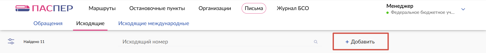

В открывшемся окне :

-   в поле «Выберите тип письма» выбрать из выпадающего списка значение «Запрос в Ространснадзор по штрафам в области транспорта»,
-   в появившемся поле «Заявления на Маршрут» выбрать из предлагаемого списка один или несколько номеров;
-   нажать кнопку «Создать».

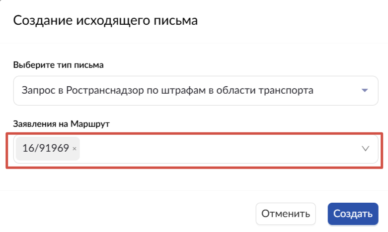

На странице откроется новая карточка письма в статусе «Новое», номер и дата исходящего письма присваиваются автоматически.

## Настройка процесса согласования и подписания в карточке письма

В новой карточке письма:

-   нажать кнопку «Создать процесс»;

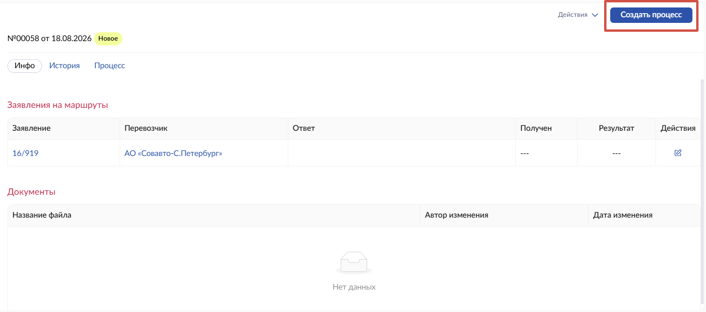

-   в открывшемся окне «Создать процесс» в поле «Тип» выбрать из возможных значений роль участника процесса «Согласующий», в поле «Сотрудник» выбрать ФИО участника процесса для согласования письма;

-   нажать на ссылку «+ Добавить»,
-   в появившемся поле «Тип» выбрать из возможных значений роль участника процесса «Подписант», в поле «Сотрудник» выбрать ФИО участника процесса для подписания письма;
-   нажать на ссылку «+ Добавить»,
-   в появившемся поле «Тип» выбрать из возможных значений роль участника процесса «Получатель», в поле «Сотрудник» выбрать ФИО получателя письма;
-   если согласующих несколько, то добавить каждого следующего участника процесса с типом «Согласующий»;
-   после добавления всех участников процесса нажать кнопку «Создать»;

-   в карточке исходящего письма отображается кнопка «Отправить» и на вкладке «Процесс» отображаются участники процесса и ожидаемые действия в соответствии с назначенными ролями;
-   нажать на кнопку «Отправить»;

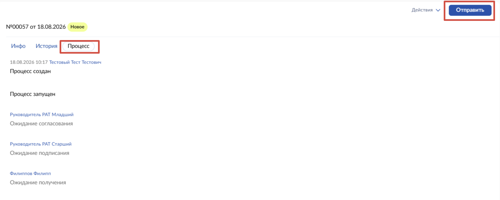

-   карточка исходящего письма переходит в статус «На согласовании» или «На подписании» в зависимости от созданных этапов процесса.

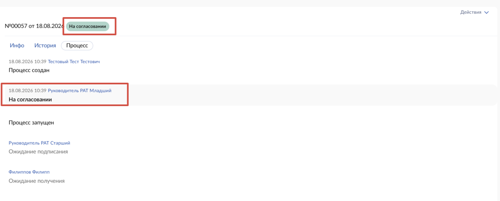

## Действия при возврате письма на доработку

Если на этапе согласования исходящее письмо возвращено с замечаниями и имеет статус «Возвращено на доработку», то в карточке письма требуется загрузить с компьютера новый файл письма с внесенными правками и отправить письмо на повторное согласование или подписание в соответствии с назначенными этапами:

-   открыть карточку исходящего письма в статусе «Возвращено на доработку»,

-   нажать на ссылку «Действия», в выпадающем меню выбрать «Загрузить новое»;
-   в открывшемся окне нажать на ссылку «Загрузить», в открывшемся окне выбрать файл и нажать кнопку «Загрузить»;
-   на вкладке «Процесс» отображается этап «Доработка завершена» и ожидаемые действия согласования или подписания в соответствии с назначенными этапами (ролями);
-   нажать на кнопку «Отправить»;
-   карточка исходящего письма переходит в статус «На согласовании» или «На подписании» в соответствии с назначенными этапами (ролями).

## Действия после получения ответа на письмо

После успешного согласования и подписания участниками процесса исходящее письмо автоматически переходит в статус «Отправлено» и доступно для рассмотрения в ЛК получателя (сотрудника Ространснадзора) в статусе «Новое». После рассмотрения письма получатель формирует ответное письмо в адрес ФБУ «Росавтотранс» с результатом рассмотрения.

После получения входящего письма с ответом Ространснадзора:

-   перейти в раздел «Письма», открыть вкладку «Исходящие», в верхней части страницы в поисковой строке ввести исходящий номер или часть номера письма, на который получен ответ, и нажать на значок ;

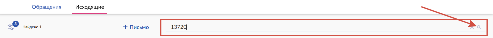

-   в открывшейся карточке нажать ссылку «Действия», в выпадающем меню выбрать ссылку «Зарегистрировать ответ»;

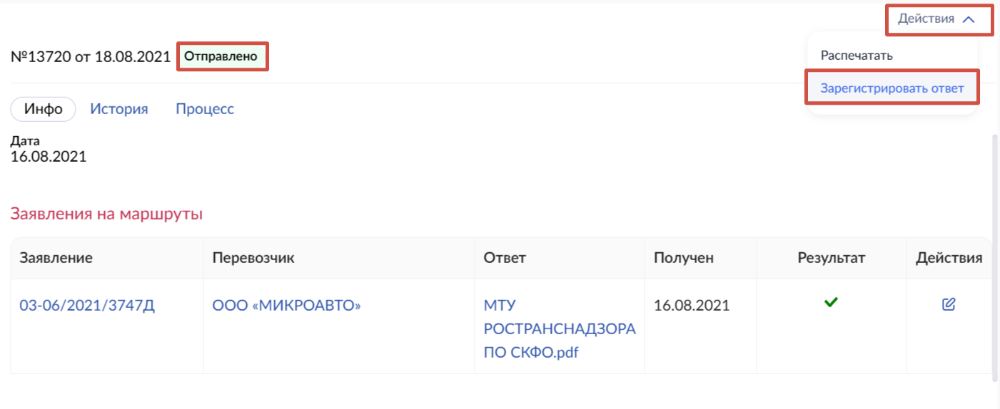

-   в открывшемся окне загрузить файл скан-копии входящего письма :
-   нажать кнопку «Зарегистрировать»;
-   карточке исходящего письма присваивается статус «Зарегистрирован ответ»;

После регистрации входящего письма с ответом Ространснадзора или, если ответ не получен, то по истечение срока получения ответа (30 дней):

-   в карточке исходящего письма в блоке «Заявление на маршруты» в столбце «Действия» нажать на значок ;

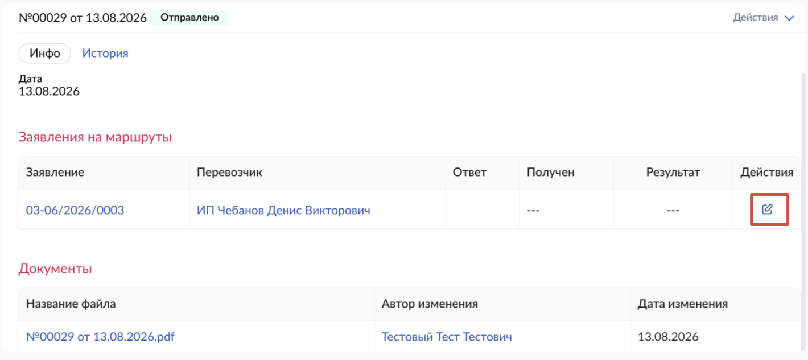

-   в открывшемся окне в зависимости от полученного ответа Ространснадзора выбрать одно из значений «Положительный» / «Отрицательный», или в случае, если ответ не получен, поставить отметку «В установленный срок ответ не получен», нажать кнопку «Сохранить»;

-   если указано решение Ространснадзора, карточке исходящего письма присваивается статус «Зарегистрирован ответ»;

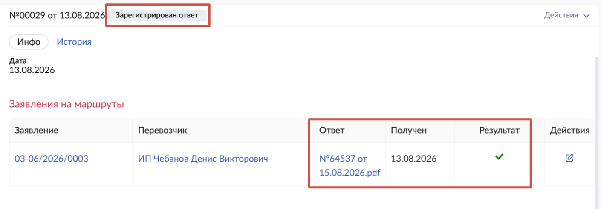

-   в карточке заявления, по которому получен ответ Ространснадзора, на вкладке «Процессы» отображается информация о запросе в Ространснадзор с указанием реквизитов исходящего письма, даты получения ответа, статуса ответа.

# Согласование с УИО субъектов РФ

В ЛК менеджера по межрегиональным перевозкам / менеджера по международным перевозкам перейти в раздел «Письма», открыть вкладку «Исходящие», и нажать на ссылку «+Добавить».

В открывшемся окне :

-   в поле «Выберите тип письма» выбрать из выпадающего списка значение «Извещение УИО субъекта РФ»,
-   в появившемся поле «Регион» выбрать субъект РФ, с которым требуется согласовать заявленный маршрут(-ы);
-   в появившемся поле «Заявления на Маршрут» выбрать из предлагаемого списка один или несколько номер(-ов) заявления(-й) на маршрут, которые требуется согласовать с выбранным субъектом РФ;
-   нажать кнопку «Создать».

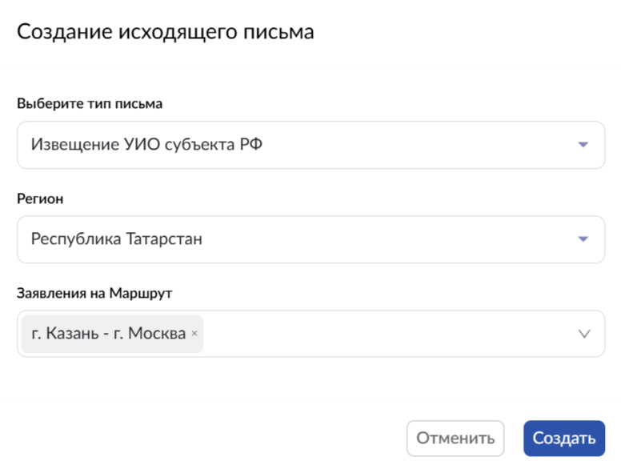

Для отправки новой карточки письма на согласование и подписание повторить действия, аналогичные для исходящего письма типа «Запрос в Ространснадзор по штрафам в области транспорта» (пункт «Настройка процесса согласования и подписания в карточке письма»).

Повторить действия для каждого субъекта РФ, по территории которого проходит маршрут.

После получения входящего письма с ответом УИО субъекта РФ, для регистрации ответа в карточке исходящего письма выполнить действия, аналогичные для регистрации ответа на исходящее письмо типа «Запрос в Ространснадзор по штрафам в области транспорта».

После регистрации входящего письма с ответом УИО субъекта РФ или, если ответ не получен, то по истечение срока получения ответа (30 дней):

-   в карточке письма в блоке «Заявление на маршруты» нажать на значок ;
-   в открывшемся окне в зависимости от полученного ответа выбрать одно из значений :

«В установленный срок ответ не получен» - если ответ не получен по истечение срока получения ответа;

«Основания для отказа отсутствуют» - заявление согласовано субъектом РФ;

«Причины для отказа» - заявление не согласовано, установить отметки для пунктов заявления, ставших причиной отказа;

-   нажать кнопку «Сохранить»;

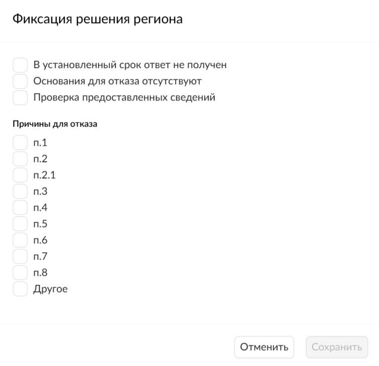

-   карточке исходящего письма присваивается статус «Зарегистрирован ответ».

-   в карточке заявления на вкладке «Процессы» отображается информация о согласовании с УИО субъектов РФ с указанием реквизитов исходящих писем и статуса ответа.

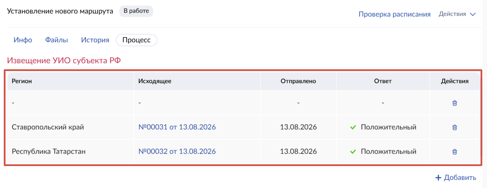

В карточке заявления по маршруту на вкладке «Процесс» в блоке «Извещение УИО субъекта РФ» столбец «Регион» автоматически предзаполняется названиями субъектов РФ, через которые проходят ОП из блока «Расписание» вкладки «Инфо». Для добавления субъекта РФ (например, если маршрут проходит через территорию субъекта РФ без остановок):

-   открыть карточку заявления в статусе «В работе» и перейти на вкладку «Процесс»;
-   на вкладке «Процесс» в блоке «Извещения УИО субъекта РФ» нажать ссылку «Добавить»;

-   в открывшемся окне «Добавить регионы» в поле «Регионы» выбрать из выпадающего списка субъекты РФ, по территории которых проходит заявленный маршрут и нажать кнопку «Добавить»;

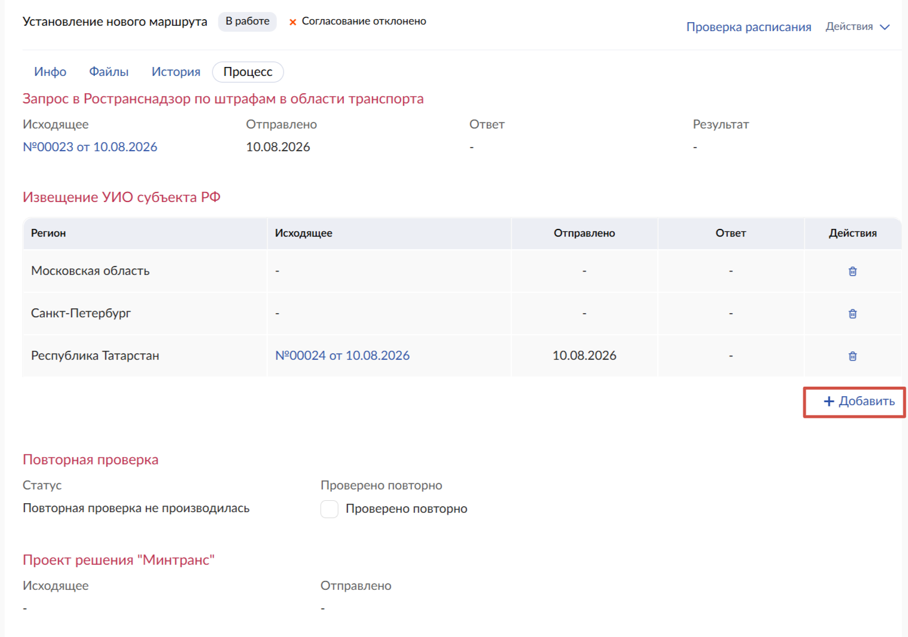

-   в открывшемся окне «Добавить регионы» в поле «Регионы» выбрать из выпадающего списка субъекты РФ, по территории которых проходит заявленный маршрут, и нажать кнопку «Добавить»;

# Запрос в ФСБ России (для международного маршрута)

В ЛК менеджера по межрегиональным перевозкам / менеджера по международным перевозкам перейти в раздел «Письма», открыть вкладку «Исходящие», и нажать на ссылку «+Добавить».

В открывшемся окне :

-   в поле «Выберите тип письма» выбрать из выпадающего списка значение «Запрос в ПС ФСБ»,
-   в появившемся поле «Заявления на Маршрут» выбрать из предлагаемого списка один или несколько номер(-ов) заявления(-й) на маршрут, которые требуется согласовать;
-   нажать кнопку «Создать».

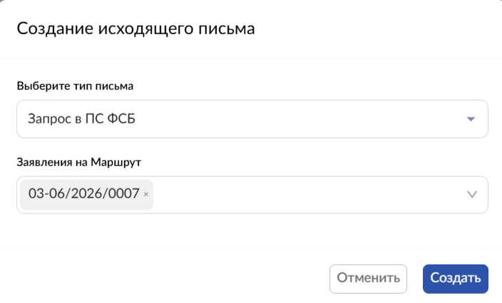

Для отправки новой карточки письма на согласование и подписание повторить действия, аналогичные для исходящего письма типа «Запрос в Ространснадзор по штрафам в области транспорта» (пункт «Настройка процесса согласования и подписания в карточке письма»).

После получения входящего письма с ответом ПС ФСБ России, для регистрации ответа в карточке исходящего письма выполнить действия, аналогичные для регистрации ответа на исходящее письмо типа «Запрос в Ространснадзор по штрафам в области транспорта».

После регистрации входящего письма с ответом ПС ФСБ России или, если ответ не получен, то по истечение срока получения ответа (30 дней):

-   в карточке письма в блоке «Заявления на маршруты» нажать на значок ;
-   в открывшемся окне в зависимости от полученного ответа выбрать одно из значений «Положительный» / «Отрицательный», или в случае, если ответ не получен, поставить отметку «В установленный срок ответ не получен», далее нажать кнопку «Сохранить»;

-   карточке исходящего письма присваивается статус «Зарегистрирован ответ».

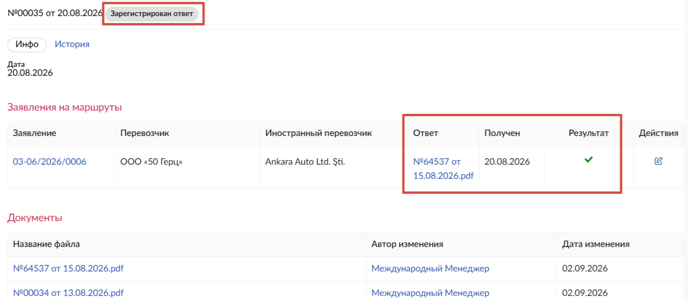

-   в карточке заявления на вкладке «Процессы» отображается информация о согласовании с ФСБ России с указанием реквизитов исходящих писем и статуса ответа.

# Маршруты. Подготовка и направление проектов решений Минтранса России

Проект решения Минтранса России по заявлению об установлении/изменении маршрута может быть как положительным, так и отрицательным в соответствии с результатами рассмотрения заявления. Для каждого решения предусмотрен тип исходящего письма:

-   «Проект решения Минтранс России положительный»,
-   «Проект решения Минтранс России отрицательный».

В ЛК менеджера по межрегиональным перевозкам / менеджера по международным перевозкам перейти в раздел «Письма», открыть вкладку «Исходящие», и нажать на ссылку «+Добавить».

В открывшемся окне :

-   в поле «Выберите тип письма» выбрать из выпадающего списка значение «Проект решения Минтранс России положительный» или «Проект решения Минтранс России отрицательный»;
-   в появившемся поле «Заявления на Маршрут» выбрать из предлагаемого списка один или несколько номер(-ов) заявления(-й) на маршрут, по которым требуется принять решение;
-   нажать кнопку «Создать».

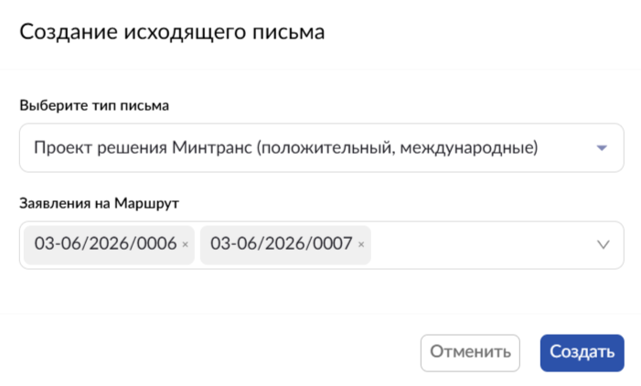

Для отправки новой карточки письма на согласование и подписание повторить действия, аналогичные для исходящего письма типа «Запрос в Ространснадзор по штрафам в области транспорта» (пункт «Настройка процесса согласования и подписания в карточке письма»).

После отправки исходящего письма с проектом решения, в карточке заявления, по которому отправлен проект решения, на вкладке «Процессы» в блоке «Проект решения Минтранса» отображается информация об отправлении  с указанием реквизитов письма и даты отправки (дата отправки определяется в Системе датой нажатия кнопки «Подписать» или, если подписание и отправка исходящего письма осуществляется вне Системы, датой нажатия кнопки «Отправлено» ).

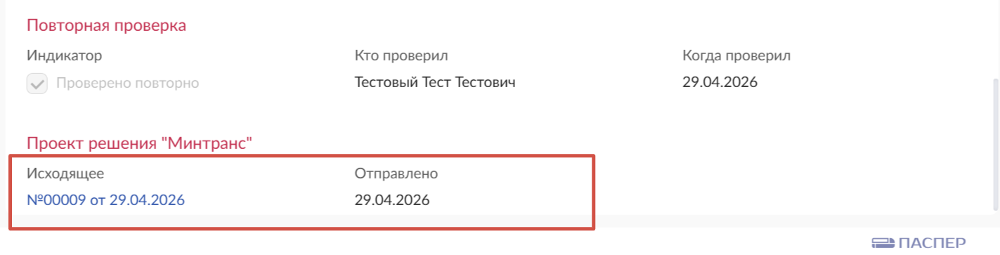

После получения подписанного решения Минтранса России необходимо выполнить действия по его регистрации в карточке исходящего письма проекта решения:

-   открыть карточку исходящего письма проекта решения со статусом «Отправлено»,
-   в карточке письма нажать ссылку «Действия», в выпадающем меню выбрать ссылку «Зарегистрировать ответ»;

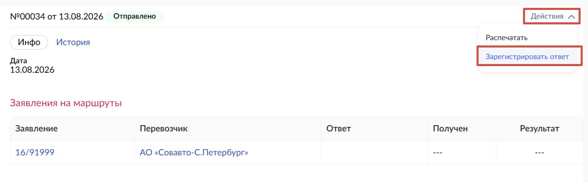

-   в открывшемся окне «Зарегистрировать ответ» :

в поле «Скан письма» нажать на ссылку «Выбрать файл», в открывшемся окне выбрать файл скан-копии входящего письма и нажать на кнопку «Открыть»;

в полях «Номер решения Минтранса» и «Дата решения Минтранса» ввести номер и дату решения Минтранса России;

при необходимости в поле «Комментарий для владельца маршрута» ввести текст (не более 2000 символов);

поле «Заявления» по умолчанию заполнено номерами всех заявлений, связанными с данным исходящим письмом;

нажать кнопку «Зарегистрировать»;

-   откроется карточка исходящего письма со статусом «Зарегистрирован ответ», в которой на вкладке «Инфо»  отображается:

название приложенного файла скан-копии входящего письма - в блоке «Документы» в столбце «Название файла», в блоке «Заявления на маршруты» в столбце «Ответ»;

ФИО сотрудника, который загрузил файл скан-копии входящего письма – в блоке «Документы» в столбце «Автор изменения»;

дата загрузки файла скан-копии входящего письма - в блоке «Документы» в столбце «Дата изменения» и в блоке «Заявления на маршруты» в столбце «Получен»;

в блоке «Заявления на маршруты» в столбце «Результат» -

значение «Отрицательный» - для типа исходящего «Проект решения Минтранс отрицательный»;

значение «Положительный» - для типа исходящего «Проект решения Минтранс положительный».

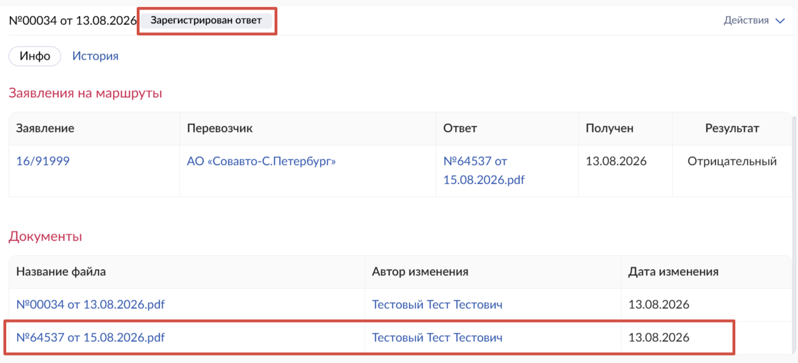

Если регистрация прошла успешно (карточка исходящего письма в статусе «Зарегистрирован ответ»), то карточка заявления переходит в статус:

-   «Утверждено»  - при положительном решении Минтранса России;
-   «Отклонено»  – при отрицательном решении Минтранса России.

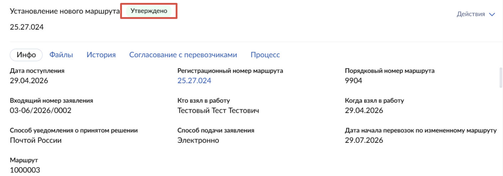

Если заявление на установление маршрута утверждено, то в реестре маршрутов создается связанный с ним маршрут в статусе «В реестре» с характеристиками, которые указаны в заявлении.

# Остановочные пункты. Подготовка и направление проектов решений Минтранса России

В ЛК менеджера по межрегиональным перевозкам перейти в раздел «Письма», открыть вкладку «Исходящие», и нажать на ссылку «+Добавить».

В открывшемся окне:

-   в поле «Выберите тип письма» выбрать из выпадающего списка значение, соответствующее типу заявления;

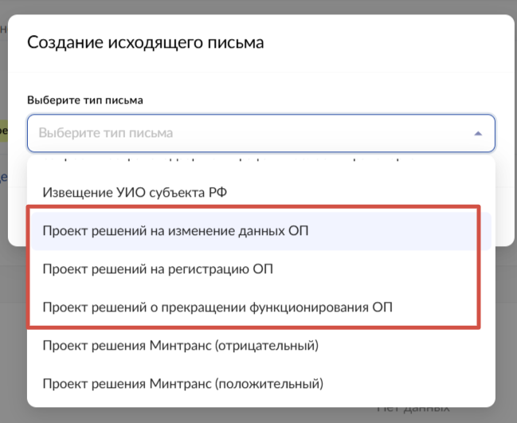

-   в появившемся поле «Заявления на ОП» выбрать из предлагаемого списка один или несколько номеров;
-   нажать кнопку «Создать».

Для отправки новой карточки письма на согласование и подписание повторить действия, аналогичные для исходящего письма типа «Запрос в Ространснадзор по штрафам в области транспорта» (пункт «Настройка процесса согласования и подписания в карточке письма»).

После отправки исходящего письма с проектом решения, в карточке заявления, по которому создан проект решения, на вкладке «Процессы» отображается информация об отправлении  со ссылкой на карточку исходящего письма.

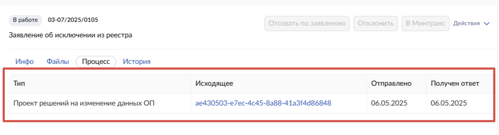

После получения подписанного решения Минтранса России необходимо выполнить действия по его регистрации в карточке исходящего письма с проектом решения:

-   открыть карточку исходящего письма проекта решения со статусом «Отправлено»,
-   в карточке письма нажать ссылку «Действия», в выпадающем меню выбрать ссылку «Зарегистрировать ответ»;

-   в открывшемся окне «Зарегистрировать ответ» :

нажать на ссылку «Выбрать файл», в открывшемся окне выбрать файл со скан-копией входящего письма с решением Минтранса России, нажать кнопку «Открыть»;

поле «Заявления» по умолчанию заполнено номерами всех заявлений, связанными с данным исходящим письмом;

нажать кнопку «Зарегистрировать»;

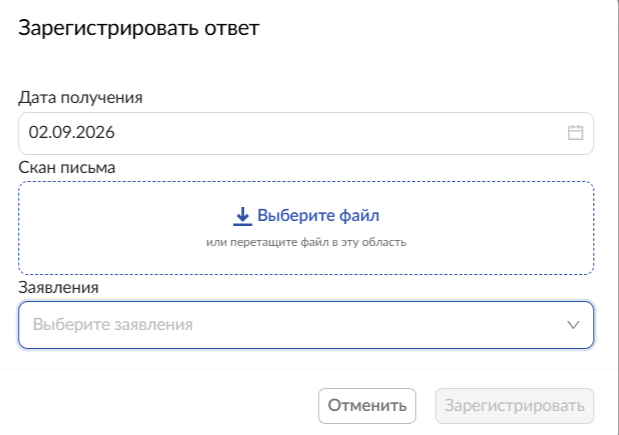

-   откроется карточка исходящего письма со статусом «Зарегистрирован ответ», в которой на вкладке «Инфо» отображается:

название приложенного файла скан-копии входящего письма - в блоке «Документы» в столбце «Название файла», в блоке «Заявления на ОП» в столбце «Ответ»;

ФИО сотрудника, который загрузил файл скан-копии входящего письма – в блоке «Документы» в столбце «Автор изменения»;

дата загрузки файла скан-копии входящего письма - в блоке «Документы» в столбце «Дата изменения» и в блоке «Заявления на ОП» в столбце «Получен»;

в блоке «Заявления на ОП» в столбце «Действия» нажать на значок ;

-   в открывшемся окне в зависимости от полученного решения Минтранса России выбрать одно из значений «Положительный» / «Отрицательный» и нажать кнопку «Сохранить»; выбранное значение отображается в блоке «Заявления на ОП» в столбце «Результат»;
-   в карточке заявления на ОП, по которому принято решение Минтранса России, на вкладке «Процессы» отображается информация о решении Минтранса России с указанием реквизитов исходящего письма проекта решения, даты получения ответа, статуса ответа.

# Публикация решений на сайте Минтранса России

Для публикации на сайте Минтранса России направить ответственному исполнителю в Минтранс России сведения о решении по заявлению:

-   открыть карточку заявления в статусе «Утверждено»,
-   нажать на ссылку «Действия», в выпадающем меню выбрать «Экспорт решений на сайт Минтранса»;
-   автоматически формируется и выгружается zip-архив для последующего направления ответственному исполнителю в Минтранс России для дальнейшей публикации на сайте.

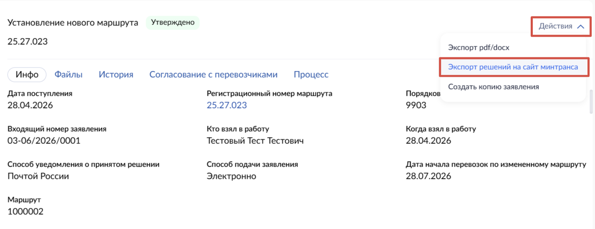

# Подписание и отправка исходящего письма вне Системы

Если подписание и отправку исходящего письма, созданного в Системе, планируется осуществлять вне Системы:

-   в карточке исходящего письма после создания со статусом «Новое» нажать на ссылку «Действия» и в выпадающем меню выбрать «Распечатать»;
-   выполняется выгрузка письма во внешний файл формата «.docx».

После подписания и отправки исходящего письма вне Системы, в Системе:

-   открыть карточку исходящего письма со статусом «Новое»,
-   в карточке письма нажать ссылку «Действия» и в выпадающем меню нажать ссылку «Отправлено»;

в открывшемся окне :

в поле «Скан письма» нажать на ссылку «Выбрать файл», в открывшемся окне выбрать файл скан-копии входящего письма и нажать на кнопку «Открыть»;

нажать кнопку «Установить»;

-   откроется карточка исходящего письма со статусом «Отправлено».

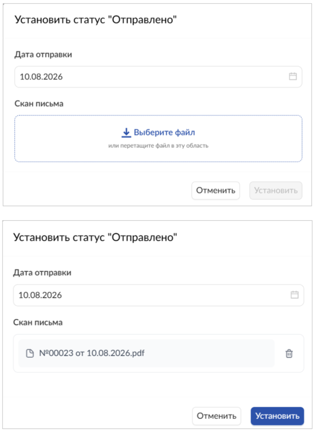

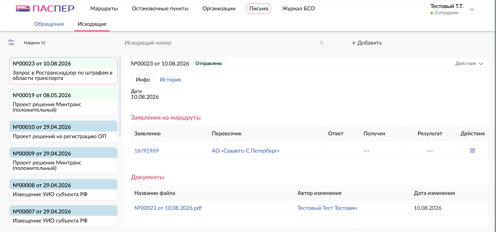

