Руководство содержит описание последовательности действий по выполнению функций ЦП ПП «ПАСПЕР» пользователями ФБУ «Росавтотранс» с ролями «Менеджер по межрегиональным перевозкам», «Менеджер по международным перевозкам».

# Главная страница

После успешной авторизации пользователя открывается главная страница личного кабинета пользователя.

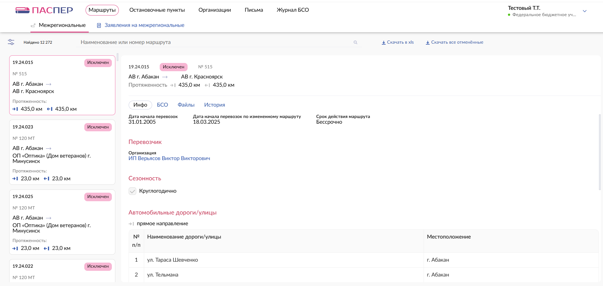

Рисунок - 

В верхней части главной страницы ЛК расположен список основных разделов, в правом углу отображаются сведения о текущем пользователе (Фамилия И.О.) и название его организации. При нажатии на значок  открывается выпадающее меню с командами:

-   «Профиль» - для входа в настройки профиля пользователя;
-   «Выйти» - для выхода из ЛК.

Рисунок - 

Список основных разделов содержит следующие ссылки: «Маршруты», «Остановочные пункты», «Организации», «Письма», «Журнал БСО».

## Смена пароля пользователя

Для самостоятельной смены пароля необходимо:

-   в правом верхнем углу главной страницы нажать на значок , в выпадающем меню нажать «Профиль»;
-   на открывшейся странице профиля нажать ссылку «Сменить пароль»,
-   в открывшемся окне заполнить требуемые данные и нажать кнопку «Готово»;
-   на адрес электронной почты пользователя, указанный пользователем при регистрации, направляется уведомление о смене пароля.

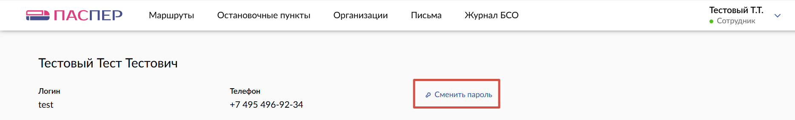

Рисунок - 

## Область настройки параметров фильтрации

Область настройки параметров фильтрации открывается в левой части страницы. Для ее открытия необходимо нажать кнопку  в левой верхней части страницы.

Набор отображаемых параметров фильтрации зависит от раздела и вкладки, которые открыты на странице.

Для настройки необходимо задать значения нужных параметров и нажать кнопку «Найти». В списке будут отображены обращения, соответствующие заданным параметрам поиска.

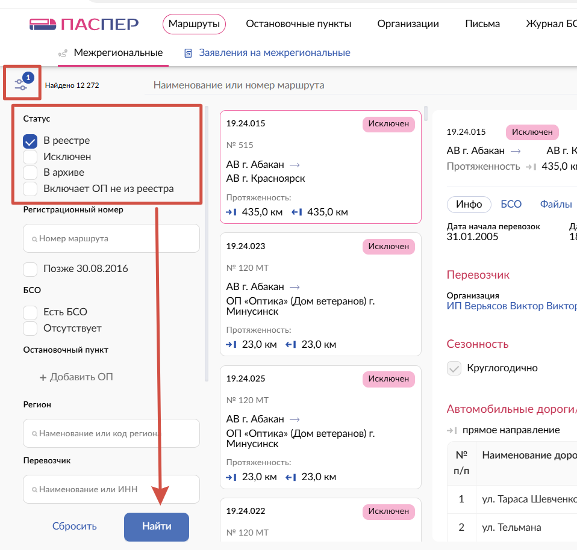

Рисунок - 

Для сброса всех заданных параметров необходимо нажать кнопку «Сбросить».

Чтобы область настройки параметров фильтрации не отображались на странице, необходимо повторно нажать кнопку .

# Работа с маршрутами

## Просмотр реестра межрегиональных маршрутов

Для просмотра реестра межрегиональных маршрутов необходимо перейти в раздел «Маршруты», открыть вкладку «Межрегиональные» (см. Рисунок 3). Вкладка доступна пользователям с правами «Менеджер по межрегиональным перевозкам», «Менеджер по международным перевозкам» и открывается по умолчанию при входе пользователя в ЛК.

На вкладке «Межрегиональные» в левой части страницы отображается список маршрутов с указанием их статуса, статусы могут быть следующие:

-   «В реестре» - действующий утвержденный маршрут межрегиональной перевозки, у которого все ОП по маршруту включены в Реестр остановочных пунктов;
-   «Исключен» - сведения о маршруте исключены из реестра в соответствии с утвержденным решением Минтранса России об отмене маршрута;
-   «В архиве» - маршрут передан в архив;
-   «Включает ОП не из реестра» - действующий утвержденный маршрут межрегиональной перевозки, который содержит ОП, не зарегистрированные в реестре ОП;

Рисунок - 

Чтобы посмотреть список маршрутов с конкретными статусами, необходимо с помощью кнопки  открыть настройки фильтрации, отметить одно или несколько значений в списке «Статус» и нажать кнопку «Найти».

В верхней части страницы отображается информация о количестве маршрутов в списке.

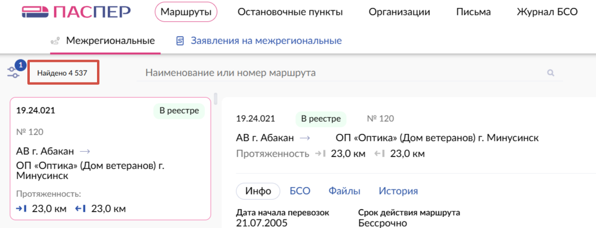

Рисунок - 

При нажатии на ссылку «Скачать в xls» выполняется формирование файла со списком маршрутов и значениями их параметров с учетом заданных настроек фильтрации и поиска.

При нажатии на ссылку «Скачать все отмененные» выполняется формирование файла со списком маршрутов, которые имеют статус «Исключен».

В визитке маршрута отображается следующая информация о маршруте: код, номер, наименование (наименования населенных пунктов, в границах которых расположены начальный и конечный ОП), протяженность в прямом и обратном направлениях, статус маршрута.

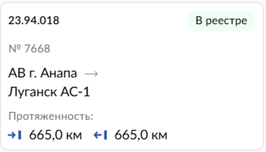

Рисунок - 

При нажатии в списке на визитку маршрута в основной части страницы отображается карточка маршрута.

## Просмотр реестра международных маршрутов

Для просмотра реестра международных маршрутов необходимо перейти в раздел «Маршруты», открыть вкладку «Международные». Вкладка доступна пользователям с правами «Менеджер по международным перевозкам» и открывается по умолчанию при входе пользователя в ЛК.

На вкладке «Международные» в левой части страницы отображается список маршрутов с указанием их статусов, статусы могут быть следующие: «В реестре», «Исключен», «В архиве», «Включает ОП не из реестра» (аналогично межрегиональным маршрутам).

Рисунок - 

Чтобы посмотреть список маршрутов с конкретными статусами, необходимо с помощью кнопки  открыть настройки фильтрации, отметить одно или несколько значений в списке «Статус» и нажать кнопку «Найти».

В верхней части страницы отображается информация о количестве маршрутов в списке.

В визитке маршрута отображается следующая информация о маршруте: код, номер, наименование (наименования населенных пунктов и государств, в границах которых расположены начальный и конечный ОП), протяженность в прямом и обратном направлениях, статус маршрута.

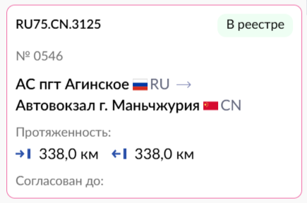

Рисунок - 

При нажатии в списке на визитку маршрута в основной части страницы отображается карточка маршрута.

## Поиск маршрута в реестре
троку в верхней части страницы, поисковый запрос может содержать номер или часть номера, название или часть названия маршрута.

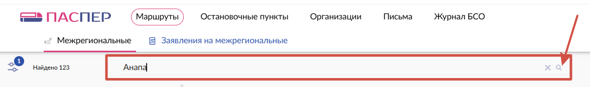

Рисунок - 

Для поиска маршрута/маршрутов в списке можно использовать настройку параметров фильтрации:

-   «Статус» - выбрать одно или несколько значений статуса маршрута;
-   «Регистрационный номер» - в поле ввести номер или часть регистрационного номера маршрута;
-   «Позже 30.08.2016» (только для межрегиональных маршрутов) – установить или сбросит отметку;
-   «БСО» - выбрать одно или оба значения «Есть БСО» или «Отсутствует»;
-   «Остановочный пункт» - нажать на ссылку «+Добавить» и в открывшемся окне ввести наименование/часть наименования или номер/часть номера остановочного пункта, можно добавить несколько ОП, повторно нажимая на «+Добавить»;
-   «Регион» - ввести в поле наименование/часть наименования или код субъекта РФ;
-   «Страна» (только для международных маршрутов) - ввести в поле наименование/часть наименования или код иностранного государства;
-   «Российский перевозчик» - ввести в поле наименование/часть наименования или ИНН ЮЛ или ИП;
-   «Товарищество» (только для межрегиональных маршрутов) - ввести в поле наименование/часть наименования или ИНН;
-   «Иностранный перевозчик» (только для международных маршрутов) - ввести в поле наименование/часть наименования организации перевозчика;
-   «Протяженность, км» - задать начальное значение и/или конечное значение возможного диапазона;
-   «Макс.количество ТС,шт» - задать начальное значение и/или конечное значение возможного диапазона, только целые числа;
-   «Дата начала срока согласования» (только для международных маршрутов) - задать начальную дату и/или конечную дату возможного периода;
-   «Дата окончания срока согласования» (только для международных маршрутов) - задать начальную дату и/или конечную дату возможного периода.

Общие правила работы с областью настройки параметров фильтрации приведены ранее в руководстве.

## Работа с карточкой маршрута

Чтобы открыть карточку маршрута, необходимо перейти в раздел «Маршруты», открыть вкладку «Межрегиональные» / «Международные», в списке маршрутов в левой части страницы найти маршрут и нажать на его визитку. В основной части страницы откроется карточка маршрута.

### Карточка межрегионального маршрута

Карточка межрегионального маршрута содержит вкладки «Инфо», «БСО» «Файлы», «История».

На вкладке «Инфо» отображаются следующие сведения:

-   дата начала регулярных перевозок по маршруту (не позднее чем через девяносто дней со дня включения маршрута в реестр; не позднее чем через десять дней со дня изменения сведений о маршруте в реестре, за исключением, если изменение маршрута предусматривает увеличение максимального количества ТС и (или) изменение их характеристик, то не позднее чем через девяносто дней со дня изменения сведений о маршруте в реестре);
-   срок действия маршрута - срок окончания осуществления регулярных перевозок по маршруту;
-   сведения о перевозчике, предоставившем заявление - название ЮЛ/ИП отображается в виде ссылки, при нажатии на которую в том же окне выполняется переход в раздел «Организации» и открывается карточка организации перевозчика, предоставившего заявление (для открытия карточки в новом окне необходимо нажать на ссылке правую кнопку мыши, в выпадающем меню выбрать «Открыть ссылку в новой вкладке»);
-   сезонность - указаны начало и окончание летнего и зимнего периодов или признак круглогодичности;
-   наименования остановочных пунктов, их места нахождения, наименования и месторасположения соответствующих автовокзалов, автостанций;
-   расписание - в прямом и обратном направлениях с детализацией по каждому ОП по дням и времени прибытия и отправления, по времени стоянки; название ОП отображается в виде ссылки, при нажатии на которую в том же окне выполняется переход в раздел «Остановочные пункты» и открывается карточка ОП в разделе «Остановочные пункты» (для открытия карточки в новом окне необходимо нажать на ссылке правую кнопку мыши, в выпадающем меню выбрать «Открыть ссылку в новой вкладке»);
-   автомобильные дороги и улицы на территории Российской Федерации, по которым предполагается движение ТС между ОП - отображаются списком с указанием названия и местоположения каждой автомобильной дороги и улицы;
-   транспортные средства, которые могут выполнять маршрут - список классов с указанием для каждого класса: максимального количества ТС, максимальных высоты и ширины ТС, полной массы и экологических характеристик (эко-класса) ТС.

На вкладке «БСО» отображаются следующие сведения:

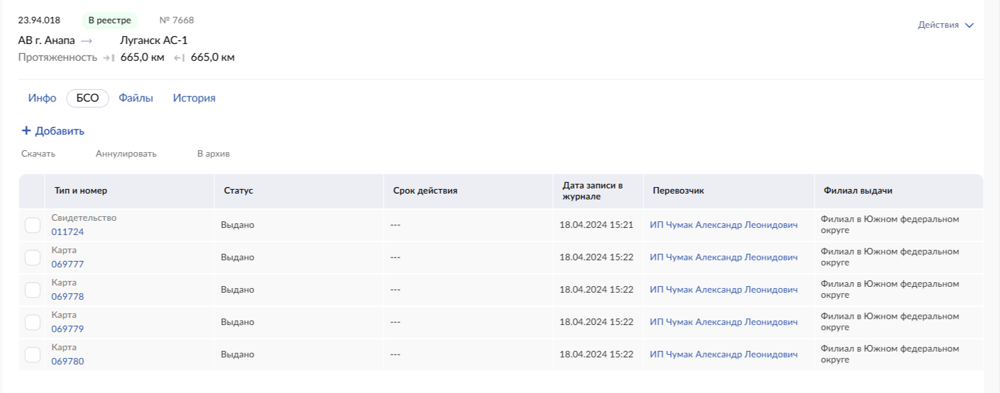

Рисунок - 

-   в табличном виде отображается список свидетельств об осуществлении перевозок по данному маршруту и карт данного маршрута с указанием типа и номера, статуса, срока действия, даты записи в журнале, перевозчика и филиала выдачи; название ЮЛ/ИП перевозчика отображается в виде ссылки, при нажатии на которую в том же окне выполняется переход в раздел «Организации» и открывается карточка организации-перевозчика (для открытия карточки в новом окне необходимо нажать на ссылке правую кнопку мыши, в выпадающем меню выбрать «Открыть ссылку в новой вкладке»);
-   в столбце «Тип и номер» при наведении курсора на строку появляется значок, при нажатии на который в буфер обмена копируется номер БСО, указанный в строке, и появляется сообщение «Успешно. Скопировано»; номер БСО в строке отображается в виде ссылки, при нажатии на которую в том же окне выполняется переход в раздел «Журнал БСО» и открывается карточка БСО (для открытия карточки в новом окне необходимо нажать на ссылке правую кнопку мыши, в выпадающем меню выбрать «Открыть ссылку в новой вкладке»)

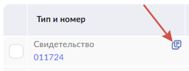

Рисунок - 

-   в таблице можно выделить одну или несколько строк, поставив отметки в первом столбце таблицы;
-   для выделенных в таблице свидетельств и карт доступны действия, ссылки на которые отображаются над верхней строкой таблицы:
-   «Скачать» - для экспорта файла в формате pdf;
-   «Аннулировать» (если в поле «Статус» значение «Выдано») - бланку присваивается статус «Аннулировано», он становится недействительным;
-   «В архив» - для перевода бланка в состояние «Архив», при нажатии в открывшемся окне «В архив» в поле «Причина» выбрать из выпадающего списка одно из значений «утерян/испорчен» или «брак», или ввести причину вручную; указанная причина отображается в поле «Причина переноса в архив» в карточке БСО.

После определения потребности в изготовлении новых БСО для маршрута выполняется создание новых БСО на вкладке «БСО» карточки маршрута. Работа с БСО на всех этапах его движения описана в разделе «Ведение журнала БСО».

На вкладке «Файлы» отображается список файлов документов, прилагаемых к маршруту при работе с заявлениями об установлении/изменении/отмене маршрута:

-   согласование в письменной форме от перевозчиков, осуществляющих регулярные перевозки по ранее установленным межрегиональным маршрутам регулярных перевозок.

Для каждого файла отображается название файла, дата добавления, кем добавлен (ФИО), тип документа, дополнительная информация, указанная при добавлении файла.

Название файла отображается в виде ссылки, при нажатии на которую выполняется скачивание файла в папку загрузки компьютера.

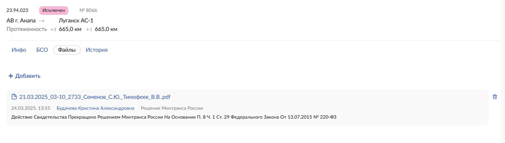

Рисунок - Вкладка «Файлы» карточки маршрута

Для добавления файла необходимо выполнить следующую последовательность действий:

-   нажать ссылку «+Добавить»,
-   в открывшемся окне «Добавить файл» в поле «Тип» выбрать из выпадающего списка одно из предлагаемых значений,
-   при необходимости в поле «Описание» ввести дополнительную информацию (будет отображаться на вкладке «Файлы» под названием файла),
-   загрузить файл (нажать ссылку «Загрузить», в открывшемся окне проводника выбрать файл и нажать «Открыть» или перетащить файлы в область загрузки окна).

Для удаления файла необходимо нажать на значок , расположенный справа напротив названия файла.

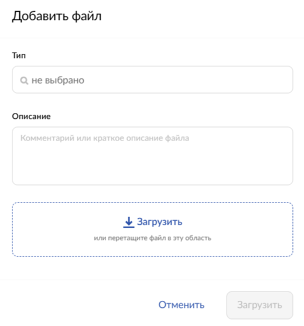

Рисунок - Окно «Добавить файл»

На вкладке «История» отображаются записи о всех действиях с маршрутом в Системе с указанием даты и времени действия, исполнителя (если действие совершил пользователь), названия действия, дополнительной информации.

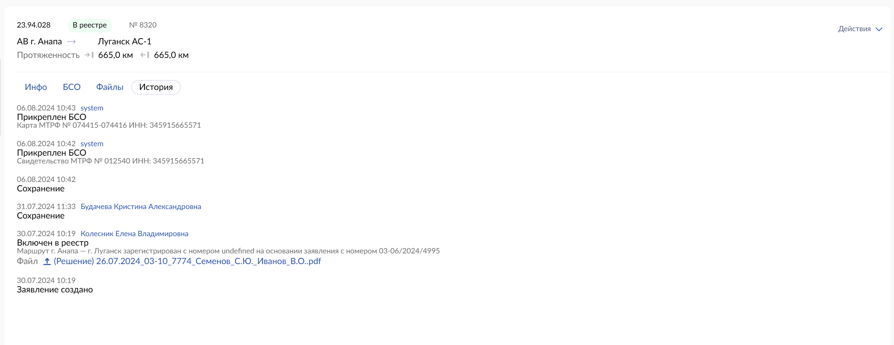

Рисунок - Вкладка «История» карточки маршрута

### Карточка международного маршрута

Карточка межрегионального маршрута содержит вкладки «Инфо», «БСО» «Файлы», «История».

На вкладке «Инфо» отображаются следующие сведения:

-   срок начала осуществления регулярных перевозок по маршруту (не может превышать девяносто дней со дня выдачи российскому или иностранному перевозчику карт международного маршрута регулярных перевозок);
-   срок окончания осуществления регулярных перевозок по маршруту (срок осуществления перевозок по маршруту - до пяти лет);
-   сведения о перевозчике, предоставившем заявление - название ЮЛ/ИП отображается в виде ссылки, при нажатии на которую в том же окне выполняется переход в раздел «Организации» и открывается карточка организации перевозчика, предоставившего заявление (для открытия карточки в новом окне необходимо нажать на ссылке правую кнопку мыши, в выпадающем меню выбрать «Открыть ссылку в новой вкладке»);
-   протяженность маршрута - измеряется в километрах;
-   сезонность - указаны начало и окончание летнего и зимнего периодов или признак круглогодичности;
-   наименования остановочных пунктов, их места нахождения, наименования и места расположения соответствующих автовокзалов, автостанций;
-   расписание для каждого ОП и пункта пропуска через Государственную границу Российской Федерации с указанием наименований ОП, дня недели (в случае, если рейс не выполняется ежедневно), наименования российского или иностранного перевозчика, который выполняет рейс, в прямом и обратном направлениях - название ОП отображается в виде ссылки, при нажатии на которую в том же окне открывается карточка ОП в разделе «Остановочные пункты» (для открытия карточки в новом окне необходимо нажать на ссылке правую кнопку мыши, в выпадающем меню выбрать «Открыть ссылку в новой вкладке»);
-   сведения об автомобильных дорогах и улицах на территориях Российской Федерации и иностранных государств, по которым предполагается движение ТС между ОП - отображаются списком с указанием наименования и местоположения каждой автомобильной дороги и улицы;
-   сведения о ТС, которые могут выполнять маршрут - список классов ТС с указанием для каждого класса: максимального количества ТС, максимальных высоты и ширины ТС, полной массы и экологических характеристик (эко-класса) ТС.

На вкладке «Файлы» отображается список файлов документов, прилагаемых к маршруту при работе с заявлениями об установлении/изменении/отмене маршрута:

-   заверенная российским или иностранным перевозчиком копия соглашения о совместной эксплуатации маршрута, срок действия которого превышает или равен сроку эксплуатации маршрута, указанному в заявлении об установлении маршрута (в случае осуществления регулярных перевозок несколькими перевозчиками); 
-   заверенные российским или иностранным перевозчиком копии разрешительных документов компетентных органов иностранных государств, по территориям которых проходит маршрут, подтверждающих согласование ими установления маршрута или согласование ими изменения маршрута;
-   переводы разрешительных документов на русский язык, верность которых должна быть удостоверена в установленном законодательством Российской Федерации порядке (в случае наличия указанных документов);
-   согласования предлагаемого изменения маршрута в произвольной форме или его копия, заверенная всеми участниками соглашения о совместной эксплуатации маршрута;
-   согласования в письменной форме от владельцев ОП в случае изменения времени отправления от соответствующего ОП, или если предусматривается остановка ТС в новом ОП.

Порядок действий на вкладке «Файлы» аналогичен приведенному для карточки межрегионального маршрута.

На вкладке «История» отображаются записи о всех действиях с маршрутом в Системе с указанием даты и времени действия, исполнителя (если действие совершил пользователь), названия действия, дополнительной информации.

## Исключение маршрута из реестра

Исключение маршрута из реестра (отмена маршрута) выполняется по решению Минтранса России, если оно поступило в течение 90 дней с момента поступления заявления об отмене маршрута.

Для исключения реестра из реестра доступны только маршруты со статусом «В реестре» или «Включает ОП не из реестра».

Для исключения маршрута из реестра необходимо открыть карточку маршрута, нажать ссылку «Действия» и выбрать «Исключить из реестра».

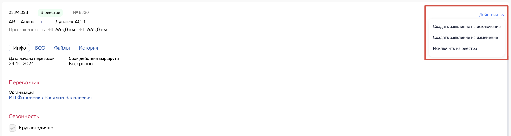

Рисунок - Действия в карточке маршрута

В открывшемся окне «Исключить из реестра»:

-   в полях «Номер» и «Дата» ввести реквизиты документа, на основании которого маршрут исключается из реестра,
-   при необходимости ввести в поле «Описание» дополнительную информацию,
-   загрузить скан-копию документа (нажать ссылку «Загрузить», в открывшемся окне проводника выбрать файл и нажать «Открыть» или перетащить файлы в область загрузки окна),
-   после ввода реквизитов документа и загрузки файла нажать кнопку «Исключить».

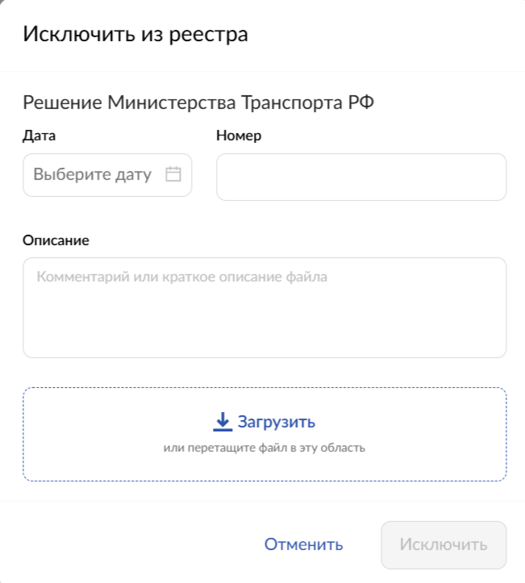

Рисунок - Окно «Исключить из реестра»

Для исключаемых из реестра маршрутов решением Минтранса России необходимо вручную аннулировать все выданные БСО по данному маршруту.

С момента поступления заявления о прекращении действия свидетельства по истечении 90 дней заявлению автоматически присваивается статус «Утверждено» (не дожидаясь ответа по проекту решения от Минтранса России), и маршрут, связанный с заявлением, автоматически переводится в статус «Исключен из реестра»

# Работа с заявлениями на маршруты

## Просмотр реестра заявлений на межрегиональные маршруты

Для просмотра реестра заявлений на межрегиональные маршруты необходимо перейти в раздел «Маршруты», открыть вкладку «Заявления на межрегиональные». Вкладка доступна пользователям с правами «Менеджер по межрегиональным перевозкам».

На вкладке «Заявления на межрегиональные» в левой части страницы отображается список заявлений на добавление/изменение/отмену межрегиональных маршрутов с указанием их статуса, статусы могут быть следующие:

-   «Черновик» - карточка заявления создана в Системе и находится в процессе заполнения заявителем;
-   «На рассмотрении» - карточка заявления создана в Системе и направлена заявителем на рассмотрение, переход к первичной проверке заявления пользователем с ролью «Менеджер по межрегиональным перевозкам»,
-   «В работе» - первичная проверка заявления пройдена успешно, переход к процессу согласований и извещений различных ведомств,
-   «Утверждено» - по заявлению в Системе зарегистрировано положительное решение Минтранса России;
-   «Отклонено» - по заявлению в Системе зарегистрировано отрицательное решение Минтранса России,
-   «Отозвано заявителем» - в Системе зарегистрирован запрос заявителя об отзыве заявления.

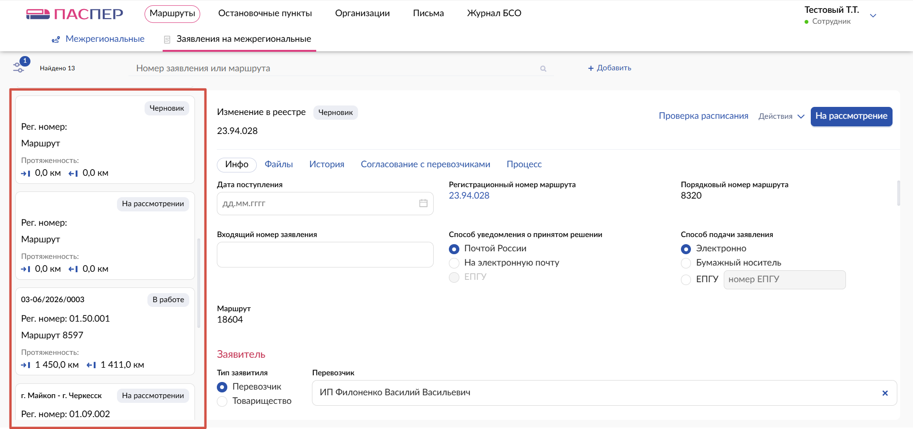

Рисунок - Список заявлений на межрегиональные маршруты

Чтобы посмотреть список заявлений с конкретными статусами, необходимо с помощью кнопки  открыть настройки фильтрации, отметить одно или несколько значений в списке «Статус» и нажать кнопку «Найти».

В верхней части страницы отображается информация о количестве заявлений в списке.

В визитке заявления отображается следующая информация о заявлении маршрута: название маршрута (начальный и конечный пункты), регистрационный номер заявления, номер маршрута, протяженность маршрута в прямом и обратном направлениях, статус заявления.

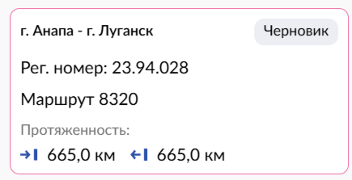

Рисунок - Визитка заявления на межрегиональный маршрут

При нажатии в списке на визитку заявления в основной части страницы отображается карточка заявления с набором параметров в соответствии со статусом заявления.

## Просмотр реестра заявлений на международные маршруты

Для просмотра реестра заявлений на международные маршруты необходимо перейти в раздел «Маршруты», открыть вкладку «Заявления на международные». Вкладка доступна пользователям с правами «Менеджер по международным перевозкам».

На вкладке «Заявления на международные» в левой части страницы отображается список заявлений на добавление/изменение/удаление международных маршрутов с указанием их статуса, статусы могут быть следующие:

-   «Черновик» - карточка заявления создана в Системе и находится в процессе заполнения заявителем;
-   «На рассмотрении» - карточка заявления создана в Системе и направлена заявителем на рассмотрение, переход к первичной проверке заявления пользователем с ролью «Менеджер по международным перевозкам»,
-   «В работе» - первичная проверка заявления пройдена успешно, переход к процессу согласований и извещений различных ведомств,
-   «Утверждено» - по заявлению в Системе зарегистрировано положительное решение Минтранса России;
-   «Отклонено» - по заявлению в Системе зарегистрировано отрицательное решение Минтранса России,
-   «Отозвано заявителем» - в Системе зарегистрирован запрос заявителя об отзыве заявления.

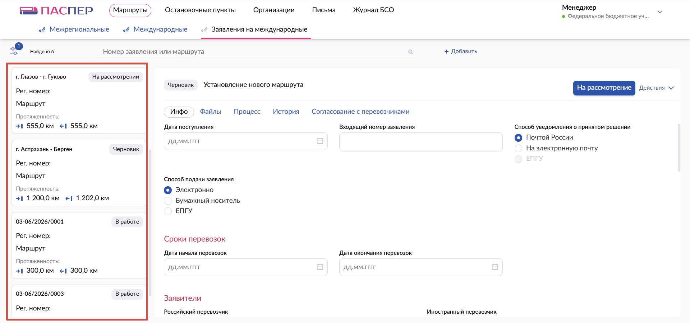

Рисунок - Список заявлений на международные маршруты

Чтобы посмотреть список заявлений с конкретными статусами, необходимо с помощью кнопки  открыть настройки фильтрации, отметить одно или несколько значений в списке «Статус» и нажать кнопку «Найти».

В верхней части страницы отображается информация о количестве заявлений в списке.

В визитке заявления отображается следующая информация о заявлении маршрута: название маршрута (начальный и конечный пункты), регистрационный номер заявления, номер маршрута, протяженность маршрута в прямом и обратном направлениях, статус заявления.

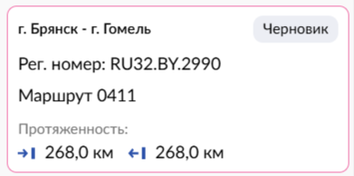

Рисунок - Визитка заявления на международный маршрут

При нажатии в списке на визитку заявления в основной части страницы отображается карточка заявления с набором параметров в соответствии со статусом заявления.

## Поиск заявления в реестре

Для поиска заявления/заявлений в списке можно использовать поисковую строку в верхней части страницы, поисковый запрос может содержать номер или часть номера заявления или маршрута.

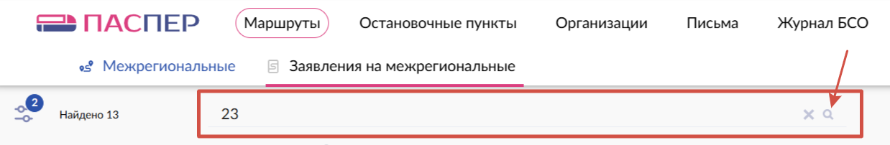

Рисунок - Поисковая строка вкладки «Заявления на межрегиональные» раздела «Маршруты»

Для поиска заявления/заявлений в списке можно использовать настройку параметров фильтрации:

-   «Только активные» - если флаг установлен, то отображаются заявления в статусах «Черновик», «На рассмотрении», «В работе»;
-   «Статус» - выбрать одно или несколько значений статуса заявления;
-   «Дата поступления» - дата входящего письма с заявлением, задать начальную дату и/или конечную дату возможного периода;
-   «Поступило электронно» - если флаг установлен, то отображаются заявления, поданные в Системе перевозчиками;
-   «Вид заявления» - выбрать одно или несколько значений вида заявления: «Установление нового маршрута», «Изменение в реестре», «Прекращение действия свидетельства»;
-   «Регистрационный номер» (на вкладке «Заявления на международные») / «Номер заявления» (на вкладке «Заявления на межрегиональные») - в поле ввести номер или часть регистрационного номера заявления;
-   «Маршрут» (на вкладке «Заявления на международные») / «Номер маршрута» (на вкладке «Заявления на межрегиональные») - в поле ввести номер или часть регистрационного номера маршрута, который указан в заявлении;
-   «Регион» - ввести в поле наименование/часть наименования или код одного из субъектов РФ, по территории которых проходит маршрут, указанный в заявлении;
-   «Страна» (только для заявлений на международные) - ввести в поле наименование/часть наименования или код одного из иностранных государств, по территории которых проходит маршрут, указанный в заявлении;
-   «Остановочный пункт» - нажать на ссылку «+Добавить» и в открывшемся окне ввести наименование/часть наименования или номер/часть номера остановочного пункта, можно добавить несколько ОП, повторно нажимая на «+Добавить»;
-   «Российский перевозчик» (на вкладке «Заявления на международные») / «Перевозчик» на вкладке «Заявления на межрегиональные» - ввести в поле наименование/часть наименования или ИНН ЮЛ или ИП, являющегося перевозчиком по маршруту, указанному в заявлении;
-   «Товарищество» (только для заявлений на межрегиональные) - ввести в поле наименование/часть наименования или ИНН являющегося перевозчиком по маршруту, указанному в заявлении;
-   «Иностранный перевозчик» (только для заявлений на международные) - ввести в поле наименование/часть наименования организации перевозчика по маршруту, указанному в заявлении;
-   «Протяженность, км» - задать начальное значение и/или конечное значение возможного диапазона для маршрута, указанного в заявлении;
-   «Макс. количество ТС, шт.» - задать начальное значение и/или конечное значение возможного диапазона для маршрута, указанного в заявлении, только целые числа;
-   «Срок нахождения в статусе от даты поступления» - для срока нахождения заявления в текущем статусе задать начальное значение и/или конечное значение возможного диапазона в днях от даты поступления заявления;
-   «Номер решения Минтранса» - ввести номер распорядительного документа Минтранса России;
-   «Дата решения Минтранса» - для даты распорядительного документа Минтранса России задать начальную дату и/или конечную дату возможного периода;
-   «Наименование» - ввести название или часть названия маршрута, который указан в заявлении;
-   «Кто взял в работу» - выбрать из предлагаемого списка одного работника, который взял в работу заявление;
-   «Когда взял в работу» - для даты взятия в работу задать начальную дату и/или конечную дату возможного периода;
-   «Кто проверил заявление» (только для заявлений на межрегиональные) – ввести ФИО сотрудника ФБУ «Росавтотранс», работающего с заявлениями;
-   «Более 3 дней в статусе «На рассмотрении» (только для заявлений на межрегиональные) – если флаг установлен, то отображаются заявления, у которых срок от даты установления статуса «На рассмотрении» до текущей даты превышает 3 дня;
-   «Более 45 дней в статусе «В работе» (только для заявлений на межрегиональные) - если флаг установлен, то отображаются заявления, у которых срок от даты установления статуса «В работе» до текущей даты превышает 45 дней;
-   «Проверка сведений (ответ извещения УИО требует уточнения)» (только для заявлений на межрегиональные) - если флаг установлен, то отображаются заявления, у которых во вкладке «Процессы» в блоке «Извещение УИО субъекта РФ» есть письма с полученным ответом и результатом «Проверка предоставленных сведений»;
-   «Более 15 дней на проверке сведений» (только для заявлений на межрегиональные) - если флаг установлен, то отображаются заявления, у которых срок от даты установления признака «Проверка сведений» до текущей даты превышает 45 дней;
-   «Срок рассмотрения заявления 10 дней» (только для заявлений на межрегиональные) - если флаг установлен, то отображаются заявления типа «Изменения в реестре», у которых установлен признак о рассмотрении заявления в 10-ти дневный срок (для таких заявлений не требуется этап извещения УИО, но уведомление УИО о решении Минтранса России нужно), признак устанавливается пользователем с ролью «Менеджер по межрегиональным перевозкам»;
-   «Отсутствует уведомление заявителя о принятом решении» (только для заявлений на межрегиональные) - если флаг установлен, то отображаются заявления, у которых в карточке заявления на вкладке «Файлы» отсутствует документ типа «Уведомление о принятом решении».

Общие правила работы с областью настройки параметров фильтрации приведены ранее в руководстве.

## Открытие карточки заявления

Чтобы открыть карточку заявления, необходимо перейти в раздел «Маршруты», открыть вкладку «Заявления на межрегиональные» / «Заявления на международные», в списке заявлений в левой части страницы найти заявление и нажать на его визитку. В основной части страницы откроется карточка заявления.

Карточка заявления на маршрут содержит следующие сведения:

-   тип выбранного заявления (1);
-   статус выбранного заявления (2);
-   регистрационный номер маршрута (3), если заявление об изменении/прекращении маршрута;
-   на вкладке «Инфо» - информационные поля заявления, которые могут заполняться \\ изменяться как пользователем личного кабинета, так и автоматически;

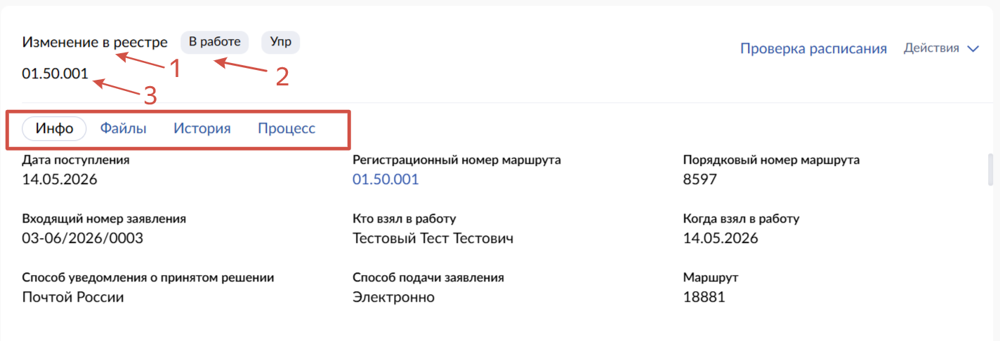

Рисунок - Карточка заявления на маршрут

-   на вкладке «Файлы» - приложенные к заявлению файлы документов, действия на вкладке «Файлы» аналогичны приведенным для карточки межрегионального маршрута;
-   на вкладке «История» - информацию обо всех действиях и изменениях, происходивших с заявлением и полученных в процессе работы с заявлением, с указанием даты и времени, исполнителя (пользователя или Системы), названия действия, дополнительной информации;

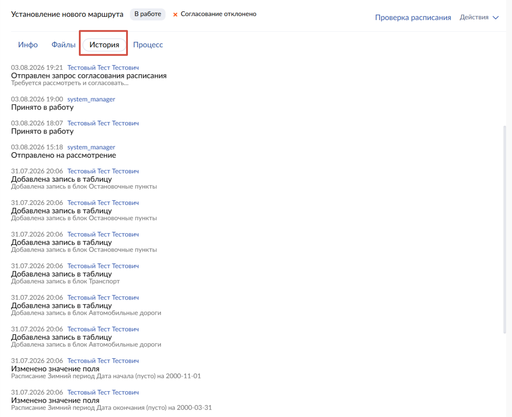

Рисунок - Вкладка «История» карточки заявления

-   на вкладке «Процесс» - информацию об этапах процесса работы по заявлению и результатах по каждому этапу: «Запрос в Ространснадзор по штрафам в области транспорта», «Извещение УИО субъекта РФ», «Повторная проверка», «Проект решения "Минтранс"».

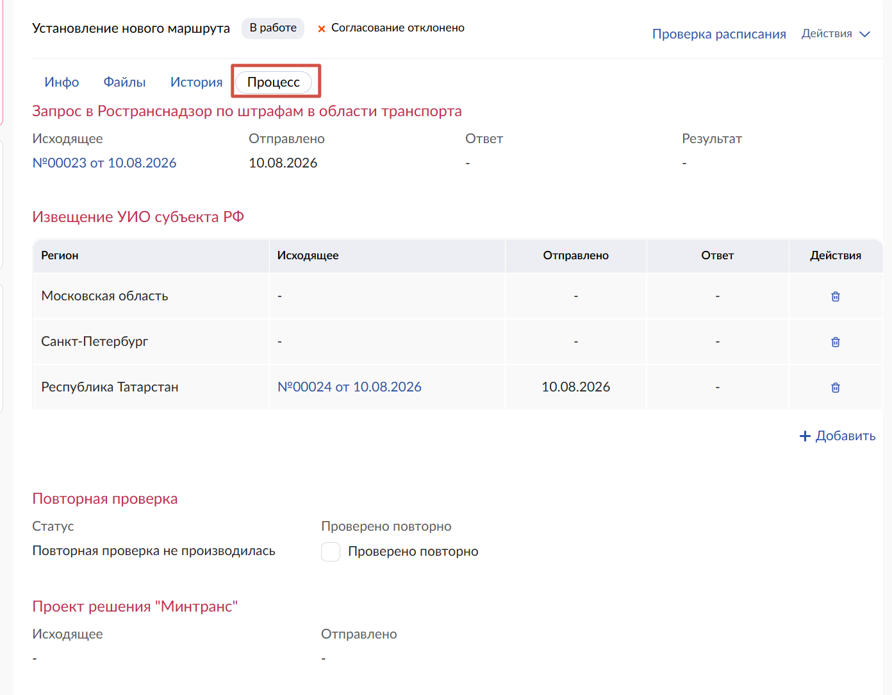

Рисунок - Вкладка «Процесс» карточки заявления

## Создание карточки заявления

Карточка заявления создается в Системе представителем перевозчика с ролью «Заявитель» (состояние заявления «Черновик») и становится доступна пользователю с ролью «Менеджер по межрегиональным перевозкам» / «Менеджер по международным перевозкам» после ее отправки на рассмотрение (состояние заявления «На рассмотрении»). 

Карточка заявления создается в Системе пользователем с ролью «Менеджер по межрегиональным перевозкам» / «Менеджер по международным перевозкам», если заявление поступило от перевозчика входящим письмом в бумажном виде или через ЕПГУ.

Для создания карточки заявления необходимо перейти в раздел «Маршруты», открыть вкладку «Заявления на межрегиональные» / «Заявления на международные» и нажать на ссылку «+Добавить».

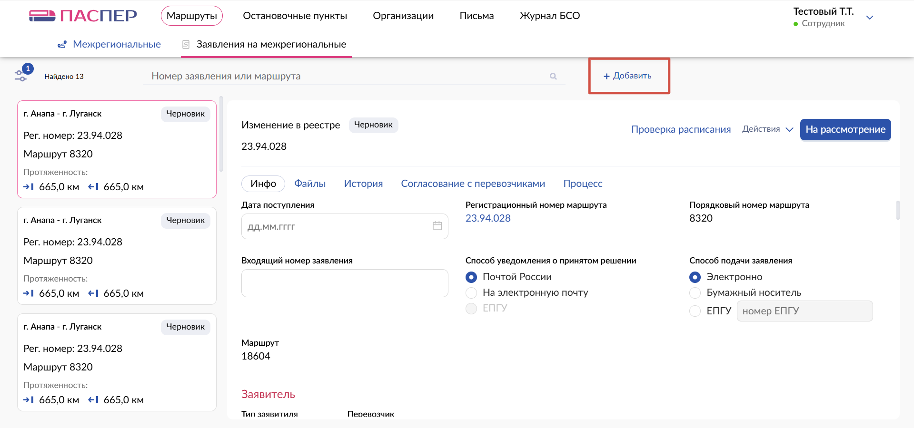

Рисунок - Ссылка «+Добавить» для добавления заявления

Создать карточку заявления об изменении или об исключении маршрута можно из карточки зарегистрированного в реестре маршрута со статусом «В реестре» или «Включает ОП не из реестра», для этого необходимо открыть карточку маршрута и нажать ссылку «Действия», в выпадающем меню выбрать ссылку «Создать заявление на изменение» или «Создать заявление на исключение» соответственно.

В открывшемся окне «Новое заявление» в поле «Тип заявления» выбрать из выпадающего списка одно из предлагаемых значений и нажать «Продолжить».

Рисунок . Окно «Новое заявление»

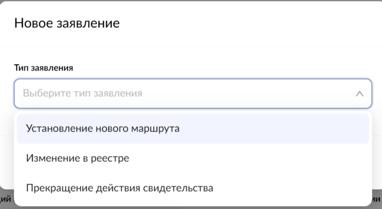

Рисунок - Возможные значения типа заявления

Если выбраны типы заявления «Изменение в реестре» или «Прекращение действия свидетельства», то в появившемся поле «Маршрут» необходимо выбрать из предлагаемого списка регистрационный номер маршрута и нажать «Продолжить».

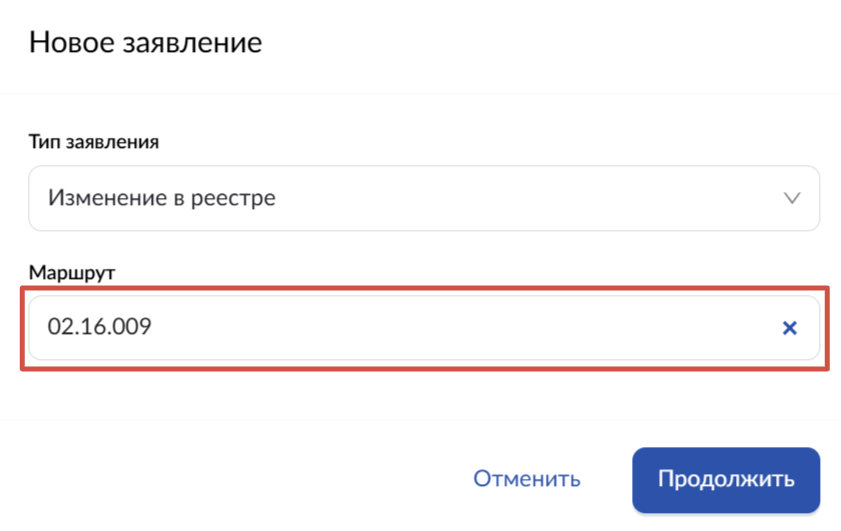

Рисунок - Выбор заявляемого маршрута для изменения или исключения

После нажатия «Продолжить» на странице откроется новая карточка заявления в статусе «Черновик».

Далее необходимо заполнить значения параметров заявления на вкладке «Инфо».

ВНИМАНИЕ! Для сохранения введенных данных в новой карточке необходимо использовать кнопку «Сохранить». Введенные данные автоматически не сохраняются.

На вкладке «Файлы» при необходимости добавить скан-копии прилагаемых к заявлению документов, например, скан-копию оригинала поданного заявления (если заявление поступило в бумажном виде). Действия по добавлению файлов аналогичны действиям для карточки маршрута, описание приведено ранее в руководстве.

На вкладке «Согласование с перевозчиками» можно добавить скан-копии документов, подтверждающих согласование расписания с другими перевозчиками, если такие документы предоставлены перевозчиком в бумажном виде.

Карточку заявления в статусе «Черновик» можно удалить, для этого необходимо нажать ссылку «Действия», в выпадающем меню нажать ссылку «Удалить заявление».

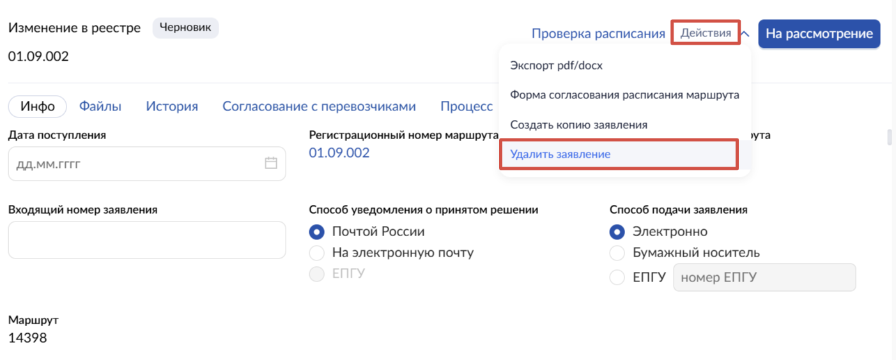

Рисунок - Удаление заявления в статусе «Черновик»

Если все параметры карточки заполнены/изменены, то для дальнейшей отправки заявления по маршруту необходимо в такой карточке нажать кнопку «На рассмотрение».

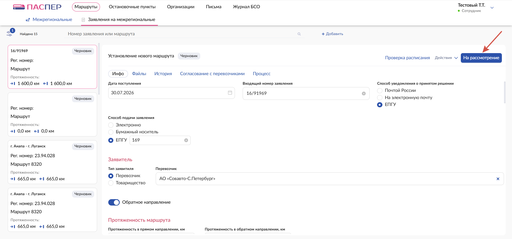

Рисунок - Кнопка «На рассмотрение» в карточке заявления

После нажатия кнопки «На рассмотрение» отображается окно с запросом подтверждения, в котором необходимо нажать кнопку «Установить».

Рисунок - Окно «Установить статус «На рассмотрении»

## Заполнение заявления на межрегиональный маршрут

На вкладке «Инфо» новой карточки заявления на межрегиональный маршрут необходимо заполнить / изменить значения следующих параметров:

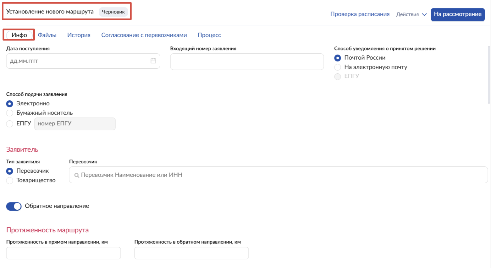

Рисунок - Фрагмент вкладки «Инфо» новой карточки заявления на установление нового межрегионального маршрута

1.  «Дата поступления» – дата входящего письма с заявлением;
2.  «Входящий номер заявления» – номер входящего письма с заявлением;
3.  «Способ подачи заявления» - выбрать одно из значений:

«Электронно» - если заявление создано в Системе перевозчиком;

«Бумажный носитель» - если заявление поступило входящим письмом экспедицией;

«ЕПГУ» - если заявление поступило через Единый портал государственных и муниципальных услуг Российской Федерации, далее в поле «номер ЕПГУ» ввести номер заявления, под которым оно зарегистрировано на ЕПГУ;

4.  «Способ уведомления о принятом решении» - способ получения уведомлений о решениях Минтранса России; выбрать одно из значений:

«Почтой России» – если решение Минтранса России по заявлению в адрес заявителя необходимо отправить в бумажном виде;

«На электронную почту» - если решение Минтранса России по заявлению в адрес заявителя необходимо отправить в электронном виде;

«ЕПГУ» - устанавливается автоматически и доступно для выбора только в случае, если в «Способ подачи заявления» выбрано значение «ЕПГУ», и недоступно для выбора, если в «Способ подачи заявления» выбраны значения, отличные от «ЕПГУ»;

5.  «Тип заявителя» - выбрать одно из значений: «Перевозчик» или «Товарищество», в поле рядом начать вводить название или ИНН перевозчика / товарищества, выбрать значение из предлагаемого списка;
6.  «Обратное направление» - если маршрут, указанный в заявлении, имеет прямое и обратное направление, то передвинуть переключатель вправо (включить); при обратном переключении отображается окно с запросом подтверждения, если необходимо оставить только прямое направление, то нажать кнопку «Выключить»;

Рисунок - Окно «Подтвердите выключение обратного направления»

7.  «Протяженность маршрута» - ввести в соответствующие поля значения протяженности маршрута в километрах в прямом направлении и, если переключатель «Обратное направление» включен, то в обратном направлении;

-   **блок «Расписание»** - планируемое расписание для каждого остановочного пункта и пункта пропуска через Государственную границу Российской Федерации (по международному маршруту):

8.  заполнить таблицу с ОП на маршруте, который указан в заявлении, для этого:

в первой строке в столбце «Название остановки» начать вводить название/часть названия города или код региона начального ОП, выбрать значение из предлагаемого списка; чтобы очистить строку, нажать значок ;

если в заявлении указано больше двух ОП на маршруте, то нажать ссылку «+ Добавить ОП» и в первой пустой строке в столбце «Название остановки» выбрать следующий ОП;

добавлять ОП, пока не останется конечный ОП,

конечный ОП выбрать в последней строке таблицы;

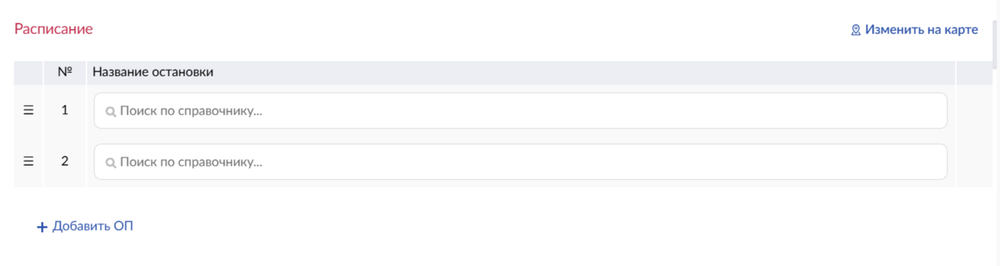

Рисунок - Таблица ОП на вкладке «Инфо» в новой карточке заявления

для заполнения таблицы с ОП можно использовать режим карты, для перехода в режим нажать ссылку «Изменить на карте, на странице откроется изображение карты с отмеченными ОП: красным цветом отмечаются ОП заявленного маршрута, синим цветом отмечены все возможные для выбора ОП; для включения ОП в маршрут необходимо нажать на его синюю метку, после чего она изменит цвет на красный;

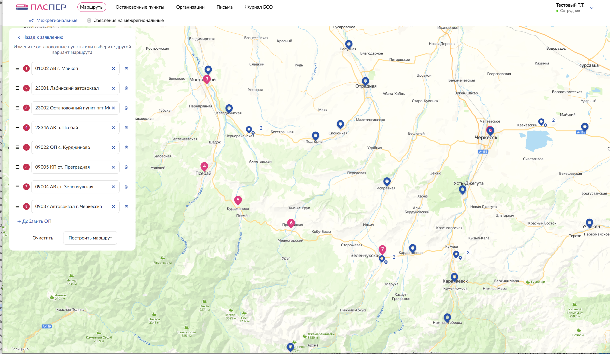

Рисунок - Формирование списка ОП в режиме карты для межрегионального маршрута

для удаления строки ОП в таблице нажать значок  в удаляемой строке, после нажатия отображается окно с запросом подтверждения, в котором нажать кнопку «Удалить»;

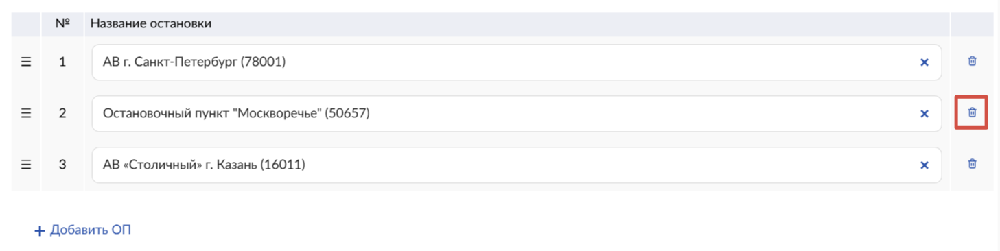

Рисунок - Заполненная таблица ОП на вкладке «Инфо» в новой карточке заявления на межрегиональный маршрут

Рисунок - Окно «Подтвердите удаление ОП»

9.  признак «Круглогодично» – если маршрут, указанный в заявлении, круглогодичный, то передвинуть переключатель вправо (включить); если необходимо выделить зимний и летний период, то передвинуть переключатель влево (выключить) и ввести начало и окончание летнего и/или зимнего периодов (далее можно ввести разные расписания для двух периодов); если необходимо оставить один период, то у второго надо снять отметку, при снятии отметки отображается окно с запросом подтверждения, в котором нажать кнопку «Выключить»;

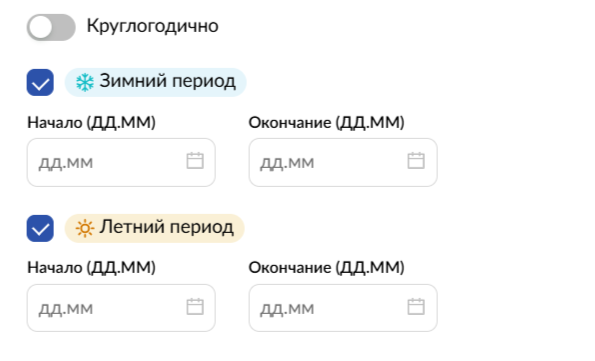

Рисунок - Блок сезонности на вкладке «Инфо» в новой карточке заявления на межрегиональный маршрут

Рисунок - Окно с запросом подтверждения

10. таблицы расписания по каждому выбранному направлению (прямое и/или обратное) для каждого выбранного периода (зимний и/или летний):

для каждого ОП необходимо нажать ссылку «+ Добавить рейс», в появившихся полях выбрать периодичность и ввести время отправления и прибытия; для выбора периодичности доступны значения: ежедневно, по четным, по нечетным, интервал, по дням недели, по дням месяца; для промежуточных ОП можно выбрать значение «нет посадки»;

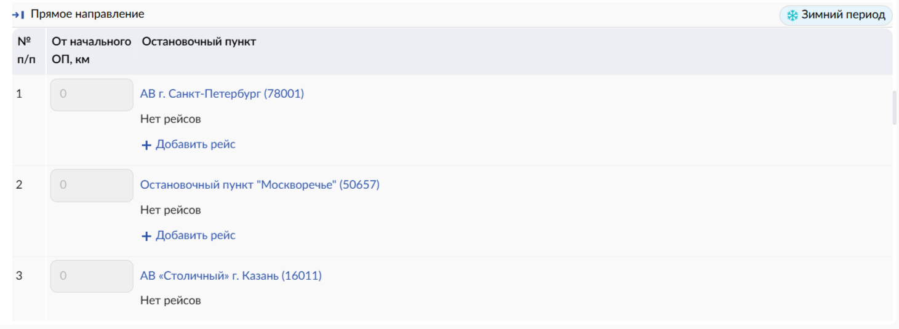

Рисунок - Таблица с расписанием по направлению в выбранный период

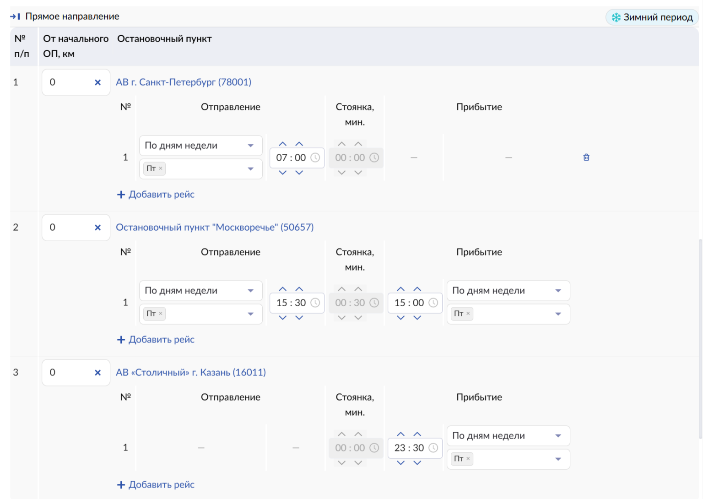

Рисунок - Пример заполнения параметров рейса для ОП межрегионального маршрута

- **блок «Автомобильные дороги/улицы»**:
11.  в таблицах необходимо сформировать список автомобильных дорог и улиц на территориях Российской Федерации, по которым предполагается движение ТС между ОП, в прямом и обратном направлениях:

в первой строке таблицы ввести название в столбец «Наименование дороги/улицы»;

для добавления строк в таблицу необходимо использовать ссылку «+ Добавить автомобильную дорогу/улицу»;

таблицу расписания по обратному направлению можно заполнить на основании заполненной таблицы по прямому направлению, для этого необходимо нажать на ссылку «Скопировать из прямого направления»;

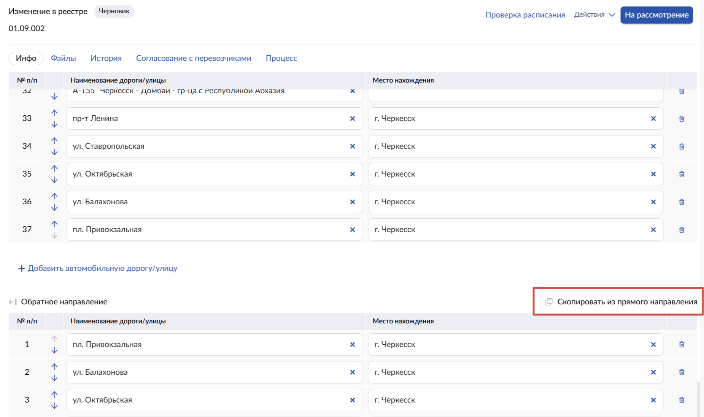

Рисунок 45 - Заполнение таблиц блока «Автомобильные дороги/улицы» для межрегионального маршрута

-   **блок «Транспортные средства»**:
12. в таблице необходимо сформировать список всех классов ТС, которые могут выполнять маршрут, с указанием для каждого класса: максимального количества ТС, максимальных высоты и ширины ТС, полной массы и эко-класса ТС; для добавления строк в таблицу необходимо использовать ссылку «+ Добавить класс»;

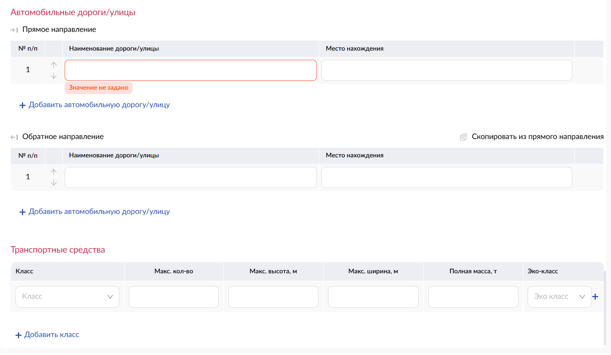

Рисунок - Блоки «Автомобильные дороги/улицы» и «Транспортные средства» новой карточки заявления межрегионального маршрута

## Заполнение заявления на международный маршрут

В заявлении об изменении международного маршрута недоступны для изменения сведения о наименованиях начального и конечного ОП, улиц и автомобильных дорог, расположенных на территории иностранного государства.

На вкладке «Инфо» новой карточки заявления на международный маршрут необходимо заполнить / изменить значения следующих параметров:

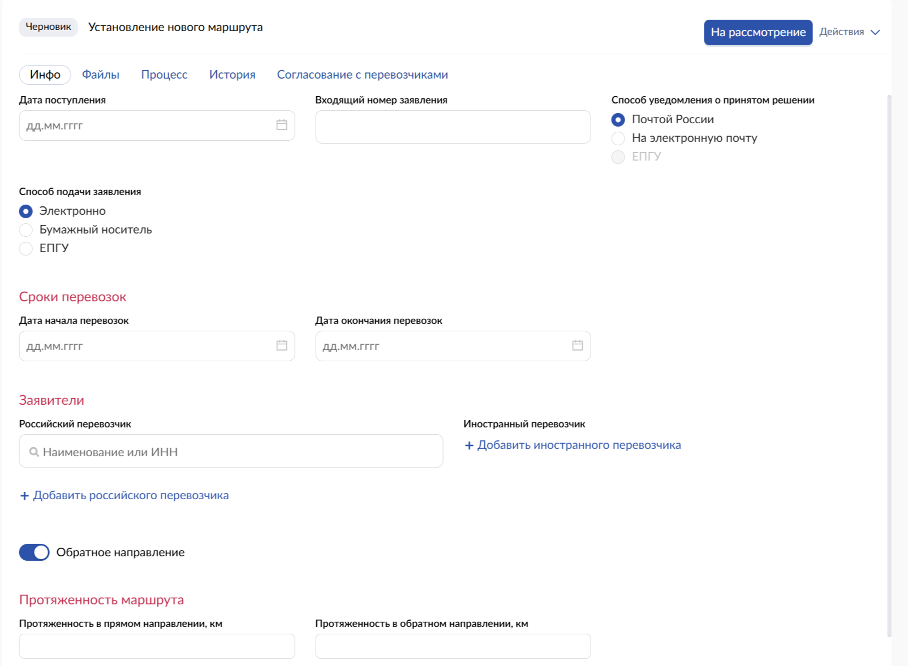

Рисунок - Фрагмент вкладки «Инфо» новой карточки заявления на установление нового международного маршрута

1.  «Дата поступления» – дата входящего письма с заявлением;
2.  «Входящий номер заявления» – номер входящего письма с заявлением;
3.  «Способ подачи заявления» - выбрать одно из значений:

«Электронно» - если заявление создано в Системе перевозчиком;

«Бумажный носитель» - если заявление поступило входящим письмом экспедицией;

«ЕПГУ» - если заявление поступило через Единый портал государственных и муниципальных услуг Российской Федерации, далее в поле «номер ЕПГУ» ввести номер заявления, под которым оно зарегистрировано на ЕПГУ;

4.  «Способ уведомления о принятом решении» - способ получения уведомлений о решениях Минтранса России; выбрать одно из значений:

«Почтой России» – если решение Минтранса России по заявлению в адрес заявителя необходимо отправить в бумажном виде;

«На электронную почту» - если решение Минтранса России по заявлению в адрес заявителя необходимо отправить в электронном виде;

«ЕПГУ» - устанавливается автоматически и доступно для выбора только в случае, если в «Способ подачи заявления» выбрано значение «ЕПГУ», и недоступно для выбора, если в «Способ подачи заявления» выбраны значения, отличные от «ЕПГУ»;

- блок «Сроки перевозок»:

5.  «Дата начала перевозок» и «Дата окончания перевозок» - указать начало и окончание периода, в течение которого планируется осуществлять международные перевозки по маршруту;
-  **блок «Заявители»:**
1.  «Российский перевозчик» - ЮЛ/ИП/товарищество, зарегистрированные в РФ и осуществляющие перевозку по маршруту; в поле начать вводить название или ИНН ЮЛ/ИП, выбрать значение из предлагаемого списка; если требуется указать несколько перевозчиков, то для ввода каждого дополнительного необходимо использовать ссылку «+ Добавить российского перевозчика»;
2.  «Иностранный перевозчик» - иностранная фирма, осуществляющая перевозку по маршруту; нажать на ссылку «+ Добавить иностранного перевозчика», в появившемся поле начать вводить название/часть названия фирмы, выбрать значение из предлагаемого списка; для удаления сведений об иностранном перевозчике нажать на значок  ; если требуется указать несколько перевозчиков, то для ввода каждого дополнительного необходимо использовать ссылку «+ Добавить иностранного перевозчика»;

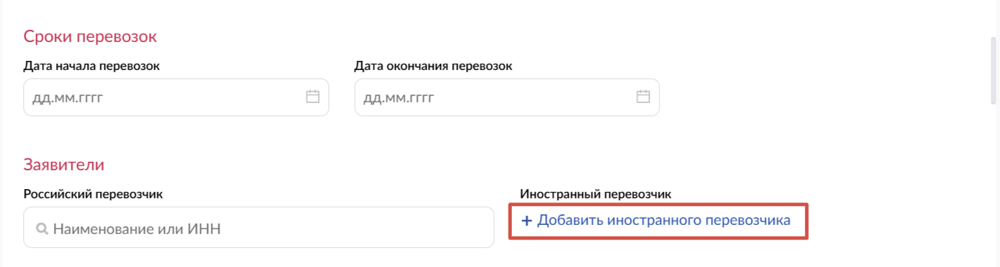

Рисунок - Блок «сроки перевозок» и «Заявители» для международного маршрута

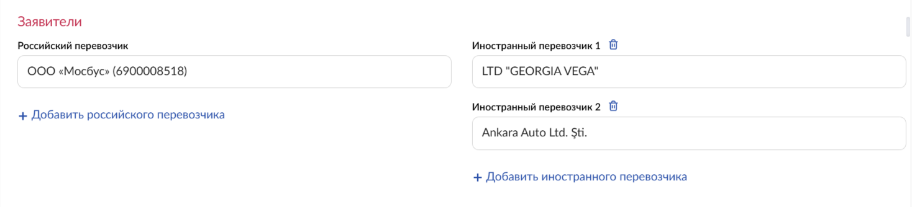

Рисунок - Добавление и удаление заявителей для международного маршрута

1.  «Обратное направление» - если маршрут, указанный в заявлении, имеет прямое и обратное направление, то передвинуть переключатель вправо (включить); при обратном переключении отображается окно с запросом подтверждения, если необходимо оставить только прямое направление, то нажать кнопку «Выключить»;

Рисунок - Окно «Подтвердите выключение обратного направления»

10.  «Протяженность маршрута» - ввести в соответствующие поля значения протяженности маршрута в километрах в прямом направлении и, если переключатель «Обратное направление» включен, то в обратном направлении;

-   **блок «Маршрут»** - планируемое расписание для каждого остановочного пункта и пункта пропуска через государственную границу Российской Федерации:

11.  заполнить таблицу с ОП на маршруте, который указан в заявлении, для этого:

в первой строке в столбце «Остановочный пункт» начать вводить название/часть названия города или региона начального ОП, выбрать значение из предлагаемого списка;

если в заявлении указано больше двух ОП на маршруте, то нажать ссылку «+ Добавить остановочный пункт» и в первой пустой строке в столбце «Остановочный пункт» выбрать следующий ОП;

добавлять ОП, пока не останется конечный ОП,

конечный ОП выбрать в последней строке таблицы;

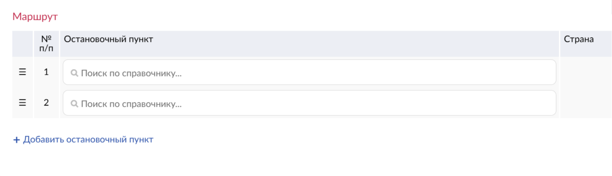

Рисунок - Таблица ОП на вкладке «Инфо» в новой карточке заявления на международный маршрут

для удаления ОП в таблице нажать значок  в удаляемой строке, после нажатия отображается окно с запросом подтверждения, в котором нажать кнопку «Удалить»;

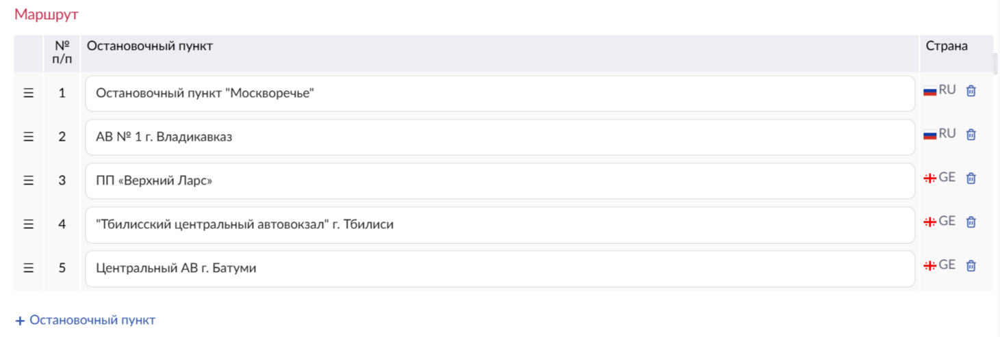

Рисунок - Заполненная таблица ОП на вкладке «Инфо» в новой карточке заявления на международный маршрут

Рисунок - Окно «Подтвердите удаление ОП»

14.   признак «Круглогодично» – если маршрут, указанный в заявлении, круглогодичный, то передвинуть переключатель вправо (включить); если необходимо выделить зимний и летний период, то передвинуть переключатель влево (выключить), настройка периодов выполняется аналогично заявлению на межрегиональный маршрут;
15.   таблицы расписания для каждого перевозчика по каждому выбранному направлению (прямое и/или обратное) для каждого выбранного периода (круглогодичный/зимний и/или летний):

для каждого ОП необходимо нажать ссылку «+ Добавить рейс», в появившихся полях выбрать периодичность и ввести время отправления и прибытия, возможные значения периодичности: ежедневно, по четным, по нечетным, интервал, по дням недели, по дням месяца; для промежуточных ОП можно выбрать значение «нет посадки»;

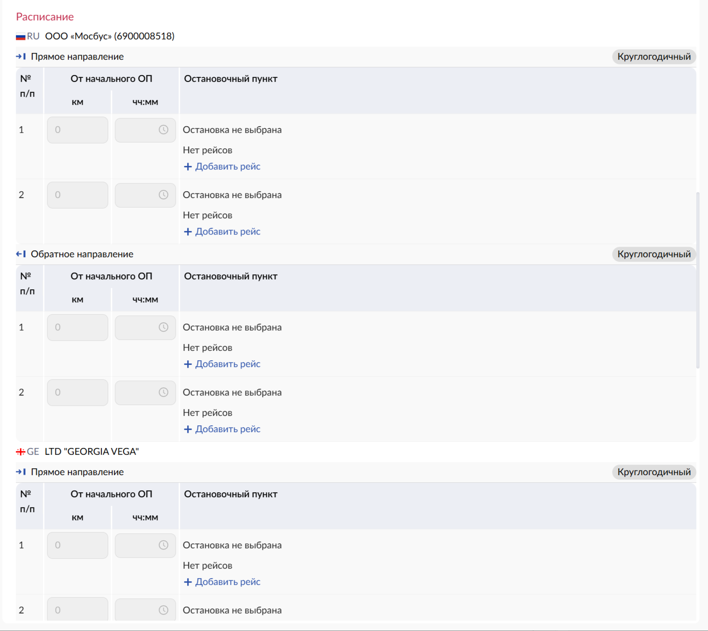

Рисунок - Таблицы для расписания по перевозчикам и по направлениям в выбранный период

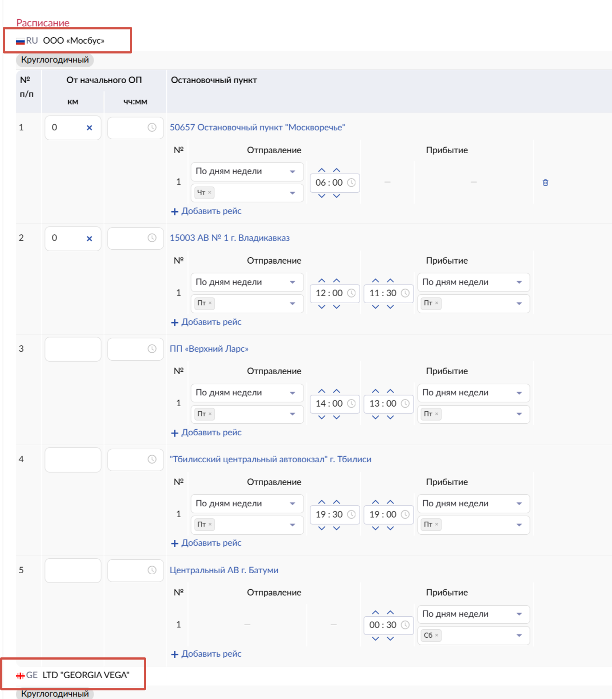

Рисунок - Пример заполнения параметров рейса для ОП и АПП на международном маршруте

-  **блок «Автомобильные дороги/улицы»**:
16.  для каждого направления (прямого и обратного) в отдельных таблицах необходимо сформировать список автомобильных дорог и улиц на территориях Российской Федерации и иностранных государств, по которым предполагается движение ТС между ОП:

в первой строке таблицы ввести название в столбец «Наименование дороги/улицы», в столбце «Страна» начать ввод названия страны, выбрать значение из предлагаемого списка;

для добавления строк в таблицу необходимо использовать ссылку «+ Добавить автомобильную дорогу/улицу»;

таблицу расписания по обратному направлению можно заполнить на основании заполненной таблицы по прямому направлению, для этого необходимо нажать на ссылку «Скопировать из прямого направления»;

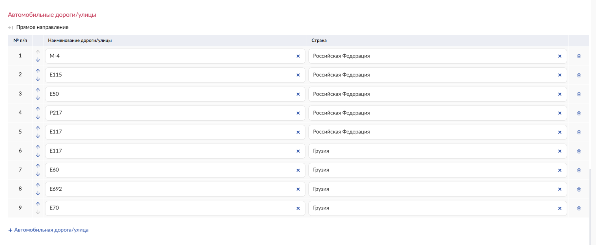

Рисунок - Блок «Автомобильные дороги/улицы» для международного маршрута

-  **блок «Тариф»:**
17.   в таблице необходимо сформировать список всех тарифов, действующих на маршруте с указанием для каждого тарифа: ОП посадки, ОП высадки, размер и денежную единицу пассажирского тарифа, размер и денежную единицу тарифа багажа за 1 кг; для добавления строк в таблицу необходимо использовать ссылку «+ Тариф»;

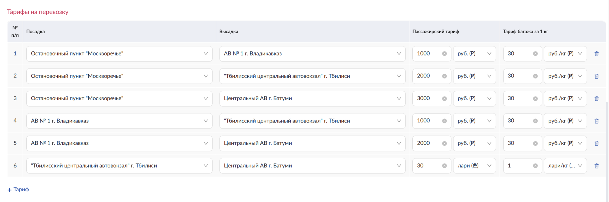

Рисунок - Заполнение таблиц блока «Тариф» для международного маршрута

-  **блок «Транспортные средства»**:
18.  для каждого перевозчика, указанного в маршруте, в отдельной таблице необходимо сформировать список всех классов ТС, которые могут выполнять маршрут, с указанием для каждого класса: максимального количества ТС, эко-класса ТС; для добавления строк в таблицу необходимо использовать ссылку «+ Класс ТС»;

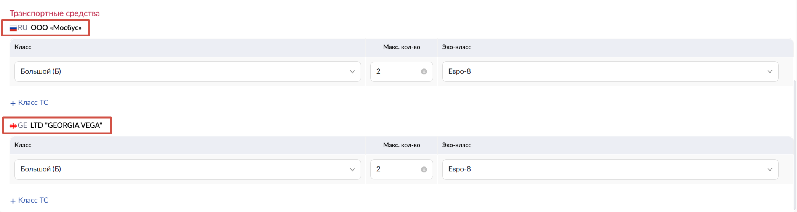

Рисунок - Блок «Транспортные средства» новой карточки заявления на международный маршрут

## Сохранение карточки заявления

Для сохранения внесенных данных в карточке заявления требуется нажать кнопку «Сохранить». Кнопка появляется после ввода любого первого значения.

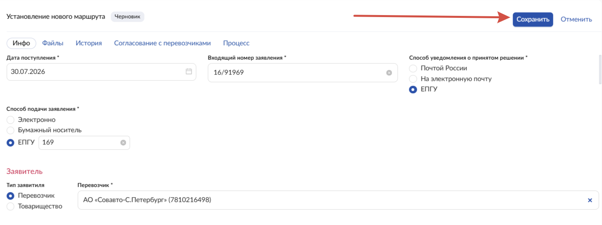

Рисунок - Кнопка «Сохранить» в новой карточке заявления

Если не все обязательные поля заполнены, выдается сообщение об ошибке.

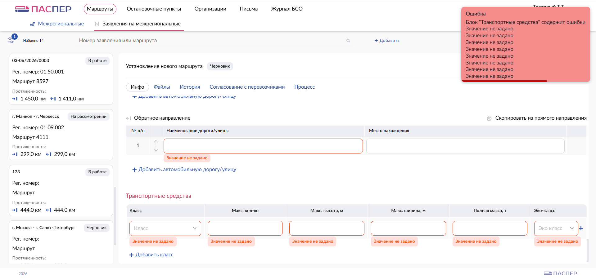

Рисунок - Сообщение об ошибке после нажатия кнопки «Сохранить»

## Рассмотрение заявления на маршрут

Для поиска всех карточек реестра в статусе «На рассмотрении» необходимо в области настройки параметров фильтрации для параметра «Статус» отметить значение «На рассмотрении», нажать кнопку «Найти».

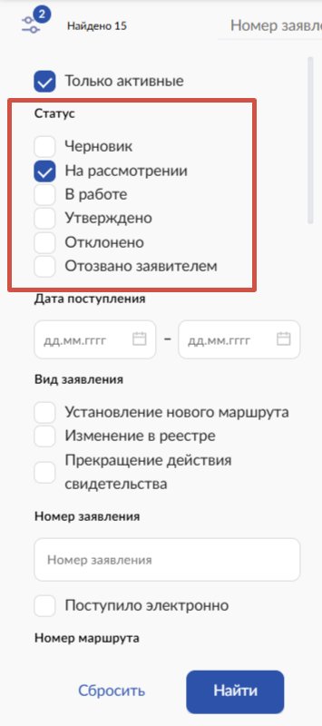

Рисунок - Выбор всех карточек заявления в статусе «На рассмотрении»

На этапе рассмотрения требуется выполнить предварительную проверку заявления на соответствие требованиям положений частей 1-3 статьи 5 и обязательств части 8 статьи 29 ФЗ-220.

Если в результате предварительной проверки заявления выявлены несоответствия, требующие его доработки, то необходимо отправить карточку заявления выступающему в качестве заявителя перевозчику, для этого необходимо нажать на ссылку «Действия» и выбрать в выпадающем меню действие «На доработку».

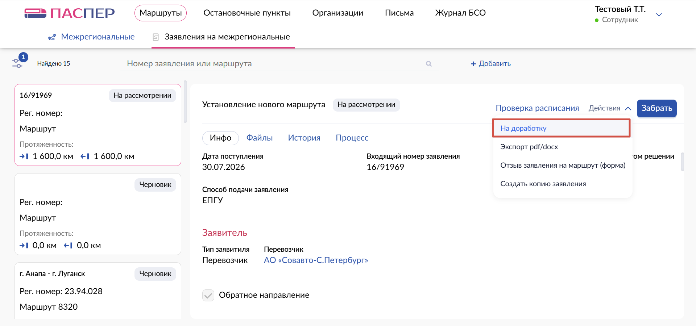

Рисунок - Выбор действия «На доработку»

В открывшемся окне «Вернуть в черновик» в поле «Комментарий» указать недостатки, требующие устранения, и нажать кнопку «Вернуть». Статус карточки изменяется на «Черновик». В адрес перевозчика, выступающего в качестве заявителя, автоматически формируется и отправляется по электронной почте уведомление о результатах проверки с перечнем выявленных недостатков, необходимости доработки и повторной подачи заявления.

Рисунок – Окно «Вернуть в черновик»

Отправить на доработку можно только заявления со статусом «На рассмотрении».

Если при проверке заявления несоответствия не выявлены, то необходимо нажать кнопку «Забрать». Происходит автоматическое назначение ответственного по заявлению сотрудника на пользователя, нажавшего кнопку «Забрать»:

-   в верхней части страницы отображается сообщение о результате назначения;
-   в поле «Кто взял в работу» устанавливается ФИО пользователя, который нажал кнопку «Забрать»;
-   в поле «Когда взял в работу» устанавливается дата, когда пользователь нажал кнопку «Забрать»;
-   в поле «Входящий номер заявления» и в шапке карточки отображается автоматически присвоенный номенклатурный номер заявления;
-   в верхней части страницы появляется кнопка «В работу», при этом статус карточки «На рассмотрение» не изменяется.

Рисунок - Назначение ответственного по заявлению сотрудника

В карточке заявления с типом «Изменение в реестре» предусмотрена возможность направить заявление по упрощенному маршруту рассмотрения, который не предусматривает направление заявления на проверку в УИО субъекта РФ. Для этого необходимо нажать кнопку «Упрощенное рассмотрение».

Рисунок - Направление заявления по упрощенному маршруту рассмотрения

В карточке заявления в статусе «На рассмотрение» можно выполнить первичную проверку заявления на пересечение расписания заявленного маршрута с расписаниями маршрутов, ранее утвержденных в реестре (для заявления на установление / изменение маршрута).

В карточке заявления в статусе «На рассмотрение» доступны следующие дополнительные действия:

-   «Экспорт pdf/docx»,
-   «Отзыв заявления на маршрут (форма)»,
-   «Создать копию заявления».

Рисунок - Дополнительные действия с карточкой заявления

Срок рассмотрения заявления отсчитывается от момента отправки заявления на рассмотрение, то есть от нажатия кнопки «На рассмотрение» в карточке заявления.

Срок рассмотрения заявления составляет 3 рабочих дня. Если заявление об изменении межрегионального маршрута регулярных перевозок предусматривает отмену отдельных рейсов по данному маршруту, уменьшение максимального количества ТС отдельных классов и (или) использование ТС меньшего класса, срок рассмотрения указанного заявления не должен превышать 10 рабочих дней.

За 1 день до окончания срока и при превышении времени нахождения карточки заявления в статусе «На рассмотрении» предусмотрена цветовая индикация визитки заявления в списке заявлений и отображение соответствующего уведомления в карточке заявления.

## Отзыв ранее поданного заявления на маршрут

По ранее поданному заявлению на установление/изменение межрегионального маршрута регулярных перевозок, направленному посредством Системы, возможно прекратить рассмотрение, в случае получения соответствующего запроса от заявителя.

Для отзыва заявления из реестра необходимо выполнить следующие действия:

-   открыть в реестре карточку заявления на маршрут, по которому поступил запрос на отзыв, карточка заявления должна быть в статусе «На рассмотрении»;
-   в карточке заявления на маршрут на вкладке «Файлы» добавить скан-копию заявления, по которому отзывается текущее заявление, в поле «Тип» выбрать «Прочее»;
-   в карточке заявления на маршрут нажать ссылку «Действия», в выпадающем меню нажать ссылку «Отзыв заявления на маршрут (форма)».

Рисунок - Отзыв ранее поданного заявления по маршруту

## Перевод заявления в статус «В работе»

Сотруднику, назначенному ответственным по заявлению, необходимо открыть карточку заявления и нажать на кнопку «В работу», в открывшемся окне с запросом подтверждения нажать «Установить». Статус заявления изменится на «В работе».

Рисунок - Окно «Установить статус «В работе»

В карточке заявления в статусе «В работе» требуется выполнить первичную проверку заявления на пересечение расписания заявленного маршрута с расписаниями маршрутов, ранее утвержденных в реестре (для заявлений на установление / изменение маршрута).

В карточке заявления в состоянии «В работе» дополнительно доступны следующие действия:

-   «Экспорт pdf/docx»,
-   «Создать копию заявления».

## Проверка расписания

Для проверки на пересечение расписания необходимо в карточке заявления нажать ссылку «Проверка расписания».

 

Рисунок - Ссылка «Проверка расписания» в карточке заявления

Запуститься процесс автоматической проверки, по результатам которой Система формирует отчет. Отчет с результатами автоматической проверки расписаний отображается в новой вкладке веб-браузера.

В ходе проверки расписания выполняется автоматический поиск маршрутов, зарегистрированных в реестре, имеющих минимальную разницу в расписаниях с заявленным маршрутом (в соответствии с приказом Минтранса России от 24.01.2018 № 27 «Об установлении значений минимальной разницы в расписаниях между временем отправления транспортных средств, предусмотренных частью 1 статьи 7 Федерального закона от 13 июля 2015 г. N 220-ФЗ»).

Рисунок - Отчет по проверке расписания

Отчет по проверке расписания содержит несколько разделов.

1.  Отчет о минимальной разнице в расписании с зарегистрированными маршрутами:

-   при отсутствии зарегистрированных маршрутов с минимальной разницей в расписаниях выводится сообщение «Пересечений с нарушением значений минимальной разницы в расписаниях между временем отправления транспортных средств не найдено!»;
-   при отсутствии заполненных расстояний между остановочными пунктами в заявлении, выводится сообщение «Формирование отчета невозможно. В разделе «Расписание» необходимо заполнить сведения о расстоянии между остановочными пунктами»;
-   если зарегистрированные маршруты с минимальными отклонениями найдены, то в отчете по каждому найденному маршруту отображается:

название и номер маршрута,

ОП, с которыми есть пересечение, с указанием времени отправления, с которым найдено отклонение по интервалу времени;

значение суммарной протяженности совпадающего пути с найденным маршрутом;

значение минимально возможного интервала времени между ОП.

2.  Отчет о режиме работы остановочных пунктов, заявленных в расписании: выводится расписание по всем ОП, включенным в маршрут, а также режим работы на данных ОП. Если заявленное время прибытия или отправления в рамках заявленного маршрута не соответствует режиму работы остановочного пункта, выводится индикация и предупреждение, также индикация выводится, если Система не может однозначно определить режим работы ОП.
3.  Отчет о соблюдении скоростного режима между остановочными пунктами, заявленными в расписании: при наличии нескольких рейсов в заявлении в таблице отчета указывается расчетная скорость, учитывая последовательность рейсов, указанных в расписании.

Если зарегистрированные маршруты с минимальными отклонениями найдены, то необходимо согласование расписания заявленного маршрута с перевозчиками найденных маршрутов. Процесс согласования находится в зоне ответственности перевозчика-заявителя.

Для формирования и отправки уведомления перевозчику-заявителю о необходимости согласования расписания с перевозчиками найденных маршрутов и прикреплении результатов согласования к заявлению необходимо:

-   в карточке заявления проверяемого маршрута использовать действие «Запросить согласование расписания»;
-   в открывшемся окне ввести текст письма с запросом о необходимости согласования и нажать кнопку «Отправить».

Рисунок - Действие «Запросить согласование расписания» в карточке заявления в статусе «В работе»

Рисунок - Окно «Запросить согласование расписания»

Формирование и отправка уведомлений перевозчику-заявителю о необходимости согласования расписания с перевозчиками найденных маршрутов доступны только в статусе заявления «В работе».

После нажатия кнопки «Отправить» в адрес перевозчика автоматически формируется электронное письмо с темой «По Вашему заявлению необходимо добавить согласование расписания» и текстом, введенным в окне «Запросить согласование расписания», которое отправляется по электронной почте перевозчику-заявителю, а в случае товарищества, уполномоченному перевозчику, по адресу, указанному при регистрации организации в реестре.

После отправки уведомления в карточке заявления отображается метка «Запрошены дополнительные согласования» (для всех пользователей, кому доступно заявление). По факту загрузки согласований в карточке заявления отображаются метки «Расписание согласовано» или «Согласование отклонено» (в зависимости от полученных решений согласующих перевозчиков). Описание действий по согласованию расписания в карточке заявления приведено в руководстве пользователя перевозчика.

В случае если хотя бы один из перевозчиков по найденным маршрутам не согласовал заявленный маршрут, в карточке заявления отображается метка «Согласование отклонено».

Рисунок - Метка об отклонении согласования расписания

## Запрос в Ространснадзор

Запрос в Ространснадзор можно сформировать как по одному, так и по нескольким заявлениям, находящимся в статусе «В работе».

Создание и отправка исходящего письма типа «Запрос в Ространснадзор по штрафам в области транспорта» выполняется на вкладке «Исходящие» в разделе «Письма».

После получения ответа Ространснадзора необходимо выполнить действия по его регистрации.

## Согласование с УИО субъектов РФ

Для направления извещений о согласовании маршрутов в УИО субъекта РФ необходимо выполнить следующие действия:

-   перейти в раздел «Письма», открыть вкладку «Исходящие»;
-   на вкладке «Исходящие» для каждого субъета РФ, по территории которого проходит маршрут, создать исходящее письмо типа «Извещение УИО субъекта РФ» и выполнить действия для отправки исходящего письма.

После получения ответа от УИО субъекта РФ необходимо выполнить действия по его регистрации.

Сведения о согласовании с УИО субъектов РФ отображаются в карточке заявления на вкладке «Процесс» в блоке «Извещение УИО субъекта РФ». Столбец «Регион» автоматически предзаполняется названиями субъектов РФ, через которые проходят ОП из блока «Расписание» на вкладке «Инфо».

Для добавления в блок «Извещение УИО субъекта РФ» субъекта РФ (например, если маршрут проходит через территорию субъекта РФ без остановок) необходимо выполнить следующие действия:

-   открыть карточку заявления в статусе «В работе» и перейти на вкладку «Процесс»;
-   на вкладке «Процесс» в блоке «Извещения УИО субъекта РФ» нажать ссылку «Добавить»;

Рисунок - Отправка извещений в УИО субъекта РФ

-   в открывшемся окне «Добавить регионы» в поле «Регионы» выбрать из выпадающего списка субъекты РФ, по территории которых проходит заявленный маршрут и нажать кнопку «Добавить»;

Рисунок - Отправка извещений в УИО субъекта РФ

-   в открывшемся окне «Добавить регионы» в поле «Регионы» выбрать из выпадающего списка субъекты РФ, по территории которых проходит заявленный маршрут и нажать кнопку «Добавить»;

Рисунок - Окно «Добавить регионы»

Если субъекты РФ не добавлены предварительно в карточке заявления на вкладке «Процессы» в блок «Извещения УИО субъекта РФ», то при внесении сведений об отправке исходящего письма и переходе карточки письма в статус «Отправлено» реквизиты исходящих писем добавляются в блок автоматически.

## Запрос в ФСБ России

Запрос в ФСБ России осуществляется только по заявлениям об установлении/изменении международных маршрутов.

Запрос можно сформировать как по одному, так и по нескольким заявлениям, находящимся в статусе «В работе».

Создание и отправка исходящего письма типа «Запрос в ПС ФСБ» выполняется на вкладке «Исходящие» в разделе «Письма».

После получения ответа из ФСБ России необходимо выполнить действия по его регистрации.

## Повторная проверка расписания

Повторная проверка расписания проводится после получения положительных результатов на запрос в Ространснадзор и согласования с УИО субъектов РФ, перед формированием проекта положительного решения Минтранса России.

Повторная проверка расписания выполняется аналогично первичной проверке.

После проведения повторной проверки требуется поставить отметку о ее прохождении, для этого необходимо выполнить следующие действия:

-   открыть карточку заявления в статусе «В работе» и перейти на вкладку «Процесс»;
-   на вкладке «Процесс» в блоке «Повторная поверка» отметить признак «Проверено повторно»;

Рисунок - Отметка о повторной проверке расписания

-   в открывшемся окне с запросом подтверждения нажать кнопку «Подтвердить»;

Рисунок - Окно «Подтвердить повторную проверку»

-   в карточке заявления на вкладке «Процессы» отображается информация о повторной проверке с указанием даты проверки.

Рисунок - Сведения о повторной проверке в карточке заявления на вкладке «Процесс»

## Подготовка и направление проектов решений Минтранса России

Проект решения Минтранса России по заявлению об установлении/изменении маршрута может быть как положительным, так и отрицательным в соответствии с результатами рассмотрения заявления. Для каждого решения предусмотрен тип исходящего письма: «Проект решения Минтранс России положительный» или «Проект решения Минтранс России отрицательный».

Создание и отправка исходящего письма типа «Проект решения Минтранс России положительный» или «Проект решения Минтранс России отрицательный» выполняется на вкладке «Исходящие» в разделе «Письма».

После отправки исходящего письма с проектом решения, в карточке заявления, по которому отправлен проект решения, на вкладке «Процессы» в блоке «Проект решения Минтранса» отображается информация об отправлении с указанием реквизитов письма и даты отправки (дата регистрации отправки в Системе по кнопке «Отправлено»).

Рисунок - Сведения об отправке проекта решения в карточке заявления на вкладке «Процесс»

## Регистрация решений Минтранса России

После получения подписанного решения Минтранса России необходимо выполнить действия по его регистрации в карточке исходящего письма проекта решения.

Если регистрация прошла успешно (карточка исходящего письма в статусе «Зарегистрирован ответ»), то карточка заявления переходит в статус:

-   «Утверждено» - при положительном решении Минтранса России;
-   «Отклонено» – при отрицательном решении Минтранса России.

Рисунок - Заявление в статусе «Утверждено»

Рисунок - Заявление в статусе «Отклонено»

Если заявление на установление маршрута утверждено, то в реестре маршрутов создается связанный с ним маршрут в статусе «В реестре» с характеристиками, которые указаны в заявлении.

## Публикация решений на сайте Минтранса России

Для публикации решения по заявлению на сайте Минтранса России необходимо выполнить следующие действия:

-   открыть карточку заявления в статусе «Утверждено»,
-   нажать на ссылку «Действия», в выпадающем меню выбрать «Экспорт решений на сайт Минтранса»;
-   автоматически формируется и выгружается zip-архив для последующего направления ответственному исполнителю в Минтранс России для дальнейшей публикации на сайте.

Рисунок - Экспорт решений на сайт Минтранса России

## Формирование уведомлений УИО субъектов РФ о принятом решении

## Формирование уведомлений заявителям о принятом решении

# Работа с остановочными пунктами

## Просмотр реестра ОП для межрегиональных маршрутов

Для просмотра реестра остановочных пунктов для межрегиональных маршрутов необходимо перейти в раздел «Остановочные пункты», открыть вкладку «На территории РФ». Вкладка доступна пользователям с правами «Менеджер по межрегиональным перевозкам», «Менеджер по международным перевозкам».

На вкладке «На территории РФ» в левой части страницы отображается список ОП с указанием их статуса, статусы могут быть следующие: «В реестре», «Исключен», «В архиве».

Чтобы посмотреть список маршрутов с конкретными статусами, необходимо с помощью кнопки  открыть настройки фильтрации, отметить одно или несколько значений в списке «Статус» и нажать кнопку «Найти».

В верхней части страницы отображается информация о количестве маршрутов в списке.

Рисунок - Список ОП на территории РФ

В визитке маршрута отображается следующая информация о маршруте: номер заявления на ОП, название ОП, код субъекта РФ, в котором расположен ОП, и статус ОП.

Рисунок - Визитка ОП

При нажатии в списке на визитку в основной части страницы отображается карточка ОП.

## Просмотр реестра ОП для международных маршрутов

Для просмотра реестра остановочных пунктов для международных маршрутов необходимо перейти в раздел «Остановочные пункты», открыть вкладку «Зарубежные». Вкладка доступна пользователям с правами «Менеджер по международным перевозкам».

На вкладке «Зарубежные» список ОП отображается в табличном виде с указанием названия ОП, страны, города и адреса местонахождения.

В верхней части страницы отображается информация о количестве маршрутов в таблице.

Рисунок - Список зарубежных ОП

## Поиск ОП в реестре

Для поиска ОП в списке можно использовать поисковую строку в верхней части страницы.

Поисковый запрос на вкладке «На территории РФ» может содержать номер или часть номера ОП или заявления на ОП.

Поисковый запрос на вкладке «Зарубежные» может содержать часть текста любого столбца таблицы.

Рисунок - Поисковая строка вкладки «На территории РФ» раздела «Остановочные пункты»

Рисунок - Поисковая строка вкладки «Зарубежные» раздела «Остановочные пункты»

Для поиска ОП на вкладке «На территории РФ» можно использовать настройку следующих параметров фильтрации:

-   «Статус» - выбрать одно или несколько значений статуса ОП;
-   «Регистрационный номер» - в поле ввести номер или часть регистрационного номера ОП;
-   «Регион» - ввести в поле наименование/часть названия или код субъекта РФ, в котором расположен ОП;
-   «Страна» (только для международных маршрутов) - ввести в поле наименование/часть названия или код иностранного государства, в котором расположен ОП;
-   «Населенный пункт» - ввести в поле наименование/часть названия населенного пункта, в котором расположен ОП;
-   «Тип» - отметить одно или несколько значений из возможных: «Автовокзал», «Автостанция», «Остановочный пункт»;
-   «Владелец» - начать вводить в поле название/часть названия организации и выбрать значение из предлагаемого списка;
-   «Подъездные пути» - установить или снять отметку о наличии признака;
-   «Наличие НПА по остановочному пункту» - установить или снять отметку о наличии признака.

Для поиска ОП на вкладке «Зарубежные» можно использовать настройку следующих параметров фильтрации:

-   «Страна» - ввести в поле наименование/часть названия или код иностранного государства, в котором расположен ОП;

Общие правила работы с областью настройки параметров фильтрации приведены в п. 3.3.2.

## Работа с карточкой ОП

Чтобы открыть карточку ОП, необходимо перейти в раздел «Остановочные пункты», открыть вкладку «На территории РФ», в списке маршрутов в левой части страницы (см. Рисунок 84) найти ОП (п. 3.3.6.2) и нажать на его визитку (см. Рисунок 85). В основной части страницы откроется карточка ОП.

### Карточка ОП для межрегиональных маршрутов

Карточка ОП отображает следующие сведения:

на вкладке «Инфо»:

-   сведения о заявлении – регистрационный номер, дата регистрации, дата заключения Ространснадзора, тип ОП,
-   сведения о владельце - название ЮЛ отображается в виде ссылки, при нажатии на которую в том же окне отображается карточка организации-перевозчика в разделе «Организации» (для открытия карточки в новом окне необходимо нажать на ссылке правую кнопку мыши, в выпадающем меню выбрать «Открыть ссылку в новой вкладке»);
-   «Запретительный список регионов» - указаны регионы, в которых не может быть начальных или конечных ОП; порядок изменения списка приведен в п. 3.3.6.4.2;
-   «Есть НПА» - установлен, если есть нормативный правовой акт, устанавливающий пути подъезда к ОП; прикладывается в виде файла в карточке ОП на вкладке «Файлы»;
-   сведения о местонахождении – код региона (субъекта РФ), часовой пояс, почтовый индекс, населенный пункт, адрес, кадастровый номер земельного участка, и признак, если населённый пункт, в котором расположен ОП, имеет население свыше 100 тыс. человек;
-   сведения об оказываемых услугах – список услуг в табличном виде с указанием наименования и тарифа;
-   сведения о подъездный путях – если признак «Есть НПА» активен, то активен признак «Подъездные пути согласно НПА субъекта РФ»;
-   сведения о количестве ТС, отправляющихся каждый час – в табличном виде с указанием часового интервала и количества ТС;
-   сведения о пропускной способности и времени технологических перерывов - в табличном виде с указанием пропускной способности в отправлениях в час, времени работы в виде интервала с начальным и конечным значениями, дней работы, среднего времени технологических перерывов в минутах;

на вкладке «Файлы»:

Рисунок - Вкладка «Файлы» карточки маршрута

-   отображается список вложенных файлов с указанием названия файла, даты добавления, кем добавлен (ФИО), типа документа, дополнительной информации, указанной при добавлении; название файла отображается в виде ссылки, при нажатии на которую выполняется скачивание файла в папку загрузки компьютера;
-   добавление и удаление файлов на вкладке выполняется аналогично вкладке «Файлы» в карточке маршрута (п. 3.3.4.4.1.1).

на вкладке «История»:

-   отображаются записи о всех действиях с маршрутом в системе с указанием даты и времени действия, исполнителя (если действие совершил пользователь), названия действия, дополнительной информации.

Рисунок - Вкладка «История» карточки ОП

### Изменение запретительного списка регионов

Изменение запретительного списка регионов доступно в карточках ОП со статусом «В реестре».

Для изменения запретительного списка регионов для конкретного ОП необходимо:

-   в карточке ОП нажать ссылку «Действия», в выпадающем меню выбрать ссылку «Запретительный список регионов»;
-   в открывшемся окне в поле «Регионы…» начать вводить название субъекта РФ, выбрать значение из предлагаемого списка; при необходимости в поле «Описание» ввести комментарий или краткое описание основания изменения списка; загрузить файл (нажать ссылку «Загрузить файл основания», в открывшемся окне проводника выбрать файл и нажать «Открыть» или перетащить файлы в область загрузки файла); нажать кнопку «Сохранить».

Рисунок - Ссылка для изменения запретительного списка регионов

Рисунок - Изменение запретительного списка регионов

### Изменение владельца ОП

Изменение владельца ОП доступно в карточках ОП со статусом «В реестре».

Для изменения владельца ОП необходимо:

-   в карточке ОП нажать ссылку «Действия», в выпадающем меню выбрать ссылку «Изменить владельца»;
-   в открывшемся окне «Изменить владельца» в поле «Владелец» начать вводить название/часть названия или ИНН/часть ИНН организации, выбрать значение из предлагаемого списка; нажать кнопку «Сохранить».

Рисунок - Ссылка для изменения владельца ОП

Рисунок - Изменение владельца ОП

## Исключение из реестра ОП для межрегиональных маршрутов

Для исключения ОП из реестра доступны только ОП со статусом «В реестре».

Для исключения ОП из реестра необходимо открыть карточку ОП, нажать ссылку «Действия» и выбрать «Исключить из реестра».

Рисунок - Исключение ОП из реестра

В открывшемся окне «Исключить из реестра»:

-   в полях «Номер» и «Дата» ввести реквизиты документа, на основании которого маршрут исключается из реестра;
-   при необходимости ввести в поле «Описание» дополнительную информацию;
-   загрузить скан-копию документа (нажать ссылку «Загрузить», в открывшемся окне проводника выбрать файл и нажать «Открыть» или перетащить файлы в область загрузки окна);
-   после ввода реквизитов документа и загрузки файла нажать кнопку «Исключить».

# Работа с заявлениями на ОП

Возможна работа с заявлениями на ОП только для межрегиональных маршрутов.

## Просмотр реестра заявлений на ОП

Для просмотра реестра заявлений на ОП необходимо перейти в раздел «Остановочные пункты», открыть вкладку «Заявления на ОП РФ». Вкладка доступна пользователям с правами «Менеджер по межрегиональным перевозкам».

На вкладке «Заявления на ОП РФ» в левой части страницы отображается список заявлений на добавление/изменение/удаление ОП с указанием их статуса, статусы могут быть следующие:

-   «Черновик» - карточка заявления создана в Системе и находится в процессе заполнения заявителем;
-   «На рассмотрении» - карточка заявления создана в системе и направлена заявителем на рассмотрение, переход к первичной проверке заявления пользователем с ролью «Менеджер по межрегиональным перевозкам»,
-   «В работе» - первичная проверка заявления пройдена успешно, переход к процессу согласований и извещений различных ведомств,
-   «Утверждено» - по заявлению в Системе зарегистрировано положительное решение Минтранса России;
-   «Отклонено» - по заявлению в Системе зарегистрировано отрицательное решение Минтранса России,
-   «Отозвано заявителем» - в Системе зарегистрирован запрос заявителя об отзыве заявления.

Рисунок - Список заявлений на ОП для межрегиональных маршрутов

Чтобы посмотреть список заявлений с конкретными статусами, необходимо с помощью кнопки  открыть настройки фильтрации, отметить одно или несколько значений в списке «Статус» и нажать кнопку «Найти» (п. 3.3.2).

В верхней части страницы отображается информация о количестве заявлений в списке.

В визитке заявления отображается следующая информация о заявлении ОП: название ОП, регистрационный номер и дата заявления, статус заявления.

Рисунок - Визитка заявления на ОП

При нажатии в списке на визитку заявления в основной части страницы отображается карточка заявления с набором параметров в соответствии со статусом заявления.

## Поиск заявления на ОП в реестре

Для поиска заявления/заявлений в списке можно использовать поисковую строку в верхней части страницы (см. Рисунок 24), поисковый запрос может содержать номер или часть номера заявления или название/часть названия ОП.

Для поиска заявления/заявлений в списке можно использовать настройку параметров фильтрации:

-   «Только активные» - если флаг установлен, то отображаются заявления со статусами «Черновик», «На рассмотрении», «В работе»;
-   «Статус» - выбрать одно или несколько значений статуса заявления (п. 3.3.7.1.2);
-   «Дата поступления» - дата входящего письма с заявлением, задать начальную дату и/или конечную дату возможного периода;
-   «Поступило электронно» - если флаг установлен, то отображаются заявления, поступившие входящим письмом по электронной почте;
-   «Цель подачи заявления» - выбрать одно или несколько значений: «Регистрация», «Изменение», «Исключение»;
-   «Регистрационный номер» - в поле ввести номер или часть регистрационного номера ОП (в случае, если заявление подается на изменение сведений или на исключение ОП из реестра);
-   «Номер заявления» - в поле ввести номер или часть входящего номера заявления;
-   «Регион» - ввести в поле наименование/часть наименования или код субъекта РФ, по территории которого находится ОП, указанный в заявлении;
-   «Населенный пункт» - ввести в поле наименование/часть названия населенного пункта, в котором расположен ОП;
-   «Адрес» - ввести адрес местонахождения ОП;
-   «Тип» - отметить одно или несколько значений из возможных: «Автовокзал», «Автостанция», «Остановочный пункт»;
-   «Владелец» - начать вводить в поле название/часть названия организации и выбрать значение из предлагаемого списка;
-   «Заявитель» - начать вводить в поле название/часть названия организации и выбрать значение из предлагаемого списка;
-   «Наименование» - ввести название/часть названия ОП, по которому поступило заявление;
-   «Кто взял в работу» - выбрать из предлагаемого списка одного работника, который взял в работу заявление;
-   «Когда взял в работу» - для даты взятия в работу задать начальную дату и/или конечную дату возможного периода.

Общие правила работы с областью настройки параметров фильтрации приведены в п. 3.3.2.

## Открытие карточки заявления на ОП

Чтобы открыть карточку заявления на ОП, необходимо перейти в раздел «Остановочные пункты», открыть вкладку «Заявления на ОП РФ», в списке заявлений в левой части страницы (см. Рисунок 96) найти заявление (п. 3.3.7.2) и нажать на его визитку (см. Рисунок 97). В основной части страницы откроется карточка заявления.

## Создание карточки заявления на ОП

Карточка заявления создается в Системе представителем владельца ОП с ролью «Заявитель» (состояние заявления «Черновик») и становится доступна пользователю с ролью «Оператор» после ее отправки на рассмотрение (состояние заявления «На рассмотрении»). Описание действий пользователя с ролью «Оператор» с карточкой в состоянии «На рассмотрении» приведено в п. 3.3.7.5.

Карточка заявления создается в Системе пользователем с ролью «Менеджер по межрегиональным перевозкам», если заявление поступило от перевозчика входящим письмом в бумажном виде или через ЕПГУ.

Для создания карточки заявления необходимо перейти в раздел «Остановочные пункты», открыть вкладку «Заявления на ОП РФ» и нажать на ссылку «+Добавить».

Рисунок - Ссылка «+Добавить» для добавления заявления

Создать карточку заявления на изменение или на исключение ОП можно из карточки зарегистрированного в реестре ОП со статусом «В реестре», для этого необходимо открыть карточку ОП (п. 3.3.6.3) и нажать ссылку «Действия», в выпадающем меню выбрать ссылку «Создать заявление на изменение» или «Создать заявление на исключение» соответственно (см. Рисунок 99).

Рисунок - Создание заявления на изменение/исключение из карточки ОП

В открывшемся окне «Новое заявление» в поле «Тип заявления» выбрать из выпадающего списка одно из возможных значений и нажать «Применить».

Рисунок - Окно «Новое заявление»

Рисунок - Возможные значения типа заявления

Если выбраны типы заявления «Внесение изменений в сведения об ОП» или «Прекращение функционирования ОП», то в появившемся поле «Маршрут» необходимо выбрать из предлагаемого списка регистрационный номер маршрута, и нажать «Продолжить».

Рисунок - Выбор заявляемого маршрута для изменения или исключения

После нажатия «Применить» на странице откроется новая карточка заявления в статусе «Черновик».

На вкладке «Инфо» в карточке заявления с типом «Установление нового маршрута» / «Изменение в реестре» необходимо заполнить / изменить значения параметров.

1.  ВНИМАНИЕ! Для сохранения введенных данных в новой карточке необходимо использовать кнопку «Сохранить» (кнопка появляется после ввода любого первого значения). Введенные данные автоматически не сохраняются.

Рисунок - Фрагмент вкладки «Инфо» новой карточки заявления о регистрации ОП

На вкладке «Инфо» новой карточки заявления необходимо заполнить / изменить значения следующих параметров:

1.  «Дата поступления» – дата входящего письма с заявлением;
2.  «Входящий номер заявления» – номер входящего письма с заявлением;
3.  «Наименование» - название ОП;
4.  «Способ подачи заявления» - выбрать одно из значений:

«Электронно» - если заявление создано в Системе владельцем ОП;

«Бумажный носитель» - если заявление поступило входящим письмом экспедицией;

«ЕПГУ» - если заявление поступило через Единый портал государственных и муниципальных услуг Российской Федерации, далее в поле «номер ЕПГУ» ввести номер заявления, под которым оно зарегистрировано на ЕПГУ;

1.  «Дата заключения Ространснадзора» - выбрать дату заключения органа государственного транспортного контроля, удостоверяющее выполнение условий, предусмотренных частью 1 статьи 31 ФЗ-220;
2.  «№ заключения Ространснадзора» - ввести номер заключения органа государственного транспортного контроля, удостоверяющее выполнение условий, предусмотренных частью 1 статьи 31 ФЗ-220;
3.  «Кем выдано» - ввести название территориального отдела государственного автодорожного надзора;
4.  «Тип» - указать тип ОП, выбрать одно из значений: «Автовокзал», «Автостанция» или «Остановочный пункт»;
5.  «Владелец» - указать владельца ОП, начать вводить в поле название/часть названия или ИНН/часть ИНН организации и выбрать значение из предлагаемого списка;
6.  «Заявитель» - указать подателя заявления, начать вводить в поле название/часть названия или ИНН/часть ИНН организации и выбрать значение из предлагаемого списка;
7.  «Код региона» - начать вводить наименование/часть наименования или код субъекта РФ, по территории которого находится ОП, указанный в заявлении, далее выбрать одно из предлагаемых в списке значений;
8.  «Населенный пункт» - ввести в поле название населенного пункта, в котором находится ОП;
9.  «Адрес» - ввести адрес местонахождения ОП;
10.  «Кадастровый номер земельного участка» - ввести кадастровый номер земельного участка, на котором находится ОП;
11.  «Автостанция, автовокзал или остановочный пункт с населением свыше 100 тыс. человек» - если населённый пункт, на территории которого находится ОП, имеет население свыше 100 тыс. человек;
12.  для сохранения внесенных данных на вкладке «Инфо» требуется нажать кнопку «Сохранить»; если не все обязательные поля заполнены, выдается сообщение об ошибке (см.).

Рисунок - Кнопка «Сохранить» в новой карточке заявления

Открыть вкладку «Файлы» и при необходимости добавить скан-копии документов (п. 3.3.4.4.1.8).

Карточку заявления в статусе «Черновик» можно удалить, для этого необходимо нажать ссылку «Действия», в выпадающем меню нажать ссылку «Удалить заявление».

Рисунок - Удаление заявления в статусе «Черновик»

Если все параметры новой карточки заполнены, то для дальнейшей отправки заявления по маршруту в такой карточке необходимо нажать кнопку «На рассмотрение».

Рисунок - Кнопка «На рассмотрение» в карточке заявления

После нажатия кнопки «На рассмотрение» отображается окно с запросом подтверждения, в котором необходимо нажать кнопку «Установить». При успешной отправке заявления на рассмотрение отображается соответствующее сообщение.

Рисунок - Сообщение об успешной отправке заявления на рассмотрение

## Рассмотрение заявления на ОП

Для поиска всех карточек заявлений на ОП в статусе «На рассмотрении» необходимо в области настройки параметров фильтрации для параметра «Статус» отметить значение «На рассмотрении», нажать кнопку «Найти».

Рисунок - Выбор всех карточек заявления на ОП в статусе «На рассмотрении»

Далее необходимо назначить ответственного по заявлению на ОП, для этого необходимо открыть карточку в реестре и нажать кнопку «Забрать».

Рисунок - Назначение ответственного по заявлению сотрудника

После нажатия кнопки «Забрать» отображается окно с запросом подтверждения, в котором необходимо нажать кнопку «Забрать».

Рисунок - Окно с запросом подтверждения

При успешном выполнении происходит автоматическое назначение заявления на сотрудника, нажавшего кнопку:

-   в поле «Кто взял в работу» устанавливается ФИО пользователя, который нажал кнопку «Забрать»;
-   в поле «Когда взял в работу» устанавливается дата, когда пользователь нажал кнопку «Забрать»;
-   в поле «Входящий номер заявления» и в шапке карточки отображается автоматически присвоенный номенклатурный номер заявления;
-   в верхней части страницы появляются кнопки «Отклонить» и «В работу», при этом статус карточки «На рассмотрение» не изменяется.

Рисунок - Результат успешного назначения заявления на сотрудника

В карточке заявления в статусе «На рассмотрение» доступны следующие дополнительные действия:

-   «Экспорт pdf/docx»,
-   «Создать копию заявления».

Рисунок - Дополнительные действия с карточкой заявления

Срок рассмотрения заявления составляет 3 рабочих дня. Срок рассмотрения отсчитывается от момента отправки заявления на рассмотрение (нажатия кнопки «На рассмотрение» в карточке заявления).

За 1 день до окончания срока и при превышении времени нахождения карточки заявления в статусе «На рассмотрении» предусмотрена цветовая индикация визитки заявления в списке заявлений и отображение соответствующего уведомления в карточке заявления.

## Перевод в статус «В работе»

Сотруднику, которому назначено заявление, поступает уведомление о назначении. После получения уведомления ему необходимо открыть карточку заявления в реестре, перейдя по ссылке в уведомлении или с помощью поиска.

Далее необходимо провести первичную проверку заявления на соответствие всем требованиям положений пунктов 1-2 части 1 статьи 31 ФЗ-220.

Если при проверке заявления выявлены несоответствия, требующие его доработки, то необходимо нажать кнопку «Отклонить».

Если при проверке заявления не выявлены несоответствия требованиям, то необходимо нажать кнопку «В работу».

В открывшемся окне с запросом подтверждения при необходимости установить флаг «Требуется оригинал заключения Ространснадзора» и нажать кнопку «В работу». Статус заявления изменится на «В работе».

Рисунок - Окно «Установить статус «В работе»

Заявление на ОП можно принять в работу без заключения Ространснадзора. Однако на момент принятия решения Минтрансом России заключение Ространснадзора должно быть зарегистрировано в Системе.

При установке флага «Требуется оригинал заключения Ространснадзора» в карточке заявления на ОП отображается соответствующая метка.

В карточке заявления в состоянии «В работе» дополнительно доступны следующие действия:

-   «Экспорт pdf/docx»,
-   «Создать копию заявления».

## Отзыв ранее направленного заявления по ОП

По ранее поданному заявлению о регистрации ОП, направленному посредством Системы, возможно прекратить рассмотрение, в случае получения соответствующего запроса от заявителя.

Для отзыва заявления из реестра необходимо выполнить следующие действия:

-   открыть в реестре карточку заявления на ОП, по которому поступил запрос на отзыв;
-   в карточке заявления на ОП на вкладке «Файлы» добавить скан-копию заявления, по которому отзывается текущее заявление, в поле «Тип» выбрать «Прочее»;
-   в карточке заявления на ОП нажать кнопку «Отозвать по заявлению».

Рисунок - Кнопка «Отозвать по заявлению»

## Подготовка и направление проектов решений Минтранса России

Для каждого типа заявления формируется свой тип проекта решения Минтранса России:

-   заявление на регистрацию ОП – «Проект решения на регистрацию ОП»,
-   заявление на изменение ОП – «Проект решения на изменение ОП»;
-   заявление о прекращении функционирования ОП – «Проект решения о прекращении функционирования ОП».

Создание и отправка исходящего письма проекта решения Минтранса России по ОП выполняется на вкладке «Исходящие» в разделе «Письма».

После отправки исходящего письма с проектом решения, в карточке заявления, по которому отправлен проект решения, на вкладке «Процессы» в блоке «Проект решения Минтранса» отображается информация об отправлении с указанием реквизитов письма и даты отправки. Дата отправки определяется в Системе датой нажатия кнопки «Подписать» или, если подписание и отправка исходящего письма осуществляется вне Системы, датой нажатия кнопки «Отправлено».

Рисунок - Сведения об отправке проекта решения в карточке заявления на вкладке «Процесс»

## Регистрация решений Минтранса России

После получения подписанного решения Минтранса России необходимо выполнить действия по его регистрации в карточке исходящего письма проекта решения.

## Экспорт заявления в файл

Карточку заявления на маршрут или карточку заявления на ОП можно выгрузить в файл формата docs или pdf, для этого необходимо открыть карточку заявления и нажать ссылку «Действия», в выпадающем меню выбрать ссылку «Экспорт pdf/docx».

В открывшемся окне в поле «Формат файла» выбрать формат и нажать кнопку «Экспорт». Выполняется загрузка файла в файловую систему компьютера в папку, которая указана в настройках веб-браузера.

Рисунок - Экспорт карточки из реестра в файл

Рисунок - Кнопка «Экспорт»

## Создать копию заявления

В Системе можно создать копию заявления на маршрут или заявления на ОП, для этого необходимо открыть карточку заявления (п.п.3.3.5.4, 3.3.7.3) и нажать ссылку «Действия», в выпадающем меню выбрать ссылку «Создать копию заявления».

На текущей странице открывается новая карточка заявления в статусе «Черновик» с заполненными значениями параметров из родительской карточки.

# Работа с исходящими письмами

## Просмотр реестра исходящих писем

Реестр исходящих писем содержит письма, которые созданы в Системе.

Для просмотра реестра исходящих писем по межрегиональным перевозкам необходимо перейти в раздел «Письма», открыть вкладку «Исходящие». Вкладка доступна пользователям с правами «Менеджер по межрегиональным перевозкам», «Менеджер по международным перевозкам».

Для просмотра реестра исходящих писем по международным перевозкам необходимо перейти в раздел «Письма», открыть вкладку «Исходящие международные». Вкладка доступна пользователям с правами «Менеджер по международным перевозкам».

В левой части страницы отображается список исходящих писем с указанием номера и даты регистрации, темы письма, при нажатии на которые в основной части страницы отображается карточка письма.

Рисунок - Список исходящих для межрегиональных маршрутов

Рисунок - Список исходящих для международных маршрутов

В верхней части страницы отображается информация о количестве писем в списке.

## Поиск исходящего письма в реестре

Для поиска письма/писем в списке можно использовать поисковую строку в верхней части страницы, поисковый запрос может содержать исходящий номер или часть номера письма.

Для поиска письма/писем на вкладке «Исходящие» можно использовать настройку параметров фильтрации:

-   «Статус» - выбрать одно или несколько значений статуса письма:

«Новое» - письмо создано в Системе,

«На согласовании» - по письму создан процесс согласования и подписания, письмо находится на этапе согласования;

«На подписании» - по письму создан процесс согласования и подписания, письмо находится на этапе подписания;

«Возвращено на доработку» - по письму создан процесс согласования и подписания, письмо возвращено на доработку с этапа согласования или подписания;

«Отправлено» - письмо согласовано, подписано и отправлено получателю;

«Зарегистрирован ответ» - получен и зарегистрирован в Системе ответ получателя на письмо;

-   «Тип» - отметить одно или несколько значений из возможных:

«Запрос в Ространснадзор по штрафам в области транспорта»,

«Извещение УИО субъекта РФ»,

«Проект решения Минтранс (положительный)»,

«Проект решения Минтранс (отрицательный)»,

«Проект решений на регистрацию ОП»,

«Проект решений на изменение данных ОП»,

«Проект решений о прекращении функционирования ОП»,

-   «Код региона» - ввести в поле наименование/часть наименования или код субъекта РФ, которому направлено исходящее письмо для согласования УИО;
-   «Заявление на ОП» - ввести номер/часть номера заявления на ОП, в рамках которого сформированы письма;
-   «Заявление на Маршрут» - ввести номер/часть номера заявления по маршруту, в рамках которого сформированы письма.

Для поиска письма/писем на вкладке «Исходящие международные» можно использовать настройку параметров фильтрации:

-   «Статус» - выбрать одно или несколько значений статуса письма (п. 3.3.10.2.2);
-   «Тип» - отметить одно или несколько значений из возможных:

«Запрос в УИО субъекта РФ (международные маршруты)»,

«Запрос в Ространснадзор (международные маршруты)»,

«Проект решения Минтранс (положительный, международные)»,

«Проект решения Минтранс (отрицательный, международные)»,

«Проект решения Минтранс на отмену международного маршрута»,

«Запрос в ПС ФСБ»;

-   «Код региона» - ввести в поле наименование/часть наименования или код субъекта РФ, которому направлено исходящее письмо для согласования УИО;
-   «Заявление на ОП» - ввести номер/часть номера заявления на ОП, в рамках которого сформированы письма;
-   «Заявление на Маршрут» - ввести номер/часть номера заявления по маршруту, в рамках которого сформированы письма.

Общие правила работы с областью настройки параметров фильтрации приведены в п. 3.3.2.

## Открытие карточки исходящего письма

Чтобы открыть карточку исходящего письма, необходимо перейти в раздел «Письма», открыть вкладку «Исходящие» / «Исходящие на международные», в списке в левой части страницы найти письмо и нажать на его реквизиты. В основной части страницы откроется карточка письма.

## Создание исходящего письма

Исходящее письмо создается в Системе пользователем с ролью «Менеджер по межрегиональным перевозкам» на вкладке «Исходящие», пользователем с ролью «Менеджер по международным перевозкам» - на вкладке «Исходящие по международным».

Для создания исходящего письма необходимо перейти в раздел «Письма», открыть вкладку «Исходящие»/ «Исходящие по международным» и нажать на ссылку «+Добавить».

Рисунок - Ссылка «+Добавить» для создания исходящего письма

В открывшемся окне в поле «Выберите тип письма» выбрать из выпадающего списка одно из возможных значений и нажать «Создать».

Рисунок - Окно «Создание исходящего письма»

Для типов письма «Запрос в Ространснадзор по штрафам в области транспорта», «Проект решения Минтранс (отрицательный)», «Проект решения Минтранс (положительный)», «Проект решения Минтранса на отмену международного маршрута», «Запрос в ПС ФСБ» в появившемся поле «Заявления на Маршрут» необходимо выбрать из предлагаемого списка один или несколько номер(-ов) заявления(-й) на маршрут, которые требуется согласовать, и нажать «Создать».

Рисунок - Выбор заявления на маршрут

Для типа письма «Проект решений на регистрацию ОП», в появившемся поле «Заявления на ОП» необходимо выбрать из предлагаемого списка номеров один или несколько номер(-ов) заявления(-й) на ОП, которые требуется согласовать, и нажать «Создать».

Рисунок - Выбор заявления на ОП

Для типа письма «Извещение УИО субъекта РФ»:

-   в появившемся поле «Регион» необходимо начать вводить название субъекта РФ и из предлагаемого списка выбрать одно значение субъекта РФ, с которым требуется согласовать заявленный маршрут(-ы),
-   в появившемся поле «Заявление на Маршрут» выбрать из предлагаемого списка один или несколько номер(-ов) заявления(-й) на маршрут, которые требуется согласовать с выбранным субъектом РФ,
-   нажать «Создать».

Рисунок - Выбор субъекта РФ и заявлений по маршрутам

После нажатия кнопки «Создать» на странице откроется новая карточка письма в статусе «Новое». Номер и дата исходящего письма присваиваются автоматически.

Рисунок - Вкладка «Инфо» новой карточки исходящего письма

Если подписание и отправку исходящего письма, созданного в Системе, планируется осуществлять вне Системы, то в карточке исходящего письма в статусе «Новое» необходимо нажать на ссылку «Действия» и в выпадающем меню выбрать «Распечатать». Выполняется выгрузка письма во внешний файл формата «.docx».

Рисунок - Кнопка «Распечатать» в новой карточке исходящего письма

## Отправка исходящего письма на согласование и подписание

Для отправки нового письма на согласование и подписание необходимо выполнить следующие действия:

-   открыть карточку исходящего письма в статусе «Новое»;
-   нажать кнопку «Создать процесс»;

Рисунок - Кнопка «Создать процесс»

-   в открывшемся окне «Создать процесс» в поле «Тип» выбрать роль участника процесса из возможных значений «Согласующий», «Подписант», «Получатель», в поле «Сотрудник» выбрать участника процесса, соответствующего выбранной роли;
-   для добавления участника процесса нажать на ссылку «+ Добавить»,

Рисунок - Окно «Создать процесс»

-   в открывшихся полях «Тип» и «Сотрудник» выбрать роль и следующего участника процесса;
-   после того, как все участники процесса выбраны, нажать кнопку «Создать»;

Рисунок - Создание процесса согласования и подписания

-   в карточке исходящего письма отображается кнопка «Отправить» и на вкладке «Процесс» отображаются участники процесса и ожидаемые действия в соответствии с назначенными ролями;
-   нажать на кнопку «Отправить»;

Рисунок - Процесс согласования и подписания создан

-   карточка исходящего письма переходит в статус «На согласовании» или «На подписании» в зависимости от созданных этапов процесса.

Рисунок - Исходящее письмо в статусе «На согласовании»

Рисунок - Исходящее письмо в статусе «На подписании»

Если этап согласования или подписания завершился возвратом письма на доработку, то в карточке письма необходимо загрузить с компьютера новый файл письма с внесенными правками и отправить письмо на повторное согласование или подписание в соответствии с назначенными этапами, для этого в Системе необходимо выполнить следующие действия:

-   открыть карточку исходящего письма в статусе «Возвращено на доработку»,

Рисунок - Исходящее письмо в статусе «Возвращено на доработку»

-   нажать на ссылку «Действия», в выпадающем меню выбрать «Загрузить новое», в открывшемся окне нажать на ссылку «Загрузить», выбрать файл и нажать кнопку «Загрузить»;
-   на вкладке «Процесс» отображается этап «Доработка завершена» и ожидаемые действия согласования или подписания в соответствии с назначенными этапами (ролями);
-   нажать на кнопку «Отправить»;
-   карточка исходящего письма переходит в статус «На согласовании» или «На подписании» в соответствии с назначенными этапами (ролями).

После подписания карточка исходящего письма переходит в статус «Отправлено».

## Подписание и отправка исходящего письма вне Системы

Если подписание и отправка письма осуществлены вне Системы, то после отправки исходящего письма, в Системе необходимо выполнить следующие действия:

-   открыть карточку исходящего письма со статусом «Новое»,
-   в карточке письма нажать ссылку «Действия» и в выпадающем меню нажать ссылку «Отправлено»;

Рисунок - Кнопка «Отправлено» в новой карточке исходящего письма

-   в открывшемся окне загрузить файл скан-копии отправленного исходящего письма и нажать кнопку «Установить»;
-   откроется карточка исходящего письма со статусом «Отправлено».

Рисунок - Установка статуса «Отправлено» исходящего письма

Рисунок - Карточка исходящего письма в статусе «Отправлено»

## Регистрация ответа на исходящее письмо

### Ответ Ространснадзора на запрос по лицензиям и штрафам

После получения входящего письма с ответом Ространснадзора, необходимо выполнить следующие действия:

-   открыть карточку исходящего письма со статусом «Отправлено»,
-   в карточке письма нажать ссылку «Действия», в выпадающем меню выбрать ссылку «Зарегистрировать ответ»;
-   в открывшемся окне загрузить файл скан-копии входящего письма:
-   нажать кнопку «Зарегистрировать»;
-   откроется карточка исходящего письма со статусом «Зарегистрирован ответ»;

Рисунок - Регистрация ответа в исходящем письме типа «Запрос в Ространснадзор по штрафам в области транспорта»

После регистрации входящего письма с ответом Ространснадзора или, если ответ не получен, то по истечение срока получения ответа (30 дней), необходимо выполнить следующие действия:

-   открыть карточку исходящего письма со статусом «Зарегистрирован ответ» (после регистрации входящего письма) или со статусом «Отправлено», если ответ не получен,
-   в карточке письма в блоке «Заявление на маршруты» нажать на значок ;

Рисунок - Ввод сведений о поступившем ответе на исходящее письмо.

-   в открывшемся окне в зависимости от полученного ответа выбрать одно из значений «Положительный» / «Отрицательный», или в случае, если ответ не получен, поставить отметку «В установленный срок ответ не получен», далее нажать кнопку «Сохранить»;

Рисунок - Фиксация решения Ространснадзора в исходящем письме

Рисунок - Отметка, что ответ на исходящее письмо не получен

-   откроется карточка исходящего письма со статусом «Зарегистрирован ответ».

Рисунок - Карточка исходящего письма типа «Запрос в Ространснадзор…» в статусе «Зарегистрирован ответ»

-   в карточке заявления на вкладке «Процессы» отображается информация о запросе в Ространснадзор с указанием реквизитов исходящего письма, даты получения ответа, статуса ответа.

Рисунок - Сведения о запросе в Ространснадзор в карточке заявления на вкладке «Процесс»

### Ответ УИО субъекта РФ

После получения входящего письма с ответом УИО субъекта РФ, необходимо выполнить следующие действия:

-   открыть карточку исходящего письма со статусом «Отправлено»,
-   в карточке письма нажать ссылку «Действия», в выпадающем меню выбрать ссылку «Зарегистрировать ответ»;
-   в открывшемся окне загрузить файл скан-копии входящего письма:
-   нажать кнопку «Зарегистрировать»;
-   откроется карточка исходящего письма со статусом «Зарегистрирован ответ».

Рисунок - Регистрация входящего письма с ответом УИО субъекта РФ

После регистрации входящего письма с ответом УИО субъекта РФ или, если ответ не получен, то по истечение срока получения ответа (30 дней), необходимо выполнить следующие действия:

-   открыть карточку исходящего письма со статусом «Зарегистрирован ответ» (после регистрации входящего письма) или со статусом «Отправлено», если ответ не получен,
-   в карточке письма в блоке «Заявление на маршруты» нажать на значок ;
-   в открывшемся окне в зависимости от полученного ответа выбрать одно из значений:

«В установленный срок ответ не получен» - если ответ не получен по истечение срока получения ответа;

«Основания для отказа отсутствуют» - заявление согласовано субъектом РФ;

«Причины для отказа» - заявление не согласовано, установить отметки для пунктов заявления, ставших причиной отказа;

-   нажать кнопку «Сохранить»;
-   карточке исходящего письма присваивается статус «Зарегистрирован ответ».

Рисунок - Фиксация ответа УИО субъекта РФ в исходящем письме

Рисунок - Карточка исходящего письма типа «Извещение УИО субъекта РФ» в статусе «Зарегистрирован ответ»

-   в карточке заявления на вкладке «Процессы» отображается информация о согласовании с УИО субъектов РФ с указанием реквизитов исходящих писем, статуса ответа.

Рисунок - Сведения о согласовании с УИО субъектов РФ в карточке заявления на вкладке «Процесс»

### Ответ ФСБ России

После получения входящего письма с ответом ФСБ России, необходимо выполнить следующие действия:

-   открыть карточку исходящего письма со статусом «Отправлено»,
-   в карточке письма нажать ссылку «Действия», в выпадающем меню выбрать ссылку «Зарегистрировать ответ»;
-   в открывшемся окне загрузить файл скан-копии входящего письма;
-   нажать кнопку «Зарегистрировать»;
-   откроется карточка исходящего письма со статусом «Зарегистрирован ответ».

Рисунок - Регистрация ответа в исходящем письме типа «Запрос в ПС ФСБ»

После регистрации входящего письма с ответом или, если ответ не получен, то по истечение срока получения ответа (30 дней), необходимо выполнить следующие действия:

-   открыть карточку исходящего письма (п. 3.3.10.3) со статусом «Зарегистрирован ответ» после регистрации входящего письма или со статусом «Отправлено», если ответ не получен,
-   в карточке письма в блоке «Заявление на маршруты» нажать на значок ;

Рисунок - Ввод сведений о поступившем ответе на исходящее письмо

-   в открывшемся окне в зависимости от полученного ответа выбрать одно из значений «Положительный» / «Отрицательный», или в случае, если ответ не получен, поставить отметку «В установленный срок ответ не получен», далее нажать кнопку «Сохранить»;

Рисунок - Фиксация решения ФСБ России в исходящем письме

Рисунок - Отметка, что ответ на исходящее письмо не получен

-   откроется карточка исходящего письма со статусом «Зарегистрирован ответ».

Рисунок - Карточка исходящего письма типа «Запрос в ПС ФСБ» в статусе «Зарегистрирован ответ»

-   в карточке заявления на вкладке «Процессы» отображается информация о запросе в ФСБ России с указанием реквизитов исходящего письма, даты получения ответа, статуса ответа.

Рисунок - Сведения о запросе в ФСБ России в карточке заявления на вкладке «Процесс»

### Решение по заявлению на маршрут

После получения входящего письма с утвержденным решением, принятым по заявлению на маршрут, необходимо выполнить следующие действия:

-   открыть карточку исходящего письма со статусом «Отправлено»,
-   в карточке письма нажать ссылку «Действия», в выпадающем меню выбрать ссылку «Зарегистрировать ответ»;

Рисунок - Регистрация ответа на исходящее письмо типов «Проект решения Минтранс России положительный» или «Проект решения Минтранс России отрицательный»

-   в открывшемся окне «Зарегистрировать ответ»:

в поле «Скан письма» нажать на ссылку «Выбрать файл», в открывшемся окне выбрать файл скан-копии входящего письма и нажать на кнопку «Открыть»;

в полях «Номер решения Минтранса» и «Дата решения Минтранса» ввести номер и дату решения Минтранса России;

при необходимости в поле «Комментарий для владельца маршрута» ввести текст (не более 2000 символов);

поле «Заявления» по умолчанию заполнено номерами всех заявлений, связанными с данным исходящим письмом;

нажать кнопку «Зарегистрировать»;

Рисунок - Регистрация ответа в исходящем письме типов «Проект решения Минтранс России положительный» или «Проект решения Минтранс России отрицательный»

-   откроется карточка исходящего письма со статусом «Зарегистрирован ответ», в которой на вкладке «Инфо» отображается:

название приложенного файла скан-копии входящего письма - в блоке «Документы» в столбце «Название файла», в блоке «Заявления на маршруты» в столбце «Ответ»;

ФИО сотрудника, который загрузил файл скан-копии входящего письма – в блоке «Документы» в столбце «Автор изменения»;

дата загрузки файла скан-копии входящего письма - в блоке «Документы» в столбце «Дата изменения» и в блоке «Заявления на маршруты» в столбце «Получен»;

в блоке «Заявления на маршруты» в столбце «Результат» -

значение «Отрицательный» - для типа исходящего «Проект решения Минтранс отрицательный»;

значение «Положительный» - для типа исходящего «Проект решения Минтранс положительный».

Рисунок - Карточка исходящего письма «Проект решения Минтранс России отрицательный» в статусе «Зарегистрирован ответ»

### Решение по заявлению на ОП

После получения входящего письма с утвержденным решением по заявлению на ОП, необходимо выполнить следующие действия:

-   открыть карточку исходящего письма со статусом «Отправлено»,
-   в карточке письма нажать ссылку «Действия», в выпадающем меню выбрать ссылку «Зарегистрировать ответ»;

Рисунок - Регистрация ответа на исходящее письмо типа «Проект решений на регистрацию ОП»

-   в открывшемся окне «Зарегистрировать ответ»:

нажать на ссылку «Выбрать файл», в открывшемся окне выбрать файл со скан-копией входящего письма с решением Минтранса России, нажать кнопку «Открыть»;

поле «Заявления» по умолчанию заполнено номерами всех заявлений, связанными с данным исходящим письмом;

нажать кнопку «Зарегистрировать»;

Рисунок - Регистрация ответа в исходящем письме типа «Проект решений на регистрацию ОП»

-   откроется карточка исходящего письма со статусом «Зарегистрирован ответ», в которой на вкладке «Инфо» отображается:

название приложенного файла скан-копии входящего письма - в блоке «Документы» в столбце «Название файла», в блоке «Заявления на ОП» в столбце «Ответ»;

ФИО сотрудника, который загрузил файл скан-копии входящего письма – в блоке «Документы» в столбце «Автор изменения»;

дата загрузки файла скан-копии входящего письма - в блоке «Документы» в столбце «Дата изменения» и в блоке «Заявления на ОП» в столбце «Получен»;

в блоке «Заявления на ОП» в столбце «Действия» нажать на значок ;

Рисунок - Карточка исходящего письма типа «Проект решений на регистрацию ОП» в статусе «Зарегистрирован ответ»

-   в открывшемся окне в зависимости от полученного решения Минтранса России выбрать одно из значений «Положительный» / «Отрицательный» и нажать кнопку «Сохранить»; выбранное значение отображается в блоке «Заявления на ОП» в столбце «Результат»;
-   в карточке заявления на ОП, по которому принято решение Минтранса России, на вкладке «Процессы» отображается информация о решении Минтранса России с указанием реквизитов исходящего письма проекта решения, даты получения ответа, статуса ответа.

# Работа с обращениями

## Просмотр списка обращений

Обращение создается в Системе пользователем с ролью «Заявитель». Описание порядка создания обращения в Системе представлено в руководстве пользователя с ролью «Заявитель».

Для просмотра списка обращений необходимо перейти в раздел «Письма», открыть вкладку «Обращения». Вкладка доступна пользователям с правами «Менеджер по межрегиональным перевозкам», «Менеджер по международным перевозкам».

В левой части страницы отображается список обращений с указанием типа обращения, даты регистрации и статуса, статусы могут быть следующие:

-   «Черновик» - карточка обращения создана в Системе и находится в процессе заполнения отправителем;
-   «Отправлено» - карточка обращения создана в Системе и направлена заявителем на рассмотрение, переход к рассмотрению обращения пользователем с ролью «Менеджер по межрегиональным перевозкам»,
-   «Утверждено» - обращение рассмотрено и по нему принято положительное решение;
-   «Отклонено» - обращение рассмотрено, по нему принято отрицательное решение.

Рисунок - Список обращений

Чтобы посмотреть список обращений с конкретными статусами, необходимо с помощью кнопки  открыть настройки фильтрации, отметить одно или несколько значений в списке «Статус» и нажать кнопку «Найти».

В верхней части страницы отображается информация о количестве заявлений в списке.

В визитке обращения отображается следующая информация: ФИО отправителя, дата обращения, статус обращения.

Рисунок - Визитка обращения

При нажатии в списке на визитку заявления в основной части страницы отображается карточка заявления с набором параметров в соответствии со статусом заявления.

## Поиск обращения

Для поиска обращений можно использовать поисковую строку в верхней части страницы (см. Рисунок 24), поисковый запрос может содержать ФИО отправителя или часть ФИО.

Для поиска обращения можно использовать настройку параметров фильтрации:

-   «Статус» - выбрать одно или несколько значений статуса обращения;
-   «Дата поступления» - задать начальную дату и/или конечную дату возможного периода;
-   «Организация» - начать вводить в поле название/часть названия или ИНН/часть ИНН организации отправителя и выбрать значение из предлагаемого списка;
-   «Заявитель» - начать вводить в поле ФИО/часть ФИО автора обращения и выбрать значение из предлагаемого списка;
-   «Внутренний пользователь» - начать вводить в поле ФИО/часть ФИО сотрудника, взявшего обращение на рассмотрение, и выбрать значение из предлагаемого списка.

Общие правила работы с областью настройки параметров фильтрации приведены в разделе выше.

## Открытие карточки обращения

Чтобы открыть карточку обращения, необходимо перейти в раздел «Письма», открыть вкладку «Обращения», в списке в левой части страницы (см. Рисунок 160) найти обращение и нажать на его визитку. В основной части страницы откроется карточка обращения.

В карточке обращения на вкладке «Инфо» отображаются следующие сведения:

-   статус обращения;
-   «Пользователь» - ФИО пользователя, направившего обращение;
-   «Тема» - тема обращения, выбранная отправителем при создании карточки обращения;
-   «Содержание» - текст обращения, заполняется отправителем при создании карточки обращения;

Рисунок - Карточка обращения

Вкладка «Файлы» содержит файлы документов, приложенные к обращению (с возможностью их выгрузки).

Вкладка «История» содержит сведения обо всех изменениях, происходивших с выбранным обращением и полученных в процессе работы с обращением.

## Рассмотрение обращения

Рассмотреть необходимо карточки обращений со статусом «Отправлено».

По обращению требуется назначить ответственного сотрудника, для этого необходимо открыть карточку обращения, нажать ссылку «Действия», в выпадающем меню нажать «Забрать».

Рисунок - Назначение ответственного сотрудника по обращению

При успешном выполнении происходит автоматическое назначение заявления на сотрудника, нажавшего «Забрать»:

-   в поле «Кто взял в работу» устанавливается ФИО пользователя, который нажал кнопку «Забрать»;
-   в поле «Когда взял в работу» устанавливается дата, когда пользователь нажал кнопку «Забрать»;
-   в поле «Входящий номер заявления» и в шапке карточки отображается автоматически присвоенный номенклатурный номер заявления;
-   статус карточки «Отправлено» не изменяется.

Далее назначенный ответственный сотрудник должен рассмотреть обращение по существу и принять решение по результатам рассмотрения: утверждено или отклонено.

В случае утверждения обращения необходимо открыть карточку обращения, нажать ссылку «Действия», в выпадающем меню нажать «Одобрено». Обращение переходит в статус «Утверждено».

В случае отклонения обращения необходимо открыть карточку обращения, нажать ссылку «Действия», в выпадающем меню нажать «Отклонено». Обращение переходит в статус «Отклонено».

## Экспорт карточки обращения в файл

Карточку обращения можно выгрузить в файл формата docx или pdf, для этого необходимо открыть карточку обращения и нажать ссылку «Действия», в выпадающем меню выбрать ссылку «Экспорт PDF» или «Экспорт DOCX».

Рисунок - Экспорт карточки обращения в файл

# Справочник «Организации»

Справочник «Организации» содержит сведения об организациях, которые являются владельцами объектов транспортной инфраструктуры или перевозчиками, и доступен для просмотра в разделе «Организации». Раздел содержит вкладки «Российские» и «Товарищества».

## Вкладка «Российские»

На вкладке «Российские» в левой части страницы отображается список организаций: ЮЛ, ИП, государственных учреждений и предприятий, органов местного самоуправления.

Рисунок - Вкладка «Российские»

Для поиска организации в списке можно использовать поисковую строку в верхней части страницы. Поисковый запрос может содержать название/часть названия или ИНН/часть ИНН организации.

Для поиска организации в списке можно использовать настройку следующих параметров фильтрации:

-   «Организации, у которых нет личного кабинета в системе» - если флаг установлен, то в списке отображаются организации, не зарегистрированные в Системе, порядок регистрации организации в Системе описан в руководстве пользователя для роли «Заявитель»;
-   «Организации, у которых есть личный кабинет в системе» - если флаг установлен, то в списке отображаются организации, зарегистрированные в Системе;
-   «Не имеет права устанавливать маршруты» - если флаг установлен, то в списке отображаются организации, у которых в карточке установлен признак «Не имеет права устанавливать маршруты», описание карточки организации приведено в разделе выше;
-   «Товарищество» - начать вводить в поле название/часть названия и выбрать значение из предлагаемого списка;
-   «Перевозчик» - в списке отображаются организации, которые являются перевозчиками по указанному в поле маршруту; начать вводить в поле номер/часть номера межрегионального маршрута и выбрать значение из предлагаемого списка;
-   «Владелец ОП» - в списке отображается организация, которая является владельцем указанного в поле ОП; начать вводить в поле номер/часть номера или название/часть названия ОП и выбрать значение из предлагаемого списка;
-   «Допущен до межрегиональных перевозок» - если флаг установлен, то в списке отображаются организации перевозчиков, у которых в карточке установлен признак «Допущен до межрегиональных перевозок», описание карточки организации приведено в в разделе выше;
-   «Допущен до международных перевозок» - если флаг установлен, то в списке отображаются организации перевозчиков, у которых в карточке установлен признак «Допущен до международных перевозок», описание карточки организации приведено в в разделе выше.

Общие правила работы с областью настройки параметров фильтрации приведены в разделе выше.

В верхней части страницы отображается информация о количестве найденных в списке организаций.

В списке отображается название и ИНН организации, при нажатии на которые в основной части страницы отображается карточка организации.

Рисунок - Карточка организации

Карточка организации содержит вкладки «Инфо», «Перевозчик», «Владелец ОП», «История».

Вкладка «Инфо» содержит следующие параметры:

-   «ИНН», «ОГРН», «Почтовый адрес», «Место нахождения», «Контакты», «Пользователи» - наименование, место нахождения юридического лица, государственный регистрационный номер записи о создании юридического лица, или фамилия, имя и, если имеется, отчество, место жительства индивидуального предпринимателя, государственный регистрационный номер записи о государственной регистрации индивидуального предпринимателя (для российского или иностранного перевозчика), идентификационный номер налогоплательщика (для российского перевозчика), почтовый адрес, контактные телефоны, адрес электронной почты; все значения параметров заполняются представителями перевозчика при регистрации в Системе и не доступны для редактирования пользователям с ролью «Менеджер по межрегиональным перевозкам»;
-   «Не имеет права устанавливать маршруты» - устанавливается на основании решения Ространснадзора по отчуждению права у перевозчика (например, в связи с систематическими нарушениями); если признак установлен, то для организации на указанный период недоступен функционал отправки на рассмотрение заявлений об установлении/изменении маршрута (функционал создания заявления о прекращении действия свидетельства остается доступным);
-   «Допущен до межрегиональных перевозок» - признак активен, если в карточке организации на вкладке «Перевозчик» присутствуют данные о номере и дате выдачи лицензии на осуществление деятельности по перевозкам пассажиров и иных лиц автобусами; указанные данные заполняются представителями организации при регистрации организации в Системе и не доступны для редактирования пользователям с ролью «Менеджер по межрегиональным перевозкам»;
-   «Допущен до межрегиональных перевозок» - признак активен, если в карточке организации на вкладке «Перевозчик» присутствуют данные о номере и дате выдачи лицензии на осуществление деятельности по перевозкам пассажиров и иных лиц автобусами (для российских перевозчиков) и номер записи в реестре российских перевозчиков, допущенных к осуществлению международных автомобильных перевозок; указанные данные заполняются представителями организации при регистрации в Системе самой организации или заявления на международный маршрут и не доступны для редактирования пользователям с ролью «Менеджер по межрегиональным перевозкам».

На вкладке «Перевозчик» отображаются параметры только в случае, если организация является перевозчиком. Вкладка содержит сведения:

-   для организаций, осуществляющих международные перевозки - номер и дата выдачи действующей лицензии на осуществление деятельности по перевозкам пассажиров и иных лиц автобусами (для российских перевозчиков) и номер записи в реестре российских перевозчиков, допущенных к осуществлению международных автомобильных перевозок;
-   для организаций, осуществляющих межрегиональные перевозки - номер и дата выдачи действующей лицензии на осуществление деятельности по перевозкам пассажиров и иных лиц автобусами.

Если организация является владельцем ОП, то на вкладке «Владелец ОП» отображается список всех ОП. Название каждого ОП является ссылкой, при нажатии на которую на странице открывается карточка ОП.

## Вкладка «Товарищества»

На вкладке «Товарищества» в левой части страницы отображается список товариществ, состоящих из нескольких ЮЛ и ИП.

Рисунок - Вкладка «Товарищества»

Для поиска товарищества в списке можно использовать поисковую строку в верхней части страницы. Поисковый запрос может содержать название/часть названия или ИНН/часть ИНН организации, входящей в товарищество.

Для поиска товарищества в списке можно использовать настройку следующих параметров фильтрации:

-   «К товариществу прикреплены маршруты» - если флаг установлен, то в списке отображаются товарищества с прикрепленными к ним маршрутами;
-   «Не указан уполномоченный участник от имени товарищества» - если флаг установлен, то в списке отображаются товарищества, у которых в карточке не отмечен уполномоченный сотрудник;
-   «Указан уполномоченный участник от имени товарищества» - если флаг установлен, то в списке отображаются товарищества, у которых в карточке отмечен уполномоченный сотрудник;
-   «Организация» - начать вводить в поле название/часть названия или ИНН/часть ИНН организации, входящей в товарищество, и выбрать значение из предлагаемого списка;
-   «Маршрут» - в списке отображаются товарищества, к которым прикреплен указанный в поле маршрут; начать вводить в поле номер/часть номера межрегионального маршрута и выбрать значение из предлагаемого списка.

Общие правила работы с областью настройки параметров фильтрации приведены в разделе выше.

В верхней части страницы отображается информация о количестве найденных в списке товариществ.

Карточка товарищества содержит вкладки «Инфо», «Документы», «Перевозчик».

Вкладка «Инфо» содержит список ЮЛ и ИП, являющихся участниками договора простого товарищества.

Список отображается в табличном виде, в столбце «Перевозчик» отображается название ЮЛ/ИП в виде ссылки, при нажатии на которую в том же окне отображается карточка организации перевозчика, предоставившего заявление, в разделе «Организации» (для открытия карточки в новом окне необходимо нажать на ссылке правую кнопку мыши, в выпадающем меню выбрать «Открыть ссылку в новой вкладке»).

В столбце «Уполномоченный» для ЮЛ/ИП установлен признак, если он является уполномоченным участником договора простого товарищества.

На вкладке «Документы» отображается список файлов документов, прилагаемых при работе с заявлениями об установлении/изменении/отмене маршрута:

-   копия договора простого товарищества.

Порядок действий на вкладке «Документы» аналогичен приведенному для вкладки «Файлы» в карточке межрегиональных маршрутов.

# Ведение журнала БСО

После положительного решения Минтранса России по заявлению об установлении/изменении маршрута, после утверждения поступившего от перевозчика обращения типа «Переоформление БСО», для маршрута определяется потребность в изготовлении новых БСО.

Сведения о БСО для конкретного маршрута отображаются в карточке маршрута на вкладке «БСО».

Процесс оформления БСО и последующей выдачи их перевозчику (законному представителю перевозчика) в Системе отражается с помощью смены статусов БСО и прикрепления соответствующих сопроводительных документов (при наличии) в виде подписанных скан-копий.

Список всех БСО с указанием текущих статусов содержится в журнале БСО.

## Просмотр журнала БСО

Для просмотра списка всех БСО необходимо перейти в раздел «Журнал БСО».

На странице раздела отображается список БСО в табличном виде с указанием в столбцах: серии и номера, статуса, срока действия, даты записи в журнале, названия и ИНН перевозчика – получателя, регистрационного номера маршрута, номера заявления на маршрут, филиала выдачи и примечания. Столбцы можно скрыть, для этого нажать на ссылку «Настройка столбцов» и установить отметки у столбцов, которые необходимо отображать на странице.

Рисунок - Раздел «Журнал БСО»

Статусы БСО могут быть следующие:

-   «Печать БСО» - новый БСО;
-   «Передан в Минтранс» - БСО передан для подписания в Минтранс России;
-   «Получен из Минтранса» - подписанный БСО, полученный из Минтранса России;
-   «Передача в филиал ФБУ» - подписанный БСО, переданный в филиал ФБУ «Росавтотранс»;
-   «Ожидание выдачи» - подписанный БСО в филиале ФБУ «Росавтотранс» готов к выдаче перевозчику-получателю;
-   «Выдано» - БСО выдан перевозчику-получателю;
-   «Передача в ОМП» - БСО передан в ЦА ФБУ «Росавтотранс» как невостребованный в течение срока ожидания выдачи;
-   «Не востребован» - БСО получен ЦА ФБУ «Росавтотранс» как невостребованный в течение срока ожидания выдачи;
-   «Аннулировано» - БСО аннулирован;
-   «Архив» - БСО передан в архив.

Чтобы посмотреть список обращений с конкретными статусами, необходимо с помощью кнопки  открыть настройки фильтрации, отметить одно или несколько значений в списке «Статус» и нажать кнопку «Найти».

В верхней части страницы отображается информация о количестве заявлений в списке.

При нажатии на серию и номер БСО в столбце «Серия и номер», на странице откроется карточка БСО с набором параметров, заполненных в соответствии со статусом заявления.

## Поиск БСО в журнале

Для поиска БСО можно использовать поисковую строку в верхней части страницы (см. Рисунок 24), поисковый запрос может содержать номер/часть номера БСО или маршрута.

Для поиска БСО можно использовать настройку параметров фильтрации:

-   «Статус» - выбрать одно или несколько значений статуса БСО;
-   «Номер бланка» - ввести номер или часть номера бланка БСО;
-   «Тип бланка» - выбрать одно из значений «Свидетельство» или «Карта», если значение не выбрано, то отображаются БСО обоих типов;
-   «Маршрут» - ввести номер или часть номера маршрута, по которому оформлен БСО;
-   «Срок действия» - задать начальную дату и/или конечную дату срока действия маршрута;
-   «Дата записи в журнале» - задать начальную дату и/или конечную дату возможного периода;
-   «Перевозчик» - начать вводить в поле название/часть названия или ИНН/часть ИНН перевозчика – получателя БСО и выбрать значение из предлагаемого списка;
-   «Филиал» - начать вводить в поле название/часть названия филиала (федерального округа) и выбрать значение из предлагаемого списка.

Общие правила работы с областью настройки параметров фильтрации приведены в п. 3.3.2.

## Открытие карточки БСО

Чтобы открыть карточку БСО, необходимо перейти в раздел «Журнал БСО», найти БСО (п. 3.3.13.2) и нажать на сведения в столбце «Серия и номер». На странице откроется карточка БСО с указанием статуса, номера и типа БСО.

Рисунок . Карточка БСО.

Вкладка «Инфо» содержит следующие параметры:

-   сведения о маршруте – номер и срок действия, номер отображается в виде ссылки, при нажатии на которую в том же окне отображается карточка маршрута, в разделе «Маршруты» (для открытия карточки в новом окне необходимо нажать на ссылке правую кнопку мыши, в выпадающем меню выбрать «Открыть ссылку в новой вкладке»);
-   сведения о перевозчике (блок «Перевозчик») – название ЮЛ/ИП, номера телефонов и адрес электронной почты, название ЮЛ/ИП отображается в виде ссылки, при нажатии на которую в том же окне отображается карточка организации перевозчика, предоставившего заявление, в разделе «Организации» (для открытия карточки в новом окне необходимо нажать на ссылке правую кнопку мыши, в выпадающем меню выбрать «Открыть ссылку в новой вкладке»);
-   сведения о выдаче БСО (блок «Выдан») – дата передачи бланка в Минтранс России, дата получения подписанного бланка из Минтранса России, способ и дата выдачи бланка перевозчику;
-   сведения о ТС (блок «Транспортное средство») – класс и экологическая характеристика ТС.

Вкладка «Файлы» содержит файлы документов, приложенные к БСО (с возможностью их выгрузки).

Вкладка «История» содержит сведения обо всех изменениях, происходивших с выбранным БСО и полученных в процессе работы с ним.

В карточке БСО доступны действия в соответствии с его статусом.

Таблица – Действия в карточке БСО в соответствии с его статусом

**Действие** | **Статусы БСО**
--- | --- 

Передача на подпись в Минтранс России | «Печать БСО»

Получен из Минтранса России | «Передан в Минтранс»

Передача в филиал ФБУ | «Получен из Минтранса»

Получен филиалом | «Передача в филиал ФБУ»

Перенести в выданные | «Ожидание выдачи»

Передача в ОМП невостребованного бланка | «Ожидание выдачи»

Принять невостребованный бланк | «Передача в ОМП»

В архив | все

Аннулировать | все

Распечатать повторно | все

## Экспорт карточки БСО

Карточку БСО можно выгрузить в файл формата docx, для этого необходимо открыть карточку и нажать ссылку «Скачать».

Рисунок - Экспорт карточки БСО в файл

## Создание БСО в карточке маршрута

После определения потребности в изготовлении новых БСО для маршрута, для добавления БСО необходимо выполнить следующие действия:

-   открыть каточку маршрута в реестре и перейти на вкладку «БСО»;
-   на вкладке «БСО» нажать ссылку «+Добавить»,
-   в открывшемся окне «Добавить БСО» в поле «Тип бланка» из выпадающего списка выбрать одно из значений («Свидетельство» или «Карта»),
-   ввести номер (для карты можно ввести несколько номеров через запятую или диапазон номеров через тире),
-   установить начало и конец срока действия или установить признак «Бессрочно»;
-   для типа «Карта» в каждом поле «Класс ТС» и «Экологический класс ТС» выбрать из выпадающего списка одно значение;
-   после заполнения всех полей нажать кнопку «Добавить».

Рисунок - Окно «Добавить БСО»

Рисунок - Окно «Добавить БСО» для карты

После занесения сведений о новом БСО в Систему в карточку соответствующего маршрута, БСО принимает статус «Печать БСО», который означает, что БСО находится на стадии печати в ЦА ФБУ «Росавтотранс».

## Передача БСО в Минтранс России

После печати, БСО направляется в Минтранс России для заверения печатью и подписью уполномоченного лица. Направление БСО осуществляется исходящим письмом установленным порядком.

Для отметки в журнале факта передачи в Минтранс России одного или нескольких БСО, необходимо выполнить следующие действия:

-   перейти в раздел «Журнал БСО», в области настройки параметров фильтрации для параметра «Статус» отметить значение «Печать БСО», нажать кнопку «Найти»; на странице отобразится список всех карточек новых БСО в статусе «Печать БСО»;

Рисунок - Выбор БСО в статусе «Печать БСО»

-   нажать на чек-боксы , расположенные слева от серии и номера тех БСО, которые отправлены в Минтранс России исходящим письмом;
-   нажать на ссылку «Установить статус» в левом верхнем углу страницы, в выпадающем списке выбрать значение «Передача на подпись в Минтранс России».
-   в открывшемся окне «Передача на подпись в Минтранс России» указать дату регистрации исходящего письма, которым БСО были отправлены с Минтранс России; нажать кнопку «Установить»;
-   статус выбранных БСО автоматически меняется на «Передан в Минтранс».

Отметку в журнале факта передачи в Минтранс России для одного БСО, можно выполнить из карточки БСО:

-   в карточке БСО со статусом «Печать БСО» нажать на ссылку «Действия», в выпадающем меню выбрать «Передача на подпись в Минтранс России»;
-   в открывшемся окне «Передача на подпись в Минтранс России» указать дату регистрации исходящего письма, которым БСО был отправлен с Минтранс России; нажать кнопку «Установить»;
-   статус БСО автоматически меняется на «Передан в Минтранс».

## Получение БСО из Минтранса России

После подписания уполномоченным лицом Минтранса России, подписанные БСО направляются в ЦА ФБУ «Росавтотранс» для последующего распределения по филиалам.

Для отметки в журнале факта получения из Минтранса России одного или нескольких подписанных БСО, необходимо выполнить следующие действия:

-   в разделе «Журнал БСО» в области настройки параметров фильтрации для параметра «Статус» отметить значение «Передан в Минтранс», нажать кнопку «Найти»; на странице отобразится список всех карточек БСО, переданных для подписания в Минтранс России;
-   нажать на чек-боксы , расположенные слева от серии и номера, тех БСО, которые были получены из Минтранса России входящим письмом;
-   нажать на ссылку «Установить статус» в левом верхнем углу страницы, в выпадающем списке выбрать значение «Получен из Минтранса»;
-   в открывшемся окне «Получены из Минтранса России» указать дату регистрации входящего письма, которым БСО были отправлены из Минтранса России; нажать кнопку «Установить»;
-   статус выбранных БСО автоматически меняется на «Получен из Минтранса».

Отметку в журнале факта получения из Минтранса России для одного БСО, можно выполнить из карточки БСО:

-   в карточке БСО со статусом «Передан в Минтранс» нажать на ссылку «Действия», в выпадающем меню выбрать «Получен из Минтранса»;
-   в открывшемся окне «Получены из Минтранса России» указать дату регистрации входящего письма, которым БСО были отправлены из Минтранса России; нажать кнопку «Установить»;
-   статус выбранных БСО автоматически меняется на «Получен из Минтранса».

## Передача БСО в филиал

Подписанные БСО, полученные из Минтранса России, направляются в филиалы ФБУ «Росавтотранс», которые курируют соответствующие регионы перевозчиков – получателей БСО.

Для направления в филиал одного или нескольких БСО необходимо выполнить следующие действия:

-   в разделе «Журнал БСО» в области настройки параметров фильтрации для параметра «Статус» отметить значение «Получен из Минтранса», нажать кнопку «Найти»; на странице отобразится список всех карточек БСО, подписанных и полученных из Минтранса России;
-   нажать на чек-боксы , расположенные слева от серии и номера, тех БСО, которые необходимо направить в филиал;
-   нажать на ссылку «Установить статус» в левом верхнем углу страницы, в выпадающем списке выбрать значение «Передача в филиал ФБУ»;
-   в открывшемся окне «Передача в филиал ФБУ» в поле «Филиал» начать вводить название/часть названия филиала и в выпадающем списке выбрать филиал, который соответствует региону перевозчика - получателя БСО, нажать кнопку «Направить»;
-   статус выбранных БСО автоматически меняется на «Передача в филиал ФБУ».

Направление в филиал одного БСО можно выполнить из карточки БСО:

-   в карточке БСО со статусом «Получен из Минтранса» нажать на ссылку «Действия», в выпадающем меню выбрать «Передача в филиал ФБУ»;
-   в открывшемся окне «Передача в филиал ФБУ» в поле «Филиал» начать вводить название/часть названия филиала и в выпадающем списке выбрать филиал, который соответствует региону перевозчика - получателя БСО, нажать кнопку «Направить»;
-   статус карточки БСО автоматически меняется на «Передача в филиал ФБУ».

## Ожидание выдачи

Для отметки в журнале факта получения филиалом одного или нескольких БСО необходимо выполнить следующие действия:

-   в разделе «Журнал БСО» в области настройки параметров фильтрации для параметра «Статус» отметить значение «Передача в филиал ФБУ», в поле «Филиал» выбрать нужный филиал и нажать кнопку «Найти»; на странице отобразится список всех карточек БСО, переданных в выбранный филиал;
-   нажать на чек-боксы , расположенные слева от серии и номера тех БСО, которые были переданы в филиал;
-   нажать на ссылку «Установить статус» в левом верхнем углу страницы, в выпадающем списке выбрать значение «Ожидание выдачи»;
-   статус выбранных БСО автоматически меняется на «Ожидание выдачи».

Рисунок - Получение БСО филиалом для ожидания выдачи

Отметку в журнале факта получения филиалом для одного БСО можно выполнить из карточки БСО:

-   в карточке БСО со статусом «Передача в филиал ФБУ» нажать на ссылку «Действия», в выпадающем меню выбрать «Получено филиалом»;
-   статус карточки БСО автоматически меняется на «Ожидание выдачи».

Рисунок - Действие «Получено филиалом» в карточке БСО

## Выдача перевозчику

Выдача БСО перевозчику-получателю (законному представителю перевозчика-получателя) осуществляется в филиале ФБУ «Росавтотранс» по акту приема-передачи БСО.

Формирование акта приема-передачи БСО выполняется в Системе автоматически.

Для печати и подписания акта приема-передачи БСО в момент обращения перевозчика-получателя (законного представителя перевозчика-получателя) в филиал необходимо выполнить следующие действия:

-   в разделе «Журнал БСО» в области настройки параметров фильтрации для параметра «Статус» отметить значение «Ожидание выдачи», в поле «Филиал» выбрать нужный филиал и нажать кнопку «Найти»; на странице отобразится список всех карточек БСО, ожидающих выдачи в выбранном филиале;
-   нажать на чек-боксы , расположенные слева от серии и номера тех БСО, которые необходимо выдать перевозчику;
-   нажать ссылку «Скачать», в выпадающем меню выбрать «Акт приема-передачи»;
-   в открывшемся окне «Выберите перевозчика для акта приема-передачи» в поле «Перевозчик» начать вводить название/часть названия или ИНН/часть ИНН и выбрать в выпадающем списке ЮЛ/ИП перевозчика-получателя, нажать кнопку «ОК».

Рисунок - Выгрузка в файл документов по выдаче БСО

Рисунок - Выбор перевозчика-получателя для акта приема-передачи БСО

Автоматически формируется файл акта приема-передачи в формате \*.docx, заполненный согласно выбранным параметрам и доступный для редактирования.

После подписания акта приема-передачи обеими сторонами, для отметки в журнале о выдаче БСО необходимо выполнить следующие действия:

Для отметки в журнале факта выдачи одного или нескольких БСО необходимо выполнить следующие действия:

-   в разделе «Журнал БСО» в области настройки параметров фильтрации для параметра «Статус» отметить значение «Ожидание выдачи», в поле «Филиал» выбрать нужный филиал, в поле «Перевозчик» выбрать перевозчика-получателя, которому выдан БСО и нажать кнопку «Найти»; на странице отобразится список карточек БСО, ожидающих выдачи в выбранном филиале выбранному перевозчику;
-   нажать на чек-боксы , расположенные слева от серии и номера тех БСО, которые выданы перевозчику;
-   нажать на ссылку «Установить статус» в левом верхнем углу страницы, в выпадающем списке выбрать значение «Выдан»;

Рисунок - Выдача БСО

-   в открывшемся окне «Перенести в выданные»:

в поле «Дата выдачи» указать дату, когда БСО передан получателю (законному представителю получателя),

в поле «Способ выдачи» выбрать из выпадающего списка одно из значений «Получил представитель от имени организации» или «Получил представитель курьерской службы»,

в поле «Акт приема-передачи» загрузить файл скан-копии подписанного акта приема-передачи БСО,

в поле «Скан документа-основания» загрузить файл скан-копии документа, подтверждающего, что лицо, подписавшее акт приема-передачи, является законным представителем перевозчика-получателя;

нажать кнопку «Сохранить».

Рисунок - Окно «Перенести в выданные»

Статус выбранных БСО автоматически меняется на «Выдано», во вкладке «Файлы» карточки БСО отображаются приложенные скан-копии документов, доступные для скачивания.

Отметку в журнале факта выдачи для одного БСО можно выполнить из карточки БСО:

-   в карточке БСО со статусом «Ожидание выдачи» нажать на ссылку «Действия», в выпадающем меню выбрать «Перенести в выданные»;
-   статус карточки БСО автоматически меняется на «Выдано».

Рисунок - Действие «Перенести в выданные» в карточке БСО

## Передача в ОМП

В случае если БСО не были получены перевозчиком в течение срока ожидания выдачи (до установленной даты начала перевозок), они направляются филиалами в ЦА ФБУ «Росавтотранс» как невостребованные.

Для отметки в журнале факта передачи невостребованных БСО в ЦА ФБУ «Росавтотранс» необходимо выполнить следующие действия:

-   в разделе «Журнал БСО» в области настройки параметров фильтрации для параметра «Статус» отметить значение «Ожидание выдачи», в поле «Филиал» выбрать нужный филиал и нажать кнопку «Найти»; на странице отобразится список всех карточек БСО, ожидающих выдачи в выбранном филиале;
-   нажать на чек-боксы , расположенные слева от серии и номера тех БСО, которые необходимо передать в ЦА ФБУ «Росавтотранс» как невостребованные;
-   нажать на ссылку «Установить статус» в левом верхнем углу страницы, в выпадающем списке выбрать значение «Передан в ОМП»;

Рисунок - Передача невостребованных БСО

-   в открывшемся «Передача в ОМП невостребованного бланка» в поле «Дата передачи» указать дату передачи БСО в ЦА ФБУ «Росавтотранс», нажать кнопку «Сохранить»;
-   статус выбранных БСО автоматически меняется на «Передача в ОМП».

Рисунок - Окно «Передача в ОМП невостребованного бланка»

Отметку в журнале факта передачи в ЦА ФБУ «Росавтотранс» для одного невостребованного БСО можно выполнить из карточки БСО:

-   в карточке БСО со статусом «Ожидание выдачи» нажать на ссылку «Действия», в выпадающем меню выбрать «Передача в ОМП невостребованного бланка»;
-   статус карточки БСО автоматически меняется на «Передача в ОМП».

Рисунок - Действие «Передача в ОМП невостребованного бланка» в карточке БСО

## Получение невостребованных БСО

Для отметки в журнале факта получения невостребованных БСО в ЦА ФБУ «Росавтотранс» необходимо выполнить следующие действия:

-   в разделе «Журнал БСО» в области настройки параметров фильтрации для параметра «Статус» отметить значение «Передача в ОМП» и нажать кнопку «Найти»; на странице отобразится список всех карточек БСО, переданных в в ЦА ФБУ «Росавтотранс» как невостребованные;
-   нажать на чек-боксы , расположенные слева от серии и номера тех БСО, которые получены в ЦА ФБУ «Росавтотранс» как невостребованные;
-   нажать на ссылку «Установить статус» в левом верхнем углу страницы, в выпадающем списке выбрать значение «Не востребован»;
-   статус выбранных БСО автоматически меняется на «Не востребован».

Рисунок - Получение невостребованного БСО

Отметку в журнале факта получения в ЦА ФБУ «Росавтотранс» для одного невостребованного БСО можно выполнить из карточки БСО:

-   в карточке БСО со статусом «Передача в ОМП» нажать на ссылку «Действия», в выпадающем меню выбрать «Принять невостребованный бланк»;
-   статус карточки БСО автоматически меняется на «Не востребован».

Рисунок - Действие «Принять невостребованный бланк» в карточке БСО

## Аннулирование БСО

Аннулировать можно БСО, находящийся в любом статусе.

Для отметки в журнале факта аннулирования БСО необходимо выполнить следующие действия:

-   открыть карточку БСО (п. 3.3.13.3), который требуется аннулировать;
-   в карточке БСО нажать на ссылку «Действия», в выпадающем меню выбрать «Аннулировать»;
-   в открывшемся окне с запросом подтверждения нажать «Установить»;
-   статус карточки БСО автоматически меняется на «Не востребован».

Рисунок - Действие «Аннулировать» в карточке БСО

Рисунок - Окно с запросом подтверждения «Аннулировать»

## Передача БСО в архив

Передать в архив можно БСО, находящийся в любом статусе.

Для отметки в журнале факта передачи БСО в архив необходимо выполнить следующие действия:

-   открыть карточку БСО, который требуется передать в архив;
-   в карточке БСО нажать на ссылку «Действия», в выпадающем меню выбрать «В архив»;

Рисунок - Действие «В архив» в карточке БСО

-   в открывшемся окне «В архив» в поле «Причина» выбрать из выпадающего списка одно из предлагаемых значений: «Утерян/испорчен», «Брак» и нажать кнопку «Сохранить»;
-   статус карточки БСО автоматически меняется на «Архив».

Рисунок - Окно «В архив»

# Сообщения пользователю

Сообщения пользователю в интерфейсе Системы описаны в подразделах раздела руководства.

На адрес электронной почты, указанный при регистрации пользователя, поступают уведомления:

-   об авторизации пользователя в Системе;
-   о запросе на восстановление пароля и о смене пароля;
-   о регистрации или отклонении запроса на регистрацию учетной записи;
-   о смене статусов заявлений – для заявителей.
