Руководство содержит описание последовательности действий по выполнению функций ЦП ПП «ПАСПЕР» пользователями федерального уполномоченного исполнительного органа с ролями «Согласующий», «Подписант».

# Главная страница

После успешной авторизации пользователя открывается главная страница личного кабинета пользователя.

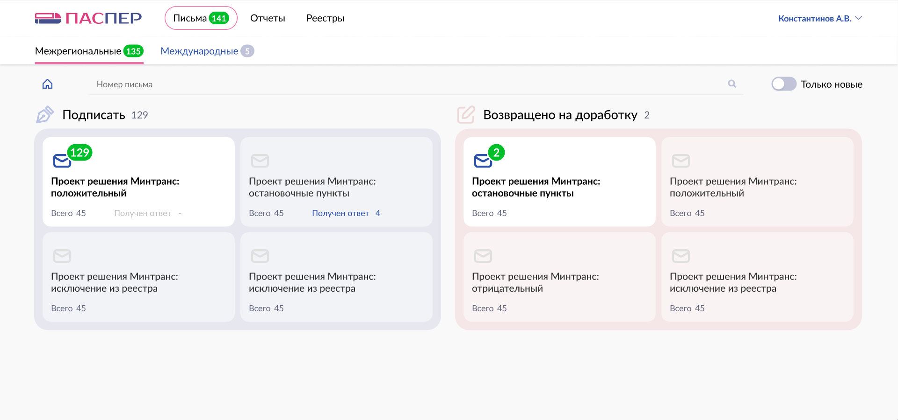

В верхней части главной страницы ЛК расположен список основных разделов, в правом углу отображаются сведения о текущем пользователе (Фамилия И.О.) и название его организации. При нажатии на значок  открывается выпадающее меню  с командами:

-   «Выйти» - для выхода из ЛК.

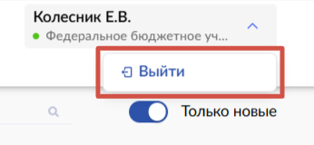

Список основных разделов содержит следующие ссылки: «Письма», «Отчеты», «Реестры».

# Работа с письмами

## Просмотр входящих писем

В Минтранс России в Системе поступают входящие письма следующих типов:

-   «Проект решения Минтранс (положительный)»,
-   «Проект решения Минтранс (отрицательный)»,
-   «Проект решения Минтранс (положительный, международные)»,
-   «Проект решения Минтранс (отрицательный, международные)»,
-   «Проект решения Минтранс на отмену международного маршрута»,
-   «Проект решений на регистрацию ОП»,
-   «Проект решений на изменение данных ОП»,
-   «Проект решений о прекращении функционирования ОП».

Для просмотра писем необходимо перейти в раздел «Письма» (открывается по умолчанию при входе в ЛК) и переместить переключатель «Только новые» вправо в активное состояние.

Письма сгруппированы по типам в папках блоков:

-   «Согласовать», «Возвращено на доработку» - для пользователя с ролью «Согласующий»;
-   «Подписать», «Возвращено на доработку» - для пользователя с ролью «Подписант».

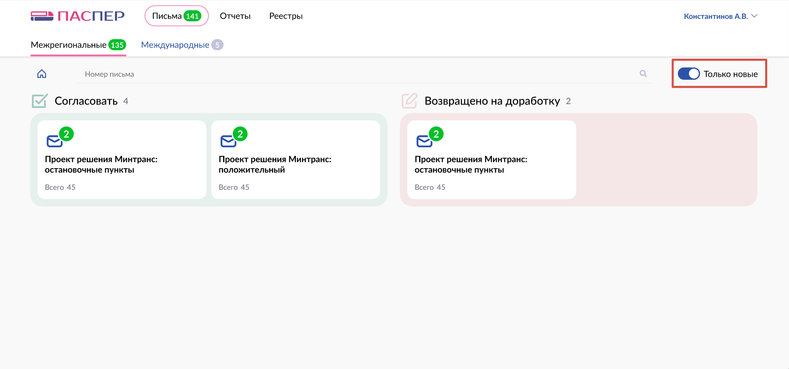

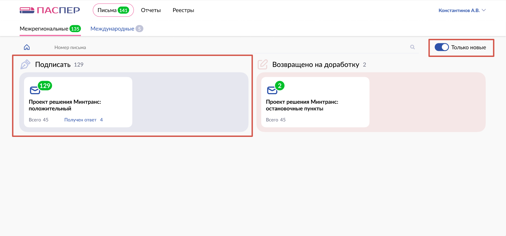

Для открытия карточки письма необходимо выполнить следующие действия:

-   в соответствующем блоке нажать на значок конверта с зеленым кружочком, в котором отображается количество писем указанного типа;
-   откроется список писем выбранного типа;

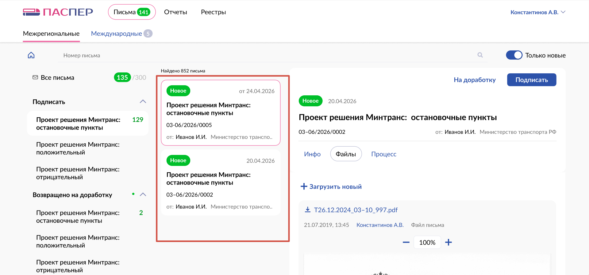

-   выбрать письмо в списке, откроется карточка письма в статусе «Новое»;
-   для просмотра письма перейти на вкладку «Файл», содержимое письма отображается в режиме предпросмотра файла в формате pdf.

Карточка письма содержит вкладки «Инфо», «Файлы», «Процесс».

На вкладке «Инфо» отображаются номер и дата письма.

На вкладке «Файлы» отображается файл исходящего письма в режиме предпросмотра и сведения о нем: тип документа, название файла, дата изменения, кем изменен (ФИО); название файла отображается в виде ссылки, при нажатии на которую выполняется скачивание файла в папку загрузки компьютера. Для загрузки файла с ПК пользователя необходимо нажать кнопку «Загрузить новый». Если файл уже загружен, то при загрузке нового файла происходит замена старого файла на новый.

Вкладка «Процесс» содержит сведения о маршруте письма: кто и когда согласовал/подписал и планируется согласовать/подписать.

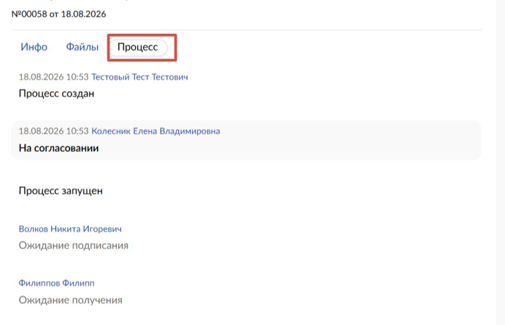

В карточке входящего письма на любой вкладке доступна ссылка «Скачать», при нажатии на которую из Системы в файловую систему компьютера выгружается архивный файл, который содержит файл текста письма в формате pdf и файл ЭП.

## Отправка решения на согласование и подписание

Для отправки проекта решения на согласование и подписание необходимо выполнить следующие действия:

-   открыть карточку письма в статусе «Новое»;
-   нажать кнопку «Создать процесс»;
-   в открывшемся окне «Создать процесс» в поле «Тип» выбрать роль участника процесса из возможных значений «Согласующий», «Подписант», «Получатель», в поле «Сотрудник» выбрать участника процесса, соответствующего выбранной роли;
-   для добавления участника процесса нажать на ссылку «+ Добавить»,

-   в открывшихся полях «Тип» и «Сотрудник» выбрать роль и следующего участника процесса;
-   после того, как все участники процесса выбраны, нажать кнопку «Создать»;

-   в карточке исходящего письма отображается кнопка «Отправить» и на вкладке «Процесс» отображаются участники процесса и ожидаемые действия в соответствии с назначенными ролями;
-   нажать на кнопку «Отправить»;

-   карточка исходящего письма переходит в статус «На согласовании» или «На подписании» в зависимости от созданных этапов процесса.

Если этап согласования или подписания завершился возвратом письма на доработку, то в карточке письма необходимо загрузить с компьютера новый файл письма с внесенными правками и отправить письмо на повторное согласование или подписание в соответствии с назначенными этапами, для этого в Системе необходимо выполнить следующие действия:

-   открыть карточку исходящего письма в статусе «Возвращено на доработку»,

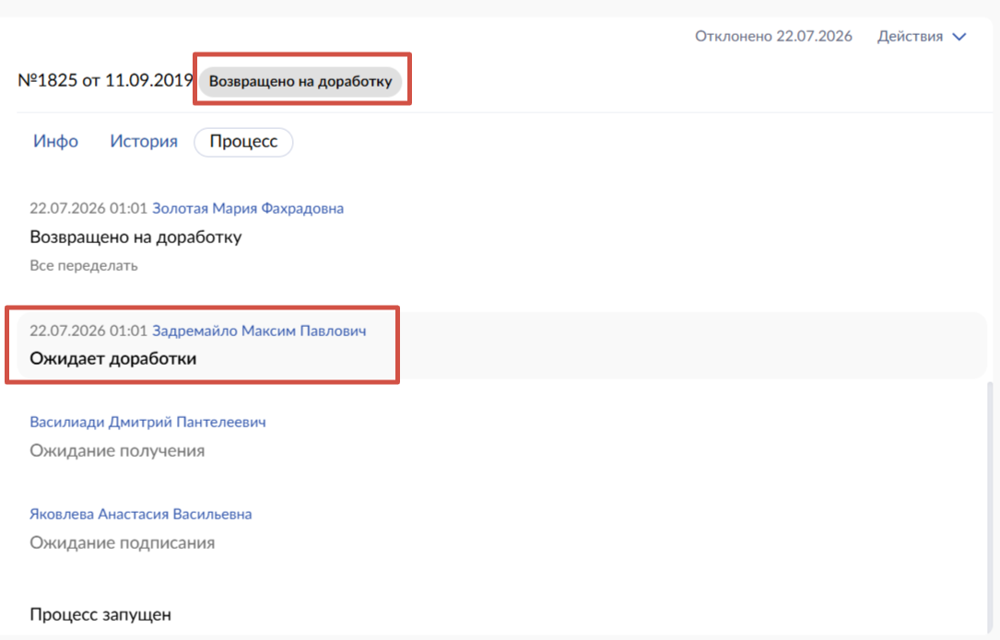

-   нажать на ссылку «Действия», в выпадающем меню выбрать «Загрузить новое», в открывшемся окне нажать на ссылку «Загрузить», выбрать файл и нажать кнопку «Загрузить»;
-   на вкладке «Процесс» отображается этап «Доработка завершена» и ожидаемые действия согласования или подписания в соответствии с назначенными этапами (ролями);
-   нажать на кнопку «Отправить»;
-   карточка исходящего письма переходит в статус «На согласовании» или «На подписании» в соответствии с назначенными этапами (ролями).

После подписания карточка исходящего письма переходит в статус «Отправлено».

## Согласование решения

Согласование проекта решения доступно пользователю с ролью «Согласующий».

Для согласования необходимо выполнить следующие действия:

-   перейти в раздел «Письма» на вкладку «Межрегиональные»/«Международные»;
-   в блоке «Согласовать» нажать на значок конверта с зеленым кружочком, в котором отображается количество поступивших пользователю для согласования писем указанного типа;
-   откроется список писем выбранного типа, поступивших для согласования;
-   выбрать письмо в списке, откроется карточка письма;
-   после рассмотрения письма и в соответствии с принятым решением:

для согласования – в карточке письма нажать кнопку «Согласовать», карточка письма переходит к следующему согласующему или, если согласующих больше нет, то в статус «На подписании» и отображается в ЛК пользователя, указанного как «Подписант»;

для возврата на доработку при наличии замечаний – в карточке письма нажать на ссылку «На доработку», в открывшемся окне указать причину возврата на доработку и нажать кнопку «Отправить»; карточка письма переходит в статус «Возвращено на доработку» и отображается в ЛК пользователя, отправившего письмо на согласование;

-   на вкладке «Процесс» отображается результат этапа согласования и текст причины возврата в случае доработки.

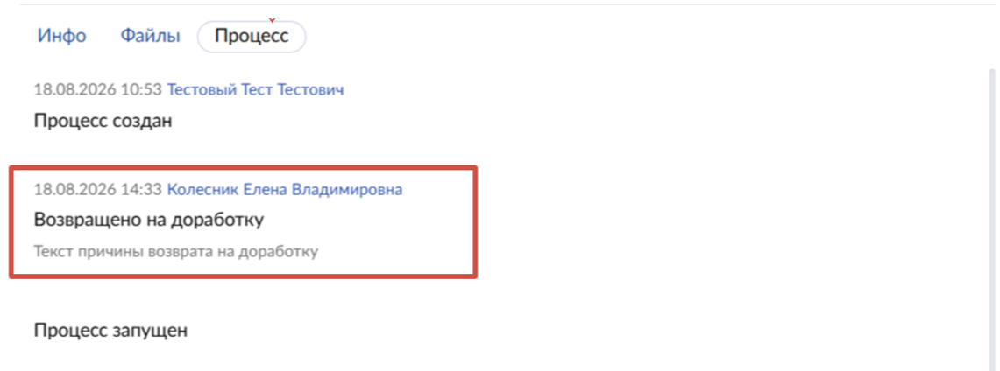

## Подписание решения

Для подписания решения необходимо выполнить следующие действия:

-   перейти в раздел «Письма» на вкладку «Межрегиональные»/«Международные»;
-   в блоке «Подписать» нажать на значок конверта с зеленым кружочком, в котором отображается количество писем указанного типа, поступивших пользователю для подписания;

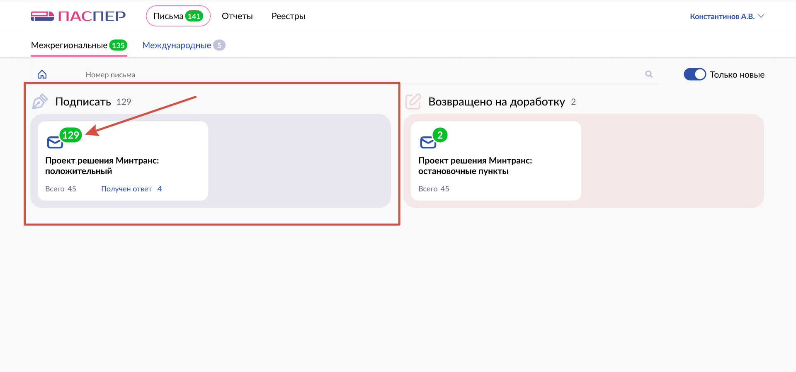

-   откроется список писем выбранного типа, поступивших для подписания;
-   выбрать письмо в списке, откроется карточка письма;
-   после рассмотрения письма и в соответствии с принятым решением:

для подписания – в карточке письма нажать кнопку «Подписать», выбрать сертификат ЭП и подписать; карточка письма отображается в ЛК пользователя, указанного как «Получатель», в статусе «Новое»; карточка письма отображается в ЛК пользователя, указанного как «Подписант» или «Согласующий» в статусе «Отправлено»;

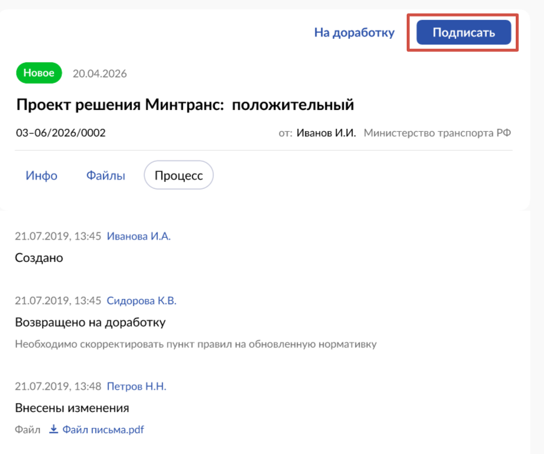

для возврата на доработку при наличии замечаний – в карточке письма нажать на ссылку «На доработку», в открывшемся окне указать причину возврата на доработку и нажать кнопку «Отправить»; карточка письма переходит в статус «Возвращено на доработку» и отображается в ЛК предыдущего участника в процессе согласования;

-   на вкладке «Процесс» отображается результат этапа подписания и текст причины возврата в случае доработки (аналогично этапу согласования).

## Доработка проекта решения

Если этап подписания завершился возвратом письма на доработку, то карточка письма отображается в ЛК предыдущего участника этапа согласования в блоке «Возвращено на доработку».

Для доработки в карточке письма необходимо заменить файл письма на другой файл с внесенными правками, выбрав его в файловой системе компьютера, и отправить письмо на повторное подписание. Для этого в Системе необходимо выполнить следующие действия:

-   перейти в раздел «Письма» на вкладку «Межрегиональные»/«Международные»;
-   в блоке «Возвращено на доработку» нажать на значок конверта с зеленым кружочком, в котором отображается количество возвращенных для доработки писем указанного типа;

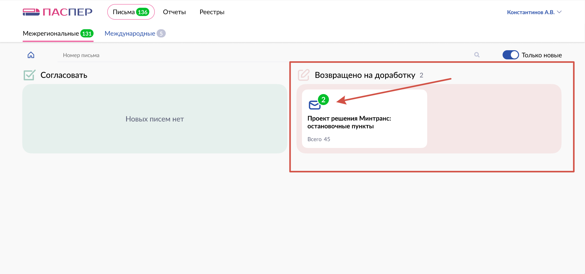

-   откроется список писем выбранного типа, возвращенных для доработки;
-   выбрать письмо в списке, откроется карточка письма;
-   в карточке письма нажать на ссылку «Загрузить новый», в открывшемся окне нажать на ссылку «Загрузить», выбрать файл и нажать кнопку «Загрузить»;
-   на вкладке «Файлы» в режиме предпросмотра откроется выбранный файл и отобразятся сведения о нем: название файла, ком изменен и дата изменения;

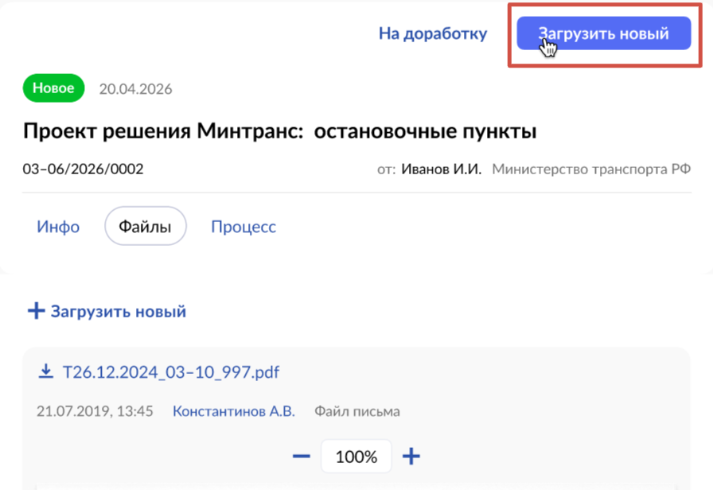

-   на вкладке «Процесс» отображается этап «Доработка завершена»;
-   нажать на кнопку «Согласовать»;
-   карточка исходящего письма переходит в статус «На подписании» в соответствии с назначенными ролями.

# Работа с реестрами

## Область настройки параметров фильтрации

Область настройки параметров фильтрации открывается в разделе «Реестры» в левой части страницы.

Для открытия области настройки параметров фильтрации необходимо нажать кнопку  в левой верхней части страницы.

Набор отображаемых параметров фильтрации зависит от раздела и вкладки, которые открыты на странице.

Для настройки необходимо задать значения нужных параметров и нажать кнопку «Найти». В списке будут отображены обращения, соответствующие заданным параметрам поиска.

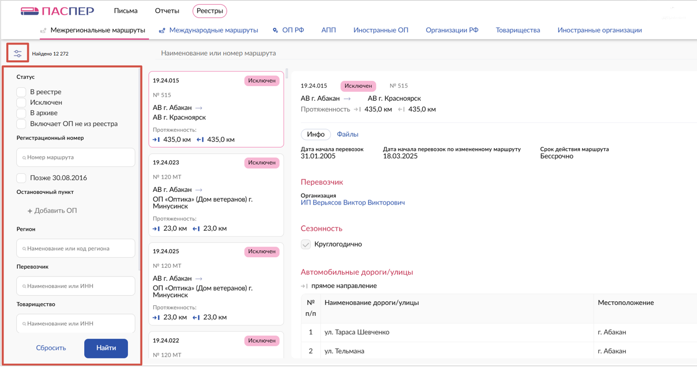

Для сброса всех заданных параметров необходимо нажать кнопку «Сбросить».

Чтобы область настройки параметров фильтрации не отображались на странице, необходимо повторно нажать кнопку .

## Межрегиональные маршруты

Для просмотра реестра межрегиональных маршрутов необходимо перейти в раздел «Реестры», открыть вкладку «Межрегиональные маршруты».

В левой части страницы отображается список маршрутов с указанием их статуса, статусы могут быть следующие:

-   «В реестре» - действующий утвержденный маршрут межрегиональной перевозки, у которого все ОП по маршруту включены в Реестр остановочных пунктов,
-   «Исключен» - сведения о маршруте исключены из реестра в соответствии с утвержденным решением Минтранса России об отмене маршрута;
-   «В архиве» - маршрут передан в архив,
-   «Включает ОП не из реестра» - действующий утвержденный маршрут межрегиональной перевозки, который содержит ОП, не зарегистрированные в реестре ОП;

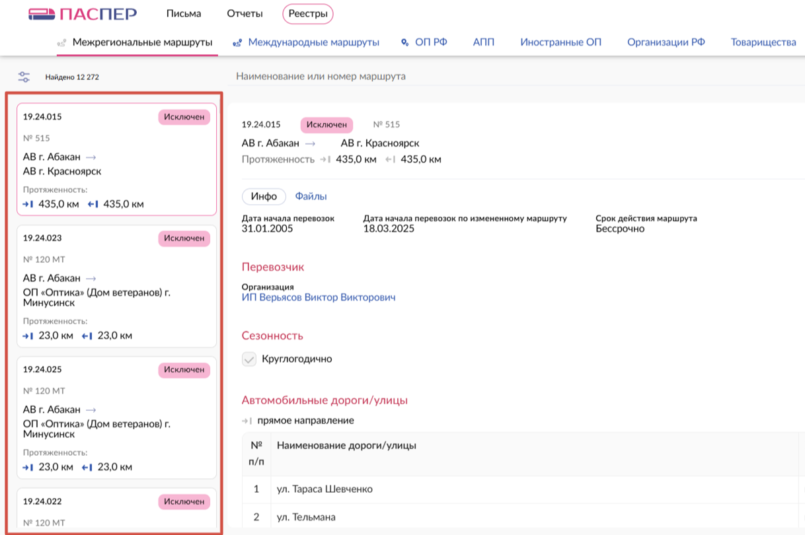

Чтобы посмотреть список маршрутов с конкретными статусами, необходимо с помощью кнопки  открыть настройки фильтрации, отметить одно или несколько значений в списке «Статус» и нажать кнопку «Найти».

В верхней части страницы отображается информация о количестве маршрутов в списке.

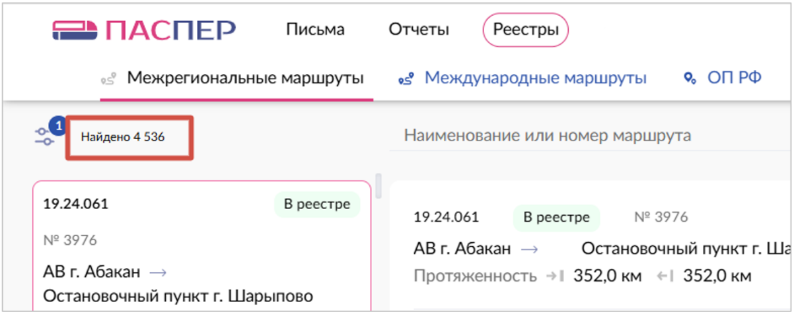

В визитке маршрута  отображается следующая информация о маршруте: код, номер, наименование (наименования населенных пунктов, в границах которых расположены начальный и конечный ОП), протяженность в прямом и обратном направлениях, статус маршрута.

При нажатии в списке на визитку маршрута в основной части страницы отображается карточка маршрута.

## Международные маршруты

Для просмотра реестра международных маршрутов необходимо перейти в раздел «Реестры», открыть вкладку «Международные маршруты».

В левой части страницы отображается список маршрутов с указанием их статусов, статусы могут быть следующие: «В реестре», «Исключен», «В архиве», «Включает ОП не из реестра» (аналогично межрегиональным маршрутам).

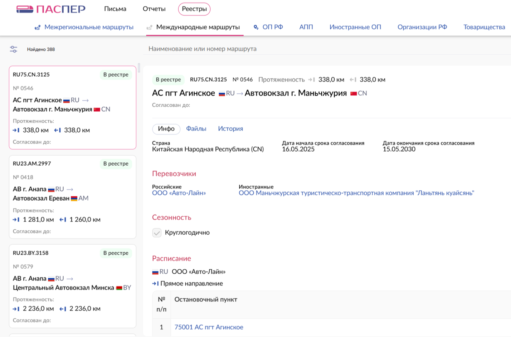

Чтобы посмотреть список маршрутов с конкретными статусами, необходимо с помощью кнопки  открыть настройки фильтрации, отметить одно или несколько значений в списке «Статус» и нажать кнопку «Найти».

В верхней части страницы отображается информация о количестве маршрутов в списке.

В визитке маршрута  отображается следующая информация о маршруте: код, номер, наименование (наименования населенных пунктов и государств, в границах которых расположены начальный и конечный ОП), протяженность в прямом и обратном направлениях, статус маршрута.

При нажатии в списке на визитку маршрута в основной части страницы отображается карточка маршрута.

## Поиск маршрута в реестре

Для поиска маршрута/маршрутов в реестре можно использовать поисковую строку в верхней части страницы, поисковый запрос может содержать номер или часть номера, название или часть названия маршрута.

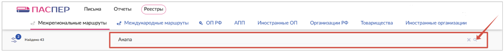

Для поиска маршрута/маршрутов в списке можно использовать настройку параметров фильтрации:

-   «Статус» - выбрать одно или несколько значений статуса маршрута;
-   «Регистрационный номер» - в поле ввести номер или часть регистрационного номера маршрута;
-   «Позже 30.08.2016» (только для межрегиональных маршрутов) – установить или сбросит отметку;
-   «БСО» - выбрать одно или оба значения «Есть БСО» или «Отсутствует»;
-   «Остановочный пункт» - нажать на ссылку «+Добавить» и в открывшемся окне ввести наименование/часть наименования или номер/часть номера остановочного пункта, можно добавить несколько ОП, повторно нажимая на «+Добавить»;
-   «Регион» - ввести в поле наименование/часть наименования или код субъекта РФ;
-   «Страна» (только для международных маршрутов) - ввести в поле наименование/часть наименования или код иностранного государства;
-   «Российский перевозчик» - ввести в поле наименование/часть наименования или ИНН ЮЛ или ИП;
-   «Товарищество» (только для межрегиональных маршрутов) - ввести в поле наименование/часть наименования или ИНН;
-   «Иностранный перевозчик» (только для международных маршрутов) - ввести в поле наименование/часть наименования организации перевозчика;
-   «Протяженность, км» - задать начальное значение и/или конечное значение возможного диапазона;
-   «Макс.количество ТС,шт» - задать начальное значение и/или конечное значение возможного диапазона, только целые числа;
-   «Дата начала срока согласования» (только для международных маршрутов) - задать начальную дату и/или конечную дату возможного периода;
-   «Дата окончания срока согласования» (только для международных маршрутов) - задать начальную дату и/или конечную дату возможного периода.

Общие правила работы с областью настройки параметров фильтрации приведены в разделе выше.

## Работа с карточкой маршрута

Чтобы открыть карточку маршрута, необходимо перейти в раздел «Реестры», открыть вкладку «Межрегиональные маршруты» / «Международные маршруты», в списке маршрутов в левой части страницы найти маршрут и нажать на его визитку. В основной части страницы откроется карточка маршрута.

### Карточка межрегионального маршрута

Карточка межрегионального маршрута содержит вкладки «Инфо», «Файлы», «История».

На вкладке «Инфо» отображаются следующие сведения:

-   дата начала регулярных перевозок по маршруту (не позднее чем через девяносто дней со дня включения маршрута в реестр; не позднее чем через десять дней со дня изменения сведений о маршруте в реестре, за исключением, если изменение маршрута предусматривает увеличение максимального количества ТС и (или) изменение их характеристик, то не позднее чем через девяносто дней со дня изменения сведений о маршруте в реестре);
-   срок действия маршрута - срок окончания осуществления регулярных перевозок по маршруту;
-   сведения о перевозчике, предоставившем заявление - название ЮЛ/ИП отображается в виде ссылки, при нажатии на которую в том же окне выполняется переход в раздел «Организации» и открывается карточка организации перевозчика, предоставившего заявление (для открытия карточки в новом окне необходимо нажать на ссылке правую кнопку мыши, в выпадающем меню выбрать «Открыть ссылку в новой вкладке»);
-   сезонность - указаны начало и окончание летнего и зимнего периодов или признак круглогодичности;
-   наименования остановочных пунктов, их места нахождения, наименования и месторасположения соответствующих автовокзалов, автостанций;
-   расписание - в прямом и обратном направлениях с детализацией по каждому ОП по дням и времени прибытия и отправления, по времени стоянки; название ОП отображается в виде ссылки, при нажатии на которую в том же окне выполняется переход в раздел «Остановочные пункты» и открывается карточка ОП в разделе «Остановочные пункты» (для открытия карточки в новом окне необходимо нажать на ссылке правую кнопку мыши, в выпадающем меню выбрать «Открыть ссылку в новой вкладке»);
-   автомобильные дороги и улицы на территории Российской Федерации, по которым предполагается движение ТС между ОП - отображаются списком с указанием названия и местоположения каждой автомобильной дороги и улицы;
-   транспортные средства, которые могут выполнять маршрут - список классов с указанием для каждого класса: максимального количества ТС, максимальных высоты и ширины ТС, полной массы и экологических характеристик (эко-класса) ТС.

На вкладке «Файлы»  отображается список файлов документов, прилагаемых к маршруту при работе с заявлениями об установлении/изменении/отмене маршрута:

-   согласование в письменной форме от перевозчиков, осуществляющих регулярные перевозки по ранее установленным межрегиональным маршрутам регулярных перевозок.

На вкладке «Файлы»  отображается список файлов документов, прилагаемых к маршруту при работе с заявлениями об установлении/изменении/отмене маршрута:

-   согласование в письменной форме от перевозчиков, осуществляющих регулярные перевозки по ранее установленным межрегиональным маршрутам регулярных перевозок.

Для каждого файла отображается название файла, дата добавления, кем добавлен (ФИО), тип документа, дополнительная информация, указанная при добавлении файла.

Название файла отображается в виде ссылки, при нажатии на которую выполняется скачивание файла в папку загрузки компьютера.

Для добавления файла необходимо выполнить следующую последовательность действий:

-   нажать ссылку «+Файл»,
-   в открывшемся окне «Добавить файл»  в поле «Тип» выбрать из выпадающего списка одно из предлагаемых значений,
-   при необходимости в поле «Описание» ввести дополнительную информацию (будет отображаться на вкладке «Файлы» под названием файла),
-   загрузить файл (нажать ссылку «Загрузить», в открывшемся окне проводника выбрать файл и нажать «Открыть» или перетащить файлы в область загрузки окна).

Для удаления файла необходимо нажать на значок , расположенный справа напротив названия файла.

На вкладке «История» отображаются записи о всех действиях с маршрутом в Системе с указанием даты и времени действия, исполнителя (если действие совершил пользователь), названия действия, дополнительной информации.

### Карточка международного маршрута

Карточка межрегионального маршрута содержит вкладки «Инфо», «Файлы», «История».

На вкладке «Инфо» отображаются следующие сведения:

-   срок начала осуществления регулярных перевозок по маршруту (не может превышать девяносто дней со дня выдачи российскому или иностранному перевозчику карт международного маршрута регулярных перевозок);
-   срок окончания осуществления регулярных перевозок по маршруту (срок осуществления перевозок по маршруту - до пяти лет);
-   сведения о перевозчике, предоставившем заявление - название ЮЛ/ИП отображается в виде ссылки, при нажатии на которую в том же окне выполняется переход в раздел «Организации» и открывается карточка организации перевозчика, предоставившего заявление (для открытия карточки в новом окне необходимо нажать на ссылке правую кнопку мыши, в выпадающем меню выбрать «Открыть ссылку в новой вкладке»);
-   протяженность маршрута - измеряется в километрах;
-   сезонность - указаны начало и окончание летнего и зимнего периодов или признак круглогодичности;
-   наименования остановочных пунктов, их места нахождения, наименования и места расположения соответствующих автовокзалов, автостанций;
-   расписание для каждого ОП и пункта пропуска через Государственную границу Российской Федерации с указанием наименований ОП, дня недели (в случае, если рейс не выполняется ежедневно), наименования российского или иностранного перевозчика, который выполняет рейс, в прямом и обратном направлениях - название ОП отображается в виде ссылки, при нажатии на которую в том же окне открывается карточка ОП в разделе «Остановочные пункты» (для открытия карточки в новом окне необходимо нажать на ссылке правую кнопку мыши, в выпадающем меню выбрать «Открыть ссылку в новой вкладке»);
-   сведения об автомобильных дорогах и улицах на территориях Российской Федерации и иностранных государств, по которым предполагается движение ТС между ОП - отображаются списком с указанием наименования и местоположения каждой автомобильной дороги и улицы;
-   сведения о ТС, которые могут выполнять маршрут - список классов ТС с указанием для каждого класса: максимального количества ТС, максимальных высоты и ширины ТС, полной массы и экологических характеристик (эко-класса) ТС.

На вкладке «Файлы» отображается список файлов документов, прилагаемых к маршруту при работе с заявлениями об установлении/изменении/отмене маршрута:

-   заверенная российским или иностранным перевозчиком копия соглашения о совместной эксплуатации маршрута, срок действия которого превышает или равен сроку эксплуатации маршрута, указанному в заявлении об установлении маршрута (в случае осуществления регулярных перевозок несколькими перевозчиками); 
-   заверенные российским или иностранным перевозчиком копии разрешительных документов компетентных органов иностранных государств, по территориям которых проходит маршрут, подтверждающих согласование ими установления маршрута или согласование ими изменения маршрута;
-   переводы разрешительных документов на русский язык, верность которых должна быть удостоверена в установленном законодательством Российской Федерации порядке (в случае наличия указанных документов);
-   согласования предлагаемого изменения маршрута в произвольной форме или его копия, заверенная всеми участниками соглашения о совместной эксплуатации маршрута;
-   согласования в письменной форме от владельцев ОП в случае изменения времени отправления от соответствующего ОП, или если предусматривается остановка ТС в новом ОП.

Порядок действий на вкладке «Файлы» аналогичен приведенному для карточки межрегионального маршрута.

На вкладке «История» отображаются записи о всех действиях с маршрутом в Системе с указанием даты и времени действия, исполнителя (если действие совершил пользователь), названия действия, дополнительной информации.

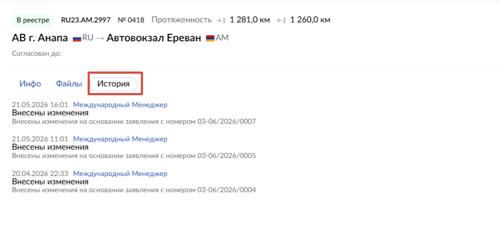

## Реестр ОП РФ

Для просмотра реестра ОП на территории РФ необходимо перейти в раздел «Реестры», открыть вкладку «ОП РФ».

На вкладке «На территории РФ» в левой части страницы отображается список ОП с указанием их статуса, статусы могут быть следующие: «В реестре», «Исключен», «В архиве».

Чтобы посмотреть список ОП с конкретными статусами, необходимо с помощью кнопки  открыть настройки фильтрации, отметить одно или несколько значений в списке «Статус» и нажать кнопку «Найти».

В верхней части страницы отображается информация о количестве ОП в списке.

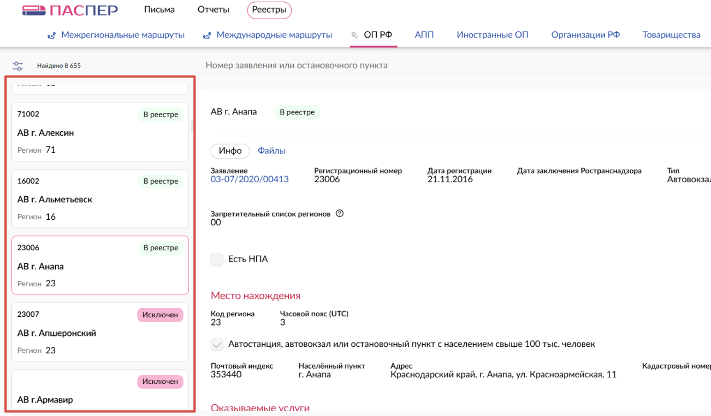

В визитке ОП  отображается следующая информация: номер заявления на ОП, название ОП, код субъекта РФ, в котором расположен ОП, и статус ОП.

При нажатии в списке на визитку в основной части страницы отображается карточка ОП.

## Реестр иностранных ОП

Для просмотра реестра остановочных пунктов для международных ОП необходимо перейти в раздел «Реестры», открыть вкладку «Иностранные ОП».

Список ОП отображается в табличном виде с указанием названия ОП, страны, города и адреса местонахождения.

В верхней части страницы отображается информация о количестве ОП в таблице.

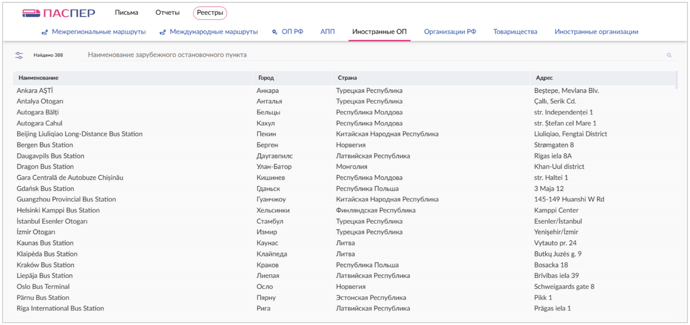

## Поиск ОП в реестре

Для поиска ОП в списке можно использовать поисковую строку в верхней части страницы.

Поисковый запрос на вкладке «ОП РФ»  может содержать номер или часть номера ОП или заявления на ОП.

Поисковый запрос на вкладке «Иностранные ОП»  может содержать часть текста любого столбца таблицы.

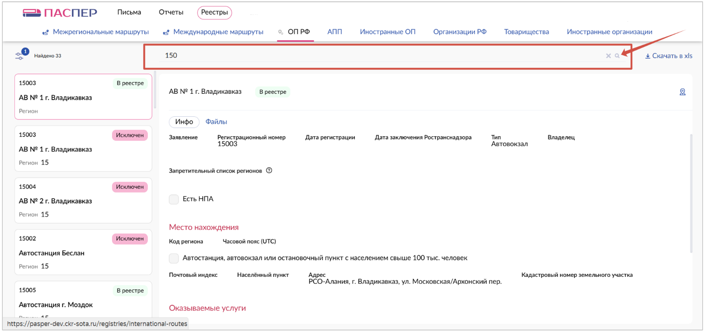

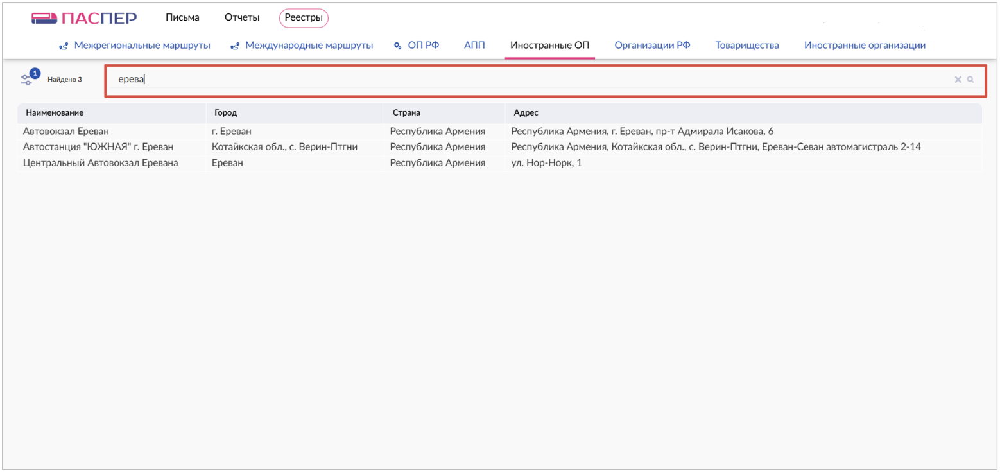

Для поиска ОП на вкладке «ОП РФ» можно использовать настройку следующих параметров фильтрации:

-   «Статус» - выбрать одно или несколько значений статуса ОП;
-   «Регистрационный номер» - в поле ввести номер или часть регистрационного номера ОП;
-   «Регион» - ввести в поле наименование/часть названия или код субъекта РФ, в котором расположен ОП;
-   «Страна» (только для международных маршрутов) - ввести в поле наименование/часть названия или код иностранного государства, в котором расположен ОП;
-   «Населенный пункт» - ввести в поле наименование/часть названия населенного пункта, в котором расположен ОП;
-   «Тип» - отметить одно или несколько значений из возможных: «Автовокзал», «Автостанция», «Остановочный пункт»;
-   «Владелец» - начать вводить в поле название/часть названия организации и выбрать значение из предлагаемого списка;
-   «Подъездные пути» - установить или снять отметку о наличии признака;
-   «Наличие НПА по остановочному пункту» - установить или снять отметку о наличии признака.

Для поиска ОП на вкладке «Иностранные ОП» можно использовать настройку следующих параметров фильтрации:

-   «Страна» - ввести в поле наименование/часть названия или код иностранного государства, в котором расположен ОП.

Общие правила работы с областью настройки параметров фильтрации приведены в разделе выше.

## Работа с карточкой ОП

Чтобы открыть карточку ОП, необходимо перейти в раздел «Реестры», открыть вкладку «ОП РФ», в списке маршрутов в левой части страницы  найти ОП и нажать на его визитку. В основной части страницы откроется карточка ОП.

Карточка ОП РФ отображает следующие сведения:

на вкладке «Инфо»:

-   сведения о заявлении – регистрационный номер, дата регистрации, дата заключения Ространснадзора, тип ОП,
-   сведения о владельце - название ЮЛ отображается в виде ссылки, при нажатии на которую в том же окне отображается карточка организации-перевозчика в разделе «Организации» (для открытия карточки в новом окне необходимо нажать на ссылке правую кнопку мыши, в выпадающем меню выбрать «Открыть ссылку в новой вкладке»);
-   «Запретительный список регионов» - указаны регионы, в которых не может быть начальных или конечных ОП;
-   «Есть НПА» - установлен, если есть нормативный правовой акт, устанавливающий пути подъезда к ОП; прикладывается в виде файла в карточке ОП на вкладке «Файлы»;
-   сведения о местонахождении – код региона (субъекта РФ), часовой пояс, почтовый индекс, населенный пункт, адрес, кадастровый номер земельного участка, и признак, если населённый пункт, в котором расположен ОП, имеет население свыше 100 тыс. человек;
-   сведения об оказываемых услугах – список услуг в табличном виде с указанием наименования и тарифа;
-   сведения о подъездный путях – если признак «Есть НПА» активен, то активен признак «Подъездные пути согласно НПА субъекта РФ»;
-   сведения о количестве ТС, отправляющихся каждый час – в табличном виде с указанием часового интервала и количества ТС;
-   сведения о пропускной способности и времени технологических перерывов - в табличном виде с указанием пропускной способности в отправлениях в час, времени работы в виде интервала с начальным и конечным значениями, дней работы, среднего времени технологических перерывов в минутах;

на вкладке «Файлы»:

-   отображается список вложенных файлов с указанием названия файла, даты добавления, кем добавлен (ФИО), типа документа, дополнительной информации, указанной при добавлении; название файла отображается в виде ссылки, при нажатии на которую выполняется скачивание файла в папку загрузки компьютера;
-   добавление и удаление файлов на вкладке выполняется аналогично вкладке «Файлы» в карточке маршрута.

на вкладке «История»:

-   отображаются записи о всех действиях с маршрутом в системе с указанием даты и времени действия, исполнителя (если действие совершил пользователь), названия действия, дополнительной информации.

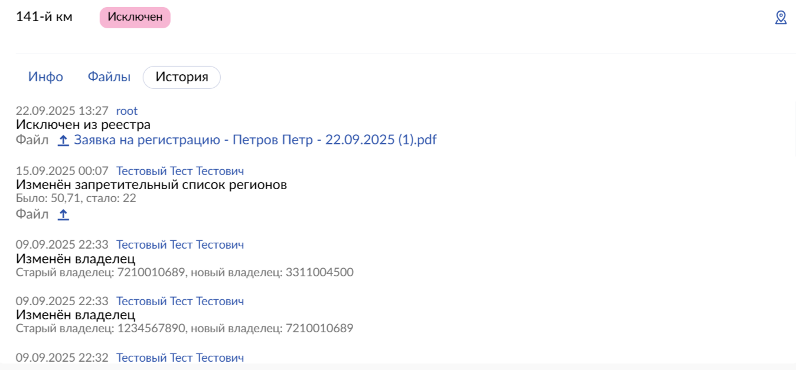

##### Реестр АПП

Для просмотра реестра АПП необходимо перейти в раздел «Реестры», открыть вкладку «АПП».

В левой части страницы отображается список АПП в алфавитном порядке  с указанием их статуса, названия, режима работы.

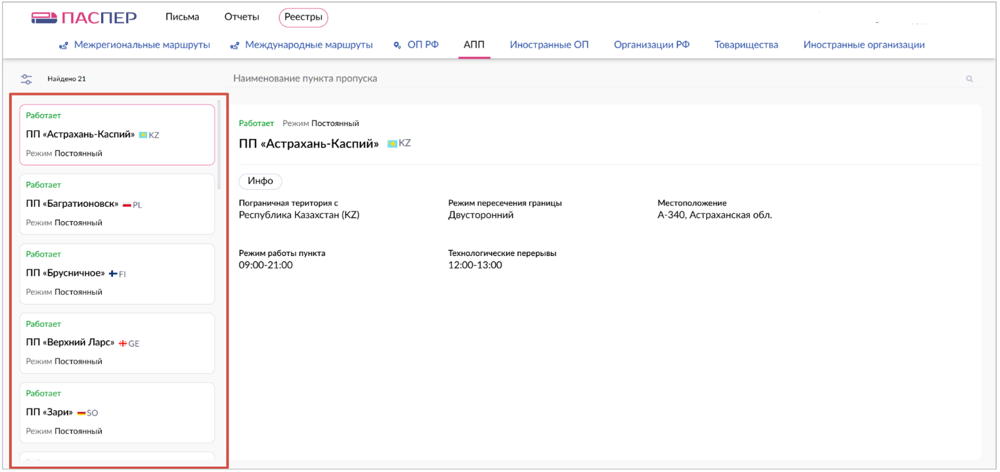

Для поиска АПП в реестре можно использовать поисковую строку в верхней части страницы. Поисковый запрос может содержать название/часть названия АПП.

Для поиска АПП в реестре можно использовать настройку следующих параметров фильтрации:

-   «Режим» - выбрать одно или несколько значений из возможных: «Постоянный», «Временный», «Сезонный»;
-   «Страна» - ввести в поле наименование/часть названия или код иностранного государства, на границе с которым расположен АПП;
-   «Статус» - выбрать одно из значений «Работает» или «Не работает», если значение не выбрано, то отображаются АПП в обоих статусах.

Общие правила работы с областью настройки параметров фильтрации приведены в разделе выше.

В верхней части страницы отображается информация о количестве найденных в реестре АПП.

В визитке АПП  отображаются статус, название и режим работы АПП. При нажатии на визитку АПП, в основной части страницы отображается карточка АПП, с указанием: режима пересечения границы, режима работы АПП, технологических перерывов и местоположения.

## Организации РФ

Для просмотра реестра российских организаций необходимо перейти в раздел «Реестры», открыть вкладку «Организации РФ».

В левой части страницы отображается список организаций: ЮЛ, ИП, государственных учреждений и предприятий, органов местного самоуправления.

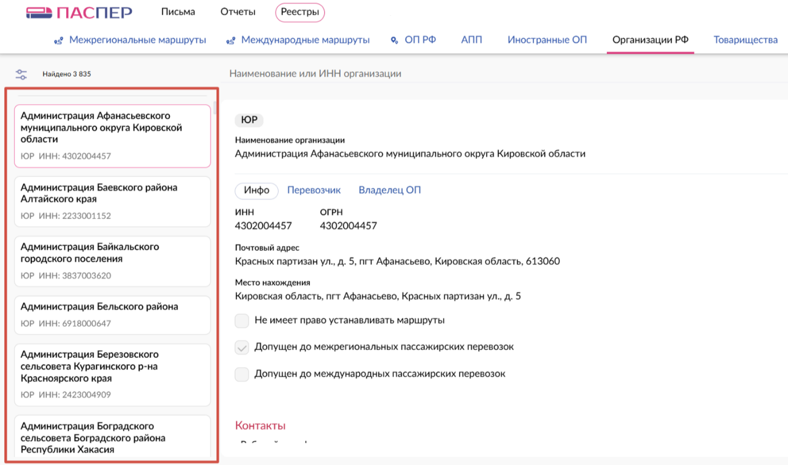

Для поиска организации в списке можно использовать поисковую строку в верхней части страницы. Поисковый запрос может содержать название/часть названия или ИНН/часть ИНН организации.

Для поиска организации в списке можно использовать настройку следующих параметров фильтрации:

-   «Организации, у которых нет личного кабинета в системе» - если флаг установлен, то в списке отображаются организации, не зарегистрированные в Системе, порядок регистрации организации в Системе описан в руководстве пользователя для роли «Заявитель»;
-   «Организации, у которых есть личный кабинет в системе» - если флаг установлен, то в списке отображаются организации, зарегистрированные в Системе;
-   «Не имеет права устанавливать маршруты» - если флаг установлен, то в списке отображаются организации, у которых в карточке установлен признак «Не имеет права устанавливать маршруты», описание карточки организации приведено в разделе выше1.9;
-   «Товарищество» - начать вводить в поле название/часть названия и выбрать значение из предлагаемого списка;
-   «Перевозчик» - в списке отображаются организации, которые являются перевозчиками по указанному в поле маршруту; начать вводить в поле номер/часть номера межрегионального маршрута и выбрать значение из предлагаемого списка;
-   «Владелец ОП» - в списке отображается организация, которая является владельцем указанного в поле ОП; начать вводить в поле номер/часть номера или название/часть названия ОП и выбрать значение из предлагаемого списка;
-   «Допущен до межрегиональных перевозок» - если флаг установлен, то в списке отображаются организации перевозчиков, у которых в карточке установлен признак «Допущен до межрегиональных перевозок», описание карточки организации приведено в разделе выше1.9;
-   «Допущен до международных перевозок» - если флаг установлен, то в списке отображаются организации перевозчиков, у которых в карточке установлен признак «Допущен до международных перевозок», описание карточки организации приведено в разделе выше1.9.

Общие правила работы с областью настройки параметров фильтрации приведены в разделе выше.

В верхней части страницы отображается информация о количестве найденных в списке организаций.

В списке отображается название и ИНН организации, при нажатии на которые в основной части страницы отображается карточка организации.

Карточка организации содержит вкладки «Инфо», «Перевозчик», «Владелец ОП».

Вкладка «Инфо» содержит следующие параметры:

-   «ИНН», «ОГРН», «Почтовый адрес», «Место нахождения», «Контакты», «Пользователи» - наименование, место нахождения юридического лица, государственный регистрационный номер записи о создании юридического лица, или фамилия, имя и, если имеется, отчество, место жительства индивидуального предпринимателя, государственный регистрационный номер записи о государственной регистрации индивидуального предпринимателя (для российского или иностранного перевозчика), идентификационный номер налогоплательщика (для российского перевозчика), почтовый адрес, контактные телефоны, адрес электронной почты; все значения параметров заполняются представителями перевозчика при регистрации в Системе и не доступны для редактирования пользователям с ролью «Менеджер по межрегиональным перевозкам»;
-   «Не имеет права устанавливать маршруты» - устанавливается на основании решения Ространснадзора по отчуждению права у перевозчика (например, в связи с систематическими нарушениями); если признак установлен, то для организации на указанный период недоступен функционал отправки на рассмотрение заявлений об установлении/изменении маршрута (функционал создания заявления о прекращении действия свидетельства остается доступным);
-   «Допущен до межрегиональных перевозок» - признак активен, если в карточке организации на вкладке «Перевозчик» присутствуют данные о номере и дате выдачи лицензии на осуществление деятельности по перевозкам пассажиров и иных лиц автобусами; указанные данные заполняются представителями организации при регистрации организации в Системе и не доступны для редактирования пользователям с ролью «Менеджер по межрегиональным перевозкам»;
-   «Допущен до межрегиональных перевозок» - признак активен, если в карточке организации на вкладке «Перевозчик» присутствуют данные о номере и дате выдачи лицензии на осуществление деятельности по перевозкам пассажиров и иных лиц автобусами (для российских перевозчиков) и номер записи в реестре российских перевозчиков, допущенных к осуществлению международных автомобильных перевозок; указанные данные заполняются представителями организации при регистрации в Системе самой организации или заявления на международный маршрут и не доступны для редактирования пользователям с ролью «Менеджер по межрегиональным перевозкам».

На вкладке «Перевозчик» отображаются параметры только в случае, если организация является перевозчиком. Вкладка содержит сведения:

-   для организаций, осуществляющих международные перевозки - номер и дата выдачи действующей лицензии на осуществление деятельности по перевозкам пассажиров и иных лиц автобусами (для российских перевозчиков) и номер записи в реестре российских перевозчиков, допущенных к осуществлению международных автомобильных перевозок;
-   для организаций, осуществляющих межрегиональные перевозки - номер и дата выдачи действующей лицензии на осуществление деятельности по перевозкам пассажиров и иных лиц автобусами.

Если организация является владельцем ОП, то на вкладке «Владелец ОП» отображается список всех ОП. Название каждого ОП является ссылкой, при нажатии на которую на странице открывается карточка ОП.

## Товарищества

На вкладке «Товарищества» в левой части страницы отображается список товариществ, состоящих из нескольких ЮЛ и ИП.

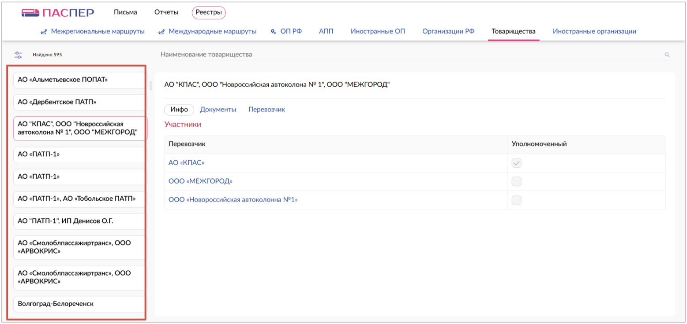

Для поиска товарищества в списке можно использовать поисковую строку в верхней части страницы. Поисковый запрос может содержать название/часть названия или ИНН/часть ИНН организации, входящей в товарищество.

Для поиска товарищества в списке можно использовать настройку следующих параметров фильтрации:

-   «К товариществу прикреплены маршруты» - если флаг установлен, то в списке отображаются товарищества с прикрепленными к ним маршрутами;
-   «Не указан уполномоченный участник от имени товарищества» - если флаг установлен, то в списке отображаются товарищества, у которых в карточке не отмечен уполномоченный сотрудник;
-   «Указан уполномоченный участник от имени товарищества» - если флаг установлен, то в списке отображаются товарищества, у которых в карточке отмечен уполномоченный сотрудник;
-   «Организация» - начать вводить в поле название/часть названия или ИНН/часть ИНН организации, входящей в товарищество, и выбрать значение из предлагаемого списка;
-   «Маршрут» - в списке отображаются товарищества, к которым прикреплен указанный в поле маршрут; начать вводить в поле номер/часть номера межрегионального маршрута и выбрать значение из предлагаемого списка.

Общие правила работы с областью настройки параметров фильтрации приведены в разделе выше.

В верхней части страницы отображается информация о количестве найденных в списке товариществ.

Карточка товарищества содержит вкладки «Инфо», «Документы», «Перевозчик».

Вкладка «Инфо» содержит список ЮЛ и ИП, являющихся участниками договора простого товарищества.

Список отображается в табличном виде, в столбце «Перевозчик» отображается название ЮЛ/ИП в виде ссылки, при нажатии на которую в том же окне отображается карточка организации перевозчика, предоставившего заявление, в разделе «Организации» (для открытия карточки в новом окне необходимо нажать на ссылке правую кнопку мыши, в выпадающем меню выбрать «Открыть ссылку в новой вкладке»).

В столбце «Уполномоченный» для ЮЛ/ИП установлен признак, если он является уполномоченным участником договора простого товарищества.

На вкладке «Документы» отображается список файлов документов, прилагаемых при работе с заявлениями об установлении/изменении/отмене маршрута:

-   копия договора простого товарищества.

Порядок действий на вкладке «Документы» аналогичен приведенному для вкладки «Файлы» в карточке межрегиональных маршрутов.

## Иностранные организации

Для просмотра реестра иностранных организаций необходимо перейти в раздел «Реестры», открыть вкладку «Иностранные организации».

В левой части страницы отображается список организаций.

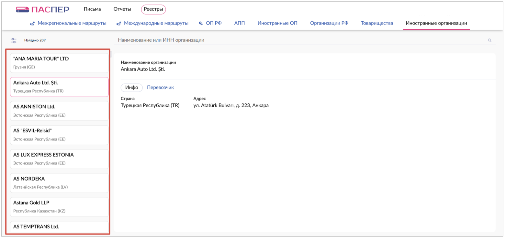

Для поиска организации в списке можно использовать поисковую строку в верхней части страницы. Поисковый запрос может содержать название/часть названия организации.

Для поиска организации в списке можно использовать настройку следующих параметров фильтрации:

-   «Страна» - ввести в поле наименование/часть названия или код иностранного государства, в котором расположен ОП.

Общие правила работы с областью настройки параметров фильтрации приведены в разделе выше.

В верхней части страницы отображается информация о количестве найденных в списке организаций.

В списке отображается название и страна организации, при нажатии на которые в основной части страницы отображается карточка организации.

Карточка организации содержит вкладки «Инфо», «Перевозчик». Вкладка «Инфо» содержит сведения о стране и адрес организации.

# Сообщения пользователю

Сообщения пользователю в интерфейсе Системы описаны в подразделах раздела руководства.

На адрес электронной почты, указанный при регистрации пользователя, поступают уведомления об авторизации пользователя в Системе.
